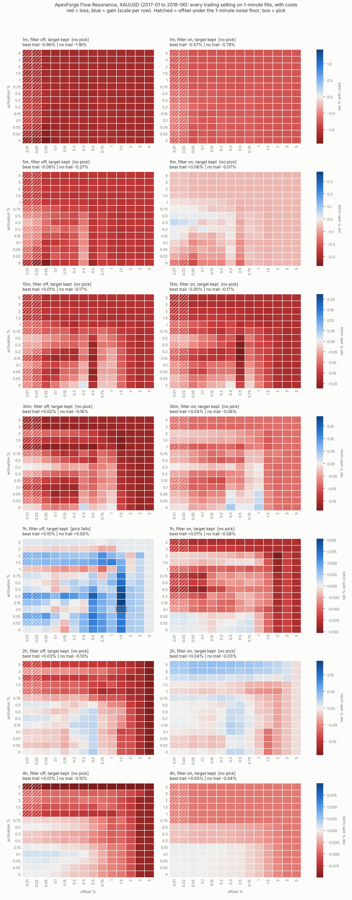
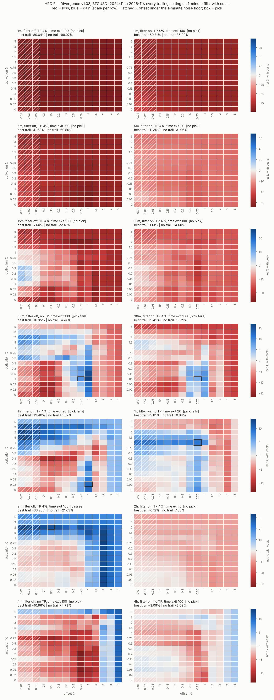
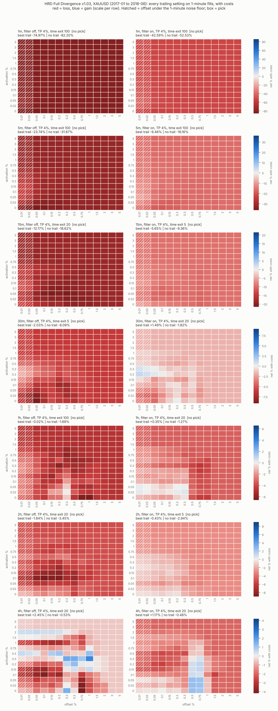

# ApexForge Flow Resonance and HRD Full Divergence v1.03: results by timeframe, filter off vs on, and every trailing setting

Files tested:
- [`ApexForge_Flow_Resonance_Strategy_FGF.pine`](../ApexForge_Flow_Resonance_Strategy_FGF.pine)
- [`HRD_Full_Divergence_Strategy_v1_03_FGF.pine`](../HRD_Full_Divergence_Strategy_v1_03_FGF.pine)

With "Enable filter" off, each one trades exactly like your original file. Every other input is at the file's defaults.

## How it was tested

- **Replicas.** A Python replica of each fused file, built independently twice. The two builds agree on 100% of trades. A third auditor checked each one line by line against the Pine and found no defects. For ApexForge, the auditor also wrote its own independent replica, which matches on every trade on all 14 pair / timeframe cells.
- **Filter.** The direction filter's permissions come from the same verified replica used for the XPW tests.
- **Fills.** As in TradingView's Strategy Tester without Bar Magnifier: orders fill at the next candle's open, and the stop / target are checked along the candle's high / low.
- **Data.**
  - BTCUSD: Bitstamp, 2024-11-17 to 2026-11-17, real volume.
  - XAUUSD: Dukascopy, 2017-01-02 to 2018-06-19, tick volume, as TradingView shows for CFD gold.
- **Money.** $1,000,000 start, the Pine default; results are in % so the capital doesn't matter.
  - ApexForge puts 1% of equity in each trade, so its percentages are small: -0.27% means it lost 27% of one position's size over the whole window.
  - HRD risks 1% over a 2% stop, which is about 50% of equity per trade.
- **"As TradingView shows"** uses each script's own Properties: ApexForge pays 0.04% commission per side, HRD pays nothing. **"With our costs"** replaces that with the costs used in every other test here:
  - gold $0.30 per ounce per round trip;
  - BTC 0.02% per side + $0.20 per round trip.

  For ApexForge our costs are lower than its own 0.04%, so it loses less with them.
- **Halves** is the change in equity in each half of the window. **Labels reversed** swaps every buy and sell, with the filter off: HRD's own "Reverse Trading" input, and a swap done in the replica for ApexForge. A strategy whose signals have a real direction should do clearly worse reversed.

## ApexForge Flow Resonance

### BTCUSD

| TF | Trades off / on | **Net % as TradingView shows, off / on** | Net % with our costs, off / on | PF off / on | Max DD % off / on | Halves on (1st / 2nd) | Labels reversed, filter off |
|---|---|---|---|---|---|---|---|
| 1m | 34,602 / 17,221 | **-23.999% / -12.971%** | -12.787% / -6.802% | 0.44 / 0.45 | 24.011 / 12.977 | -6.279% / -6.692% | -24.304% |
| 5m | 4,955 / 3,076 | **-3.709% / -2.960%** | -1.793% / -1.766% | 0.72 / 0.66 | 3.808 / 3.054 | -1.462% / -1.498% | -3.679% |
| 15m | 1,180 / 861 | **-0.470% / -0.565%** | -0.002% / -0.223% | 0.92 / 0.87 | 0.820 / 0.912 | -0.365% / -0.199% | -0.986% |
| 30m | 359 / 274 | **+0.585% / +0.050%** | +0.729% / +0.160% | 1.23 / 1.02 | 0.309 / 0.331 | -0.057% / +0.108% | -1.006% |
| 1h | 131 / 76 | **-0.217% / -0.272%** | -0.165% / -0.241% | 0.86 / 0.72 | 0.530 / 0.329 | -0.207% / -0.065% | -0.415% |
| 2h | 52 / 26 | **-0.330% / -0.300%** | -0.309% / -0.290% | 0.59 / 0.35 | 0.416 / 0.324 | -0.204% / -0.096% | +0.651% |
| 4h | 31 / 10 | **+0.004% / -0.118%** | +0.016% / -0.114% | 1.01 / 0.48 | 0.354 / 0.223 | -0.034% / -0.084% | -0.305% |

### XAUUSD

| TF | Trades off / on | **Net % as TradingView shows, off / on** | Net % with our costs, off / on | PF off / on | Max DD % off / on | Halves on (1st / 2nd) | Labels reversed, filter off |
|---|---|---|---|---|---|---|---|
| 1m | 3,651 / 2,164 | **-3.198% / -1.994%** | -1.179% / -0.787% | 0.28 / 0.29 | 3.204 / 2.005 | -0.926% / -1.068% | -2.561% |
| 5m | 875 / 606 | **-0.758% / -0.410%** | -0.267% / -0.068% | 0.54 / 0.62 | 0.773 / 0.431 | -0.174% / -0.236% | -0.653% |
| 15m | 290 / 229 | **-0.332% / -0.303%** | -0.168% / -0.174% | 0.65 / 0.60 | 0.341 / 0.320 | -0.197% / -0.105% | -0.128% |
| 30m | 194 / 138 | **-0.273% / -0.162%** | -0.163% / -0.084% | 0.63 / 0.69 | 0.298 / 0.184 | -0.039% / -0.123% | -0.060% |
| 1h | 74 / 40 | **-0.039% / -0.103%** | +0.003% / -0.081% | 0.90 / 0.56 | 0.122 / 0.159 | -0.037% / -0.066% | -0.126% |
| 2h | 37 / 17 | **-0.153% / -0.035%** | -0.132% / -0.025% | 0.44 / 0.66 | 0.188 / 0.110 | +0.028% / -0.063% | -0.031% |
| 4h | 10 / 2 | **-0.106% / -0.041%** | -0.100% / -0.040% | 0.09 / 0.00 | 0.111 / 0.044 | -0.041% / +0.000% | -0.087% |

**What it shows**

- **Commission decides the result.** Before commission the P/L is close to zero everywhere: -0.5% to +0.9% of capital. The 0.04% per side then turns almost every cell into a loss that grows with the trade count. On BTC 1m with the filter off it makes +0.2% before commission and pays 24.2% in commission: -24.0% net.
- **3 of the 28 TradingView figures are positive:** BTC 30m off +0.585%, BTC 30m on +0.050%, BTC 4h off +0.004%. Only BTC 30m with the filter off is positive in both halves. Gold loses on every timeframe, filter off and on.
- **The filter mostly loses less by trading less.** It halves the trades on 1m (BTC -24.0% to -13.0%). Its P/L before commission beats filter off on only 6 of 14 cells, and on the best cell, BTC 30m, it lowers the result from +0.585% to +0.050%.
- **With the filter on, most low-timeframe trades end with the "blocked opposite signal still closes the trade" close.** On BTC 1m that is 15,488 of 17,221 trades. Turning that option off loses less on 7 of 14 cells (BTC 1m: -3.9% instead of -13.0%).
- **No consistent direction edge.** Reversed labels do better than the real ones on 6 of 7 gold timeframes. On BTC the real labels do better on 5 of 7, most clearly on 30m (+0.585% against -1.006%).

## HRD Full Divergence v1.03

### BTCUSD

| TF | Trades off / on | **Net % as TradingView shows, off / on** | Net % with our costs, off / on | PF off / on | Max DD % off / on | Halves on (1st / 2nd) | Labels reversed, filter off |
|---|---|---|---|---|---|---|---|
| 1m | 25,630 / 10,186 | **-11.59% / -11.56%** | -99.49% / -88.61% | 0.98 / 0.95 | 21.18 / 15.41 | -7.59% / -3.97% | +5.16% |
| 5m | 5,648 / 2,282 | **-5.86% / -5.03%** | -69.78% / -39.99% | 0.98 / 0.96 | 17.84 / 12.77 | -6.91% / +1.89% | +0.58% |
| 15m | 2,105 / 909 | **+13.58% / -2.61%** | -25.63% / -18.89% | 1.07 / 0.97 | 9.89 / 6.98 | -0.87% / -1.74% | -9.38% |
| 30m | 1,185 / 576 | **-5.85% / -6.78%** | -25.82% / -16.98% | 0.96 / 0.91 | 11.69 / 12.58 | -6.56% / -0.23% | +0.65% |
| 1h | 621 / 248 | **+2.72% / +4.66%** | -9.34% / -0.44% | 1.02 / 1.11 | 10.73 / 6.37 | +7.36% / -2.70% | -4.97% |
| 2h | 333 / 97 | **+13.34% / -6.70%** | +6.00% / -8.50% | 1.15 / 0.75 | 8.68 / 13.56 | -2.22% / -4.47% | -20.09% |
| 4h | 190 / 48 | **-8.66% / -6.07%** | -12.08% / -6.97% | 0.87 / 0.63 | 20.65 / 9.16 | -5.70% / -0.37% | +9.67% |

### XAUUSD

| TF | Trades off / on | **Net % as TradingView shows, off / on** | Net % with our costs, off / on | PF off / on | Max DD % off / on | Halves on (1st / 2nd) | Labels reversed, filter off |
|---|---|---|---|---|---|---|---|
| 1m | 17,905 / 7,237 | **-0.99% / -3.59%** | -87.90% / -58.78% | 0.99 / 0.93 | 3.07 / 4.55 | -1.33% / -2.26% | -1.12% |
| 5m | 4,091 / 1,731 | **-2.32% / -2.42%** | -39.57% / -20.37% | 0.96 / 0.91 | 5.88 / 4.71 | +1.00% / -3.42% | +2.67% |
| 15m | 1,484 / 646 | **-6.44% / -2.22%** | -21.40% / -9.36% | 0.84 / 0.89 | 7.62 / 4.15 | -0.41% / -1.81% | +6.31% |
| 30m | 770 / 357 | **+2.81% / +0.65%** | -6.09% / -3.49% | 1.10 / 1.04 | 2.59 / 2.58 | +1.63% / -0.98% | -1.84% |
| 1h | 394 / 165 | **+2.97% / +0.67%** | -1.69% / -1.27% | 1.14 / 1.07 | 2.31 / 1.53 | +0.34% / +0.33% | -2.81% |
| 2h | 249 / 74 | **-4.86% / -2.09%** | -7.60% / -2.94% | 0.78 / 0.72 | 5.69 / 2.96 | +0.46% / -2.55% | +4.25% |
| 4h | 141 / 38 | **-3.15% / -0.04%** | -4.75% / -0.48% | 0.84 / 0.99 | 7.38 / 3.27 | +1.08% / -1.12% | +5.45% |

**What it shows**

- **Our costs sink it.** Each trade carries about 50% of equity and lasts about 6 candles, so everything under 30m loses heavily once costs are counted: BTC 1m -99% off / -89% on, gold 1m -88% / -59%. TradingView shows no costs for this script. The only cell positive with our costs is BTC 2h with the filter off (+6.0%).
- **The filter adds no consistent edge.** Under TradingView's costs it beats filter off on 6 of 14 cells, ties on 2 and loses on 6.
  - It wipes out the two best BTC cells: 15m +13.6% to -2.6%, and 2h +13.3% to -6.7%.
  - It shrinks the two positive gold cells: 30m +2.8% to +0.7%, and 1h +3.0% to +0.7%.
  - What it reliably does is cut trades to 25-49%, time in the market to 4-12% of candles, and the drawdown on 11 of 14 cells.
- **The signals' direction is not stable.** With the filter off, reversed labels do better than the real ones on 8 of 14 cells. The best filter-off cells (BTC 15m and 2h) earn almost all of it in the second half.
- **Best with the filter on:** BTC 1h, +4.7% as TradingView shows it, PF 1.11, drawdown 6.4%. But it earns +7.4% in the first half, gives back 2.7% in the second, and is -0.4% with our costs.
- **Exits.** 54-92% of trades end with the 5-candle time exit. With the filter on, gold never reaches the 2% stop or the 4% target.

## Limits of this test

- **Pivot ties.** Both scripts find pivots with `ta.pivothigh` / `ta.pivotlow`. How TradingView treats two equal highs or lows can't be checked here, so the replica requires a strictly higher or lower pivot. On BTC 1m the other reading gives HRD about 17% more trades and moves it by 5-7 points. From 1h up it changes HRD by at most about 2 points and ApexForge by a fraction of a point.
- **HRD reversal sizing.** HRD reverses with an entry while the time exit closes on the same candle. Whether TradingView sizes that entry when it is placed or when it fills can't be checked here.
  - With the filter on, the other reading moves results by at most 0.9 points.
  - With the filter off it moves them by up to about 4 points (for example BTC 15m +13.6% to +15.1%, BTC 1h +2.7% to -0.2%). So the filter-off column and the off-vs-on comparison are the less certain ones.
- **Live vs backtest.** HRD runs on every tick live, so live divergence and breakout entries can differ from this backtest (see the file's header). ApexForge's 15m levels differ live on charts below 15m.
- **A trade open at the end.** It is closed at the last candle here; TradingView leaves it as open P/L. That moves each figure by at most about 0.14 points.
- **Data.** The gold data is from 2017-2018; percentages carry over to today's prices, dollar distances do not. Two years of BTC is a short window.

## Every trailing setting on every timeframe

Neither strategy had a trailing stop. Both fused files now have an optional **trailing take profit**, group "Trailing take profit", off by default so nothing changes unless you turn it on.

- **Settings:** activation and offset in % of the signal candle's close.
- **ApexForge** can also drop its Reward:Risk target, but only while the trail is on.
- **HRD:** set Take Profit (%) to 0 to remove its target.

**What was swept.** For each pair, timeframe (1m to 4h) and filter setting:

- **Trail:** activation 0, 0.02, 0.05, 0.1, 0.15, 0.2, 0.3, 0.5, 0.75, 1, 1.5, 2, 3 and 5%; offset 0.01, 0.02, 0.05, 0.1, 0.15, 0.2, 0.3, 0.5, 0.75, 1, 1.5, 2, 3 and 5%; plus no trail.
- **ApexForge:** also target kept or dropped (394 settings).
- **HRD:** also TP 4% (its default) or none, and a time exit after 5 (its default), 20 or 100 candles (1,182 settings). Its 5-candle time exit ends most trades before a trail could act, so longer time exits were included.

Each setting was run with TradingView's standard fills and with 1-minute fills inside each candle (Bar Magnifier), with each script's own costs and with our costs, and with real and reversed labels. That is 640,000 backtests in total.

Unless stated otherwise, everything below uses **1-minute fills with our costs**. The extended replicas were checked against two independent references, trade by trade, on about 360,000 trades. The grid, for both fill models, is in [`trailing_sweep_all.csv.gz`](trailing_sweep_all.csv.gz).

### What it shows

1. **No trailing setting is worth adopting on either strategy, on any timeframe.** The selection rule (the same as for XPW; see below) passes one setting out of 56 pair / timeframe / filter cells. A review refuted it.
2. **The best trailing setting often beats the strategy's own exits, but it is the best of hundreds of tries.** It is positive on:
   - ApexForge BTC 15m to 4h: +0.04% to +0.85% at its 1% size;
   - HRD BTC 30m to 4h: up to +36% on 2h with the filter off;
   - HRD gold 4h, and 30m / 1h with the filter on, by small amounts.

   From 1m to 5m on ApexForge, and 1m to 15m on HRD, almost every setting loses. None of these best settings passes the rule: the best of a grid this size finds something positive by chance.
3. **TradingView's standard backtest is misleading here too.**
   - **HRD BTC 1m:** TradingView's own top trailing setting shows **+1,347%** (filter off), and on 1-minute fills with costs it loses 90%. Every HRD BTC timeframe shows the same gap.
   - **ApexForge:** it is small because each trade is only 1% of equity.

   Use Bar Magnifier, and trails well above the 1-minute candle size.
4. **The one pick, HRD BTC 2h with the filter off, was refuted.** Activation 2%, offset 0.15%, TP 4%, time exit 100: +30.0% over 2 years with our costs, PF 1.27, drawdown 6.5%, reversed labels -28.6%, stressed costs +23.7%. It reproduces exactly, but:
   - **It is really a take profit near 2%.** A plain 1.85-1.9% target makes +26% to +28%. Activation 2.25% halves the result.
   - **It looks selected, not real.** If every signal's direction is randomised, the rule still finds a pass in at least one of 16 cells about 70% of the time. The 20 best trades are 93% of the gain. It is led by shorts in a window where BTC fell 28%, and it makes +2% in ranging markets.
   - **Live it would trade differently.** HRD recalculates on every tick, and an emulation of that on 1-minute data gives +9.6% with a losing first half, or -2.3% with stressed costs. A ~$20 difference in prices (another exchange) already drops it to about +25%.

### By timeframe

"Trailing settings that make money" is the share of trailing settings with a positive result. For HRD, "No trailing" is the best of its own exits over the TP / time-exit choices; "Your default" is TP 4% and a 5-candle time exit. ApexForge figures are small because each trade is 1% of equity.

#### ApexForge, BTCUSD

| TF | Filter | Trailing settings that make money | Best trailing setting | No trailing (best of the strategy's own exits) | Your default | TradingView's top trailing setting: TradingView shows / 1-minute fills with costs | Rule verdict |
|---|---|---|---|---|---|---|---|
| 1m | off | 0% | 0% / 0.2%: -12.27% | own exits: -12.79% | -12.79% | -23.29% / -11.33% | no pick |
| 1m | on | 0% | 0% / 0.3%: -6.28% | own exits: -6.80% | -6.80% | -12.26% / -5.76% | no pick |
| 5m | off | 0% | 0% / 0.5%: -1.47% | own exits: -1.79% | -1.79% | -1.71% / -1.37% | no pick |
| 5m | on | 0% | 0% / 0.5%: -1.06% | own exits: -1.77% | -1.77% | -0.86% / -0.83% | no pick |
| 15m | off | 6% | 0.3% / 0.1%: +0.14% | own exits: -0.00% | -0.00% | +1.00% / +0.47% | no pick |
| 15m | on | 12% | 0.1% / 1%: +0.16% | own exits: -0.22% | -0.22% | +0.78% / +0.23% | no pick |
| 30m | off | 93% | 3% / 2%: +0.85% | own exits: +0.73% | +0.73% | +0.88% / +0.70% | pick fails: reverse hold-out failed |
| 30m | on | 83% | 3% / 2%, no target: +0.33% | own exits: +0.16% | +0.16% | +0.62% / +0.06% | pick fails: stressed costs -0.04%; forward hold-out failed; reverse hold-out failed |
| 1h | off | 24% | 5% / 5%, no target: +0.24% | own exits: -0.16% | -0.16% | +0.57% / +0.06% | no pick |
| 1h | on | 21% | 0% / 1.5%, no target: +0.12% | own exits: -0.24% | -0.24% | +0.27% / +0.03% | no pick |
| 2h | off | 36% | 2% / 0.1%: +0.27% | own exits: -0.31% | -0.31% | +0.39% / +0.28% | no pick |
| 2h | on | 10% | 0.75% / 0.5%: +0.04% | own exits: -0.29% | -0.29% | +0.09% / -0.01% | no pick |
| 4h | off | 81% | 0% / 5%, no target: +0.26% | own exits: +0.02% | +0.02% | +0.33% / +0.07% | no pick |
| 4h | on | 48% | 0.75% / 0.3%: +0.06% | own exits: -0.11% | -0.11% | +0.11% / +0.05% | no pick |

#### ApexForge, XAUUSD

| TF | Filter | Trailing settings that make money | Best trailing setting | No trailing (best of the strategy's own exits) | Your default | TradingView's top trailing setting: TradingView shows / 1-minute fills with costs | Rule verdict |
|---|---|---|---|---|---|---|---|
| 1m | off | 0% | 0.5% / 0.05%: -1.10% | own exits: -1.18% | -1.18% | -3.14% / -1.11% | no pick |
| 1m | on | 0% | 0.2% / 0.05%: -0.66% | own exits: -0.79% | -0.79% | -1.90% / -0.66% | no pick |
| 5m | off | 0% | 0.02% / 0.3%: -0.09% | own exits: -0.27% | -0.27% | -0.63% / -0.08% | no pick |
| 5m | on | 6% | 0.3% / 0.05%: +0.02% | own exits: -0.07% | -0.07% | -0.31% / +0.06% | no pick |
| 15m | off | 1% | 0% / 0.3%: +0.01% | own exits: -0.17% | -0.17% | -0.19% / -0.04% | no pick |
| 15m | on | 0% | 0% / 0.3%: -0.00% | own exits: -0.17% | -0.17% | -0.14% / -0.04% | no pick |
| 30m | off | 2% | 0% / 0.3%: +0.02% | own exits: -0.16% | -0.16% | -0.05% / -0.00% | no pick |
| 30m | on | 7% | 0% / 0.3%: +0.04% | own exits: -0.08% | -0.08% | -0.01% / -0.03% | no pick |
| 1h | off | 73% | 0.15% / 1.5%: +0.10% | own exits: +0.00% | +0.00% | +0.11% / +0.05% | pick fails: forward hold-out failed; reverse hold-out failed |
| 1h | on | 10% | 0% / 0.75%: +0.01% | own exits: -0.08% | -0.08% | +0.03% / +0.01% | no pick |
| 2h | off | 14% | 0% / 0.5%: +0.03% | own exits: -0.13% | -0.13% | +0.06% / +0.01% | no pick |
| 2h | on | 46% | 5% / 0.15%: +0.04% | own exits: -0.03% | -0.03% | +0.03% / +0.04% | no pick |
| 4h | off | 8% | 0.1% / 0.05%: +0.01% | own exits: -0.10% | -0.10% | +0.02% / +0.01% | no pick |
| 4h | on | 18% | 0.15% / 0.05%: +0.00% | own exits: -0.04% | -0.04% | +0.00% / +0.00% | no pick |

#### HRD, BTCUSD

| TF | Filter | Trailing settings that make money | Best trailing setting | No trailing (best of the strategy's own exits) | Your default | TradingView's top trailing setting: TradingView shows / 1-minute fills with costs | Rule verdict |
|---|---|---|---|---|---|---|---|
| 1m | off | 0% | 0.02% / 0.1%, TP 4%, time exit 100: -97.3% | TP 4%, time exit 100: -99.1% | -99.5% | +1346.9% / -89.6% | no pick |
| 1m | on | 0% | 0.02% / 0.1%, TP 4%, time exit 100: -78.6% | TP 4%, time exit 100: -86.9% | -88.6% | +188.4% / -60.7% | no pick |
| 5m | off | 0% | 0.15% / 0.1%, TP 4%, time exit 100: -51.2% | TP 4%, time exit 100: -60.6% | -69.8% | +450.9% / -42.1% | no pick |
| 5m | on | 0% | 0.02% / 0.2%, TP 4%, time exit 20: -21.3% | TP 4%, time exit 100: -31.1% | -40.0% | +140.4% / -11.3% | no pick |
| 15m | off | 0% | 0.15% / 0.3%, TP 4%, time exit 100: -4.2% | TP 4%, time exit 20: -22.2% | -25.6% | +367.9% / -5.9% | no pick |
| 15m | on | 0% | 0.1% / 0.1%, TP 4%, time exit 100: -6.6% | TP 4%, time exit 100: -14.6% | -18.9% | +96.7% / -5.0% | no pick |
| 30m | off | 21% | 0.1% / 1%, no TP, time exit 100: +16.8% | TP 4%, time exit 100: -4.7% | -25.8% | +277.0% / -5.6% | pick fails: stressed costs -8.55%; forward hold-out failed |
| 30m | on | 11% | 0.1% / 1%, no TP, time exit 100: +9.8% | TP 4%, time exit 100: -10.8% | -17.0% | +86.8% / -5.3% | pick fails: stressed costs -2.23% |
| 1h | off | 30% | 3% / 1%, no TP, time exit 20: +15.3% | no TP, time exit 20: +4.7% | -9.3% | +208.9% / +0.3% | pick fails: forward hold-out failed; reverse hold-out failed |
| 1h | on | 48% | 1% / 0.75%, no TP, time exit 20: +8.9% | no TP, time exit 5: +0.8% | -0.4% | +48.6% / -1.2% | pick fails: forward hold-out failed; reverse hold-out failed |
| 2h | off | 70% | 0.75% / 2%, TP 4%, time exit 20: +36.0% | TP 4%, time exit 20: +21.6% | +6.0% | +150.4% / +1.2% | **passes** (review below) |
| 2h | on | 0% | 0.05% / 0.1%, TP 4%, time exit 5: -0.4% | TP 4%, time exit 20: -7.8% | -8.5% | +23.9% / -0.2% | no pick |
| 4h | off | 13% | 5% / 5%, no TP, time exit 100: +11.0% | no TP, time exit 100: +4.7% | -12.1% | +105.7% / -1.7% | no pick |
| 4h | on | 13% | 3% / 1%, no TP, time exit 100: +2.6% | no TP, time exit 100: +3.1% | -7.0% | +16.0% / +1.4% | no pick |

#### HRD, XAUUSD

| TF | Filter | Trailing settings that make money | Best trailing setting | No trailing (best of the strategy's own exits) | Your default | TradingView's top trailing setting: TradingView shows / 1-minute fills with costs | Rule verdict |
|---|---|---|---|---|---|---|---|
| 1m | off | 0% | 0.05% / 0.05%, TP 4%, time exit 100: -80.6% | TP 4%, time exit 100: -82.2% | -87.9% | +43.0% / -77.3% | no pick |
| 1m | on | 0% | 0.05% / 0.05%, TP 4%, time exit 100: -49.3% | TP 4%, time exit 100: -52.5% | -58.8% | +18.0% / -44.8% | no pick |
| 5m | off | 0% | 0.15% / 0.05%, TP 4%, time exit 100: -28.0% | TP 4%, time exit 100: -31.9% | -39.6% | +37.8% / -27.7% | no pick |
| 5m | on | 0% | 0.15% / 0.05%, TP 4%, time exit 100: -13.9% | TP 4%, time exit 100: -16.2% | -20.4% | +16.3% / -9.5% | no pick |
| 15m | off | 0% | 0.5% / 0.05%, TP 4%, time exit 20: -15.7% | TP 4%, time exit 20: -18.6% | -21.4% | +21.7% / -15.1% | no pick |
| 15m | on | 0% | 0% / 0.1%, TP 4%, time exit 5: -7.3% | TP 4%, time exit 5: -9.4% | -9.4% | +8.5% / -8.4% | no pick |
| 30m | off | 0% | 0.2% / 0.05%, TP 4%, time exit 5: -3.5% | TP 4%, time exit 5: -6.1% | -6.1% | +21.1% / -6.8% | no pick |
| 30m | on | 2% | 0.2% / 0.05%, TP 4%, time exit 20: +0.4% | TP 4%, time exit 20: -1.8% | -3.5% | +10.3% / +1.5% | no pick |
| 1h | off | 0% | 0.02% / 0.3%, TP 4%, time exit 100: -0.0% | TP 4%, time exit 5: -1.7% | -1.7% | +18.3% / -2.2% | no pick |
| 1h | on | 4% | 0.02% / 0.3%, TP 4%, time exit 20: +0.3% | TP 4%, time exit 5: -1.3% | -1.3% | +8.5% / +0.4% | no pick |
| 2h | off | 0% | 0% / 0.15%, TP 4%, time exit 20: -2.4% | TP 4%, time exit 100: -3.5% | -7.6% | +13.8% / -2.8% | no pick |
| 2h | on | 0% | 0% / 0.2%, TP 4%, time exit 5: -0.4% | TP 4%, time exit 5: -2.9% | -2.9% | +3.3% / -1.0% | no pick |
| 4h | off | 10% | 0.3% / 1%, TP 4%, time exit 20: +2.5% | TP 4%, time exit 20: -0.5% | -4.7% | +17.8% / -1.4% | no pick |
| 4h | on | 8% | 0.02% / 0.5%, TP 4%, time exit 20: +1.2% | TP 4%, time exit 5: -0.5% | -0.5% | +3.9% / +0.0% | no pick |

### Heatmaps

Each panel shows activation (up) against offset (across), coloured by net % with our costs on 1-minute fills, for the other inputs of that panel's best setting (named in its title). Hatched cells have an offset under the 1-minute noise; the box marks the rule's pick.

### The rule

The same rule as the XPW trailing sweep.

- **Pool.**
  - Trail offsets of at least twice the median 1-minute candle range (BTC 0.1%, gold 0.05%), plus the no-trail settings.
  - Settings with identical results count once.
- **Pick.**
  - Candidates: trailing settings positive in both halves, with 30+ trades in each half; each half is scored from a fresh start.
  - Take the 40 best by their worse half. Score each as 0.5 x its worse half + 0.5 x the mean worse half of its grid neighbours (at least 5).
- **A pick passes only if all of these hold:**
  1. **Forward.** Settings chosen on the first half beat 95% of random draws on the second half, with 60%+ positive.
  2. **Reverse.** The same, chosen on the second half and scored on the first.
  3. **Signal control.** It beats the same setting with reversed labels in both halves.
  4. **Stressed costs.** It stays positive.

An auditor re-implemented the rule and matched all 56 verdicts and every pick. The auditor also found the random baseline lenient when the best settings cluster in the grid; with a stricter baseline, no cell passes.

### A practical note on HRD

HRD runs with calc_on_every_tick, so live it behaves differently from every backtest above. Divergence entries fire a candle early, on pivots that can still vanish. After an intrabar exit, a still-true signal re-enters, and the hybrid exit closes the new trade at once. Setting calc_on_every_tick to false in the strategy() line would make live trading match the backtest.
