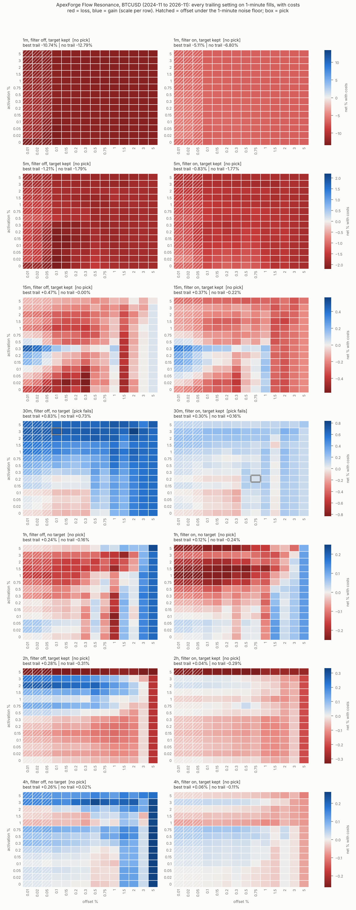

# ApexForge Flow Resonance and HRD Full Divergence v1.03: results by timeframe, filter off vs on, and every trailing setting

Files tested:
- [`ApexForge_Flow_Resonance_Strategy_FGF.pine`](../ApexForge_Flow_Resonance_Strategy_FGF.pine)
- [`HRD_Full_Divergence_Strategy_v1_03_FGF.pine`](../HRD_Full_Divergence_Strategy_v1_03_FGF.pine)

With "Enable filter" off, each one trades exactly like your original file. Every other input is at the file's defaults.

## How it was tested

- **Replicas.** A Python replica of each fused file, built independently twice. The two builds agree on 100% of trades. A third auditor checked each one line by line against the Pine and found no defects. For ApexForge, the auditor also wrote its own independent replica, which matches on every trade on all 14 pair / timeframe cells.
- **Filter.** The direction filter's permissions come from the same verified replica used for the XPW tests.
- **Fills.** As in TradingView's Strategy Tester without Bar Magnifier: orders fill at the next candle's open, and the stop / target are checked along the candle's high / low.
- **Data.**
  - BTCUSD: Bitstamp, 2024-11-17 to 2026-11-17, real volume.
  - XAUUSD: Dukascopy, 2017-01-02 to 2018-06-19, tick volume, as TradingView shows for CFD gold.
- **Money.** $1,000,000 start, the Pine default; results are in % so the capital doesn't matter.
  - ApexForge puts 1% of equity in each trade, so its percentages are small: -0.27% means it lost 27% of one position's size over the whole window.
  - HRD risks 1% over a 2% stop, which is about 50% of equity per trade.
- **"As TradingView shows"** uses each script's own Properties: ApexForge pays 0.04% commission per side, HRD pays nothing. **"With our costs"** replaces that with the costs used in every other test here:
  - gold $0.30 per ounce per round trip;
  - BTC 0.02% per side + $0.20 per round trip.

  For ApexForge our costs are lower than its own 0.04%, so it loses less with them.
- **Halves** is the change in equity in each half of the window. **Labels reversed** swaps every buy and sell, with the filter off: HRD's own "Reverse Trading" input, and a swap done in the replica for ApexForge. A strategy whose signals have a real direction should do clearly worse reversed.

## ApexForge Flow Resonance

### BTCUSD

| TF | Trades off / on | **Net % as TradingView shows, off / on** | Net % with our costs, off / on | PF off / on | Max DD % off / on | Halves on (1st / 2nd) | Labels reversed, filter off |
|---|---|---|---|---|---|---|---|
| 1m | 34,602 / 17,221 | **-23.999% / -12.971%** | -12.787% / -6.802% | 0.44 / 0.45 | 24.011 / 12.977 | -6.279% / -6.692% | -24.304% |
| 5m | 4,955 / 3,076 | **-3.709% / -2.960%** | -1.793% / -1.766% | 0.72 / 0.66 | 3.808 / 3.054 | -1.462% / -1.498% | -3.679% |
| 15m | 1,180 / 861 | **-0.470% / -0.565%** | -0.002% / -0.223% | 0.92 / 0.87 | 0.820 / 0.912 | -0.365% / -0.199% | -0.986% |
| 30m | 359 / 274 | **+0.585% / +0.050%** | +0.729% / +0.160% | 1.23 / 1.02 | 0.309 / 0.331 | -0.057% / +0.108% | -1.006% |
| 1h | 131 / 76 | **-0.217% / -0.272%** | -0.165% / -0.241% | 0.86 / 0.72 | 0.530 / 0.329 | -0.207% / -0.065% | -0.415% |
| 2h | 52 / 26 | **-0.330% / -0.300%** | -0.309% / -0.290% | 0.59 / 0.35 | 0.416 / 0.324 | -0.204% / -0.096% | +0.651% |
| 4h | 31 / 10 | **+0.004% / -0.118%** | +0.016% / -0.114% | 1.01 / 0.48 | 0.354 / 0.223 | -0.034% / -0.084% | -0.305% |

### XAUUSD

| TF | Trades off / on | **Net % as TradingView shows, off / on** | Net % with our costs, off / on | PF off / on | Max DD % off / on | Halves on (1st / 2nd) | Labels reversed, filter off |
|---|---|---|---|---|---|---|---|
| 1m | 3,651 / 2,164 | **-3.198% / -1.994%** | -1.179% / -0.787% | 0.28 / 0.29 | 3.204 / 2.005 | -0.926% / -1.068% | -2.561% |
| 5m | 875 / 606 | **-0.758% / -0.410%** | -0.267% / -0.068% | 0.54 / 0.62 | 0.773 / 0.431 | -0.174% / -0.236% | -0.653% |
| 15m | 290 / 229 | **-0.332% / -0.303%** | -0.168% / -0.174% | 0.65 / 0.60 | 0.341 / 0.320 | -0.197% / -0.105% | -0.128% |
| 30m | 194 / 138 | **-0.273% / -0.162%** | -0.163% / -0.084% | 0.63 / 0.69 | 0.298 / 0.184 | -0.039% / -0.123% | -0.060% |
| 1h | 74 / 40 | **-0.039% / -0.103%** | +0.003% / -0.081% | 0.90 / 0.56 | 0.122 / 0.159 | -0.037% / -0.066% | -0.126% |
| 2h | 37 / 17 | **-0.153% / -0.035%** | -0.132% / -0.025% | 0.44 / 0.66 | 0.188 / 0.110 | +0.028% / -0.063% | -0.031% |
| 4h | 10 / 2 | **-0.106% / -0.041%** | -0.100% / -0.040% | 0.09 / 0.00 | 0.111 / 0.044 | -0.041% / +0.000% | -0.087% |

**What it shows**

- **Commission decides the result.** Before commission the P/L is close to zero everywhere: -0.5% to +0.9% of capital. The 0.04% per side then turns almost every cell into a loss that grows with the trade count. On BTC 1m with the filter off it makes +0.2% before commission and pays 24.2% in commission: -24.0% net.
- **3 of the 28 TradingView figures are positive:** BTC 30m off +0.585%, BTC 30m on +0.050%, BTC 4h off +0.004%. Only BTC 30m with the filter off is positive in both halves. Gold loses on every timeframe, filter off and on.
- **The filter mostly loses less by trading less.** It halves the trades on 1m (BTC -24.0% to -13.0%). Its P/L before commission beats filter off on only 6 of 14 cells, and on the best cell, BTC 30m, it lowers the result from +0.585% to +0.050%.
- **With the filter on, most low-timeframe trades end with the "blocked opposite signal still closes the trade" close.** On BTC 1m that is 15,488 of 17,221 trades. Turning that option off loses less on 7 of 14 cells (BTC 1m: -3.9% instead of -13.0%).
- **No consistent direction edge.** Reversed labels do better than the real ones on 6 of 7 gold timeframes. On BTC the real labels do better on 5 of 7, most clearly on 30m (+0.585% against -1.006%).

## HRD Full Divergence v1.03

### BTCUSD

| TF | Trades off / on | **Net % as TradingView shows, off / on** | Net % with our costs, off / on | PF off / on | Max DD % off / on | Halves on (1st / 2nd) | Labels reversed, filter off |
|---|---|---|---|---|---|---|---|
| 1m | 25,630 / 10,186 | **-11.59% / -11.56%** | -99.49% / -88.61% | 0.98 / 0.95 | 21.18 / 15.41 | -7.59% / -3.97% | +5.16% |
| 5m | 5,648 / 2,282 | **-5.86% / -5.03%** | -69.78% / -39.99% | 0.98 / 0.96 | 17.84 / 12.77 | -6.91% / +1.89% | +0.58% |
| 15m | 2,105 / 909 | **+13.58% / -2.61%** | -25.63% / -18.89% | 1.07 / 0.97 | 9.89 / 6.98 | -0.87% / -1.74% | -9.38% |
| 30m | 1,185 / 576 | **-5.85% / -6.78%** | -25.82% / -16.98% | 0.96 / 0.91 | 11.69 / 12.58 | -6.56% / -0.23% | +0.65% |
| 1h | 621 / 248 | **+2.72% / +4.66%** | -9.34% / -0.44% | 1.02 / 1.11 | 10.73 / 6.37 | +7.36% / -2.70% | -4.97% |
| 2h | 333 / 97 | **+13.34% / -6.70%** | +6.00% / -8.50% | 1.15 / 0.75 | 8.68 / 13.56 | -2.22% / -4.47% | -20.09% |
| 4h | 190 / 48 | **-8.66% / -6.07%** | -12.08% / -6.97% | 0.87 / 0.63 | 20.65 / 9.16 | -5.70% / -0.37% | +9.67% |

### XAUUSD

| TF | Trades off / on | **Net % as TradingView shows, off / on** | Net % with our costs, off / on | PF off / on | Max DD % off / on | Halves on (1st / 2nd) | Labels reversed, filter off |
|---|---|---|---|---|---|---|---|
| 1m | 17,905 / 7,237 | **-0.99% / -3.59%** | -87.90% / -58.78% | 0.99 / 0.93 | 3.07 / 4.55 | -1.33% / -2.26% | -1.12% |
| 5m | 4,091 / 1,731 | **-2.32% / -2.42%** | -39.57% / -20.37% | 0.96 / 0.91 | 5.88 / 4.71 | +1.00% / -3.42% | +2.67% |
| 15m | 1,484 / 646 | **-6.44% / -2.22%** | -21.40% / -9.36% | 0.84 / 0.89 | 7.62 / 4.15 | -0.41% / -1.81% | +6.31% |
| 30m | 770 / 357 | **+2.81% / +0.65%** | -6.09% / -3.49% | 1.10 / 1.04 | 2.59 / 2.58 | +1.63% / -0.98% | -1.84% |
| 1h | 394 / 165 | **+2.97% / +0.67%** | -1.69% / -1.27% | 1.14 / 1.07 | 2.31 / 1.53 | +0.34% / +0.33% | -2.81% |
| 2h | 249 / 74 | **-4.86% / -2.09%** | -7.60% / -2.94% | 0.78 / 0.72 | 5.69 / 2.96 | +0.46% / -2.55% | +4.25% |
| 4h | 141 / 38 | **-3.15% / -0.04%** | -4.75% / -0.48% | 0.84 / 0.99 | 7.38 / 3.27 | +1.08% / -1.12% | +5.45% |

**What it shows**

- **Our costs sink it.** Each trade carries about 50% of equity and lasts about 6 candles, so everything under 30m loses heavily once costs are counted: BTC 1m -99% off / -89% on, gold 1m -88% / -59%. TradingView shows no costs for this script. The only cell positive with our costs is BTC 2h with the filter off (+6.0%).
- **The filter adds no consistent edge.** Under TradingView's costs it beats filter off on 6 of 14 cells, ties on 2 and loses on 6.
  - It wipes out the two best BTC cells: 15m +13.6% to -2.6%, and 2h +13.3% to -6.7%.
  - It shrinks the two positive gold cells: 30m +2.8% to +0.7%, and 1h +3.0% to +0.7%.
  - What it reliably does is cut trades to 25-49%, time in the market to 4-12% of candles, and the drawdown on 11 of 14 cells.
- **The signals' direction is not stable.** With the filter off, reversed labels do better than the real ones on 8 of 14 cells. The best filter-off cells (BTC 15m and 2h) earn almost all of it in the second half.
- **Best with the filter on:** BTC 1h, +4.7% as TradingView shows it, PF 1.11, drawdown 6.4%. But it earns +7.4% in the first half, gives back 2.7% in the second, and is -0.4% with our costs.
- **Exits.** 54-92% of trades end with the 5-candle time exit. With the filter on, gold never reaches the 2% stop or the 4% target.

## Limits of this test

- **Pivot ties.** Both scripts find pivots with `ta.pivothigh` / `ta.pivotlow`. How TradingView treats two equal highs or lows can't be checked here, so the replica requires a strictly higher or lower pivot. On BTC 1m the other reading gives HRD about 17% more trades and moves it by 5-7 points. From 1h up it changes HRD by at most about 2 points and ApexForge by a fraction of a point.
- **HRD reversal sizing.** HRD reverses with an entry while the time exit closes on the same candle. Whether TradingView sizes that entry when it is placed or when it fills can't be checked here.
  - With the filter on, the other reading moves results by at most 0.9 points.
  - With the filter off it moves them by up to about 4 points (for example BTC 15m +13.6% to +15.1%, BTC 1h +2.7% to -0.2%). So the filter-off column and the off-vs-on comparison are the less certain ones.
- **Live vs backtest.**
  - Your original HRD runs on every tick live, so its live entries can differ from this backtest. The fused HRD file now runs once per candle close (calc_on_every_tick = false), so live matches the backtest.
  - ApexForge's 15m levels differ live on charts below 15m.
- **A trade open at the end.** It is closed at the last candle here; TradingView leaves it as open P/L. That moves each figure by at most about 0.14 points.
- **Data.** The gold data is from 2017-2018; percentages carry over to today's prices, dollar distances do not. Two years of BTC is a short window.

## Every trailing setting on every timeframe

Neither strategy had a trailing stop. Both fused files now have an optional **trailing take profit**, group "Trailing take profit", off by default so nothing changes unless you turn it on.

- **Settings:** activation and offset in % of the signal candle's close.
- **ApexForge** can also drop its Reward:Risk target, but only while the trail is on.
- **HRD:** set Take Profit (%) to 0 to remove its target.

**What was swept.** For each pair, timeframe (1m to 4h) and filter setting:

- **Trail:** activation 0, 0.02, 0.05, 0.1, 0.15, 0.2, 0.3, 0.5, 0.75, 1, 1.5, 2, 3 and 5%; offset 0.01, 0.02, 0.05, 0.1, 0.15, 0.2, 0.3, 0.5, 0.75, 1, 1.5, 2, 3 and 5%; plus no trail.
- **ApexForge:** also target kept or dropped (394 settings).
- **HRD:** also TP 4% (its default) or none, and a time exit after 5 (its default), 20 or 100 candles (1,182 settings). Its 5-candle time exit ends most trades before a trail could act, so longer time exits were included.

Each setting was run with TradingView's standard fills and with 1-minute fills inside each candle (Bar Magnifier), with each script's own costs and with our costs, and with real and reversed labels. That is 640,000 backtests in total.

Unless stated otherwise, everything below uses **1-minute fills with our costs**. The extended replicas were checked against two independent references, trade by trade, on about 360,000 trades. The grid, for both fill models, is in [`trailing_sweep_all.csv.gz`](trailing_sweep_all.csv.gz).

### What it shows

1. **No trailing setting is worth adopting on either strategy, on any timeframe.** The selection rule (the same as for XPW; see below) passes one setting out of 56 pair / timeframe / filter cells. A review refuted it.
2. **The best trailing setting often beats the strategy's own exits, but it is the best of hundreds of tries.** It is positive on:
   - ApexForge BTC 15m to 4h: +0.04% to +0.85% at its 1% size;
   - HRD BTC 30m to 4h: up to +36% on 2h with the filter off;
   - HRD gold 4h, and 30m / 1h with the filter on, by small amounts.

   From 1m to 5m on ApexForge, and 1m to 15m on HRD, almost every setting loses. None of these best settings passes the rule: the best of a grid this size finds something positive by chance.
3. **TradingView's standard backtest is misleading here too.**
   - **HRD BTC 1m:** TradingView's own top trailing setting shows **+1,347%** (filter off), and on 1-minute fills with costs it loses 90%. Every HRD BTC timeframe shows the same gap.
   - **ApexForge:** it is small because each trade is only 1% of equity.

   Use Bar Magnifier, and trails well above the 1-minute candle size.
4. **The one pick, HRD BTC 2h with the filter off, was refuted.** Activation 2%, offset 0.15%, TP 4%, time exit 100: +30.0% over 2 years with our costs, PF 1.27, drawdown 6.5%, reversed labels -28.6%, stressed costs +23.7%. It reproduces exactly, but:
   - **It is really a take profit near 2%.** A plain 1.85-1.9% target makes +26% to +28%. Activation 2.25% halves the result.
   - **It looks selected, not real.** If every signal's direction is randomised, the rule still finds a pass in at least one of 16 cells about 70% of the time. The 20 best trades are 93% of the gain. It is led by shorts in a window where BTC fell 28%, and it makes +2% in ranging markets.
   - **Live it would have traded differently.** HRD as you wrote it recalculates on every tick, and an emulation of that on 1-minute data gives +9.6% with a losing first half, or -2.3% with stressed costs. The fused file now runs once per candle close, which fixes this. A ~$20 difference in prices (another exchange) already drops it to about +25%.

### By timeframe

"Trailing settings that make money" is the share of trailing settings with a positive result. For HRD, "No trailing" is the best of its own exits over the TP / time-exit choices; "Your default" is TP 4% and a 5-candle time exit. ApexForge figures are small because each trade is 1% of equity.

#### ApexForge, BTCUSD

| TF | Filter | Trailing settings that make money | Best trailing setting | No trailing (best of the strategy's own exits) | Your default | TradingView's top trailing setting: TradingView shows / 1-minute fills with costs | Rule verdict |
|---|---|---|---|---|---|---|---|
| 1m | off | 0% | 0% / 0.2%: -12.27% | own exits: -12.79% | -12.79% | -23.29% / -11.33% | no pick |
| 1m | on | 0% | 0% / 0.3%: -6.28% | own exits: -6.80% | -6.80% | -12.26% / -5.76% | no pick |
| 5m | off | 0% | 0% / 0.5%: -1.47% | own exits: -1.79% | -1.79% | -1.71% / -1.37% | no pick |
| 5m | on | 0% | 0% / 0.5%: -1.06% | own exits: -1.77% | -1.77% | -0.86% / -0.83% | no pick |
| 15m | off | 6% | 0.3% / 0.1%: +0.14% | own exits: -0.00% | -0.00% | +1.00% / +0.47% | no pick |
| 15m | on | 12% | 0.1% / 1%: +0.16% | own exits: -0.22% | -0.22% | +0.78% / +0.23% | no pick |
| 30m | off | 93% | 3% / 2%: +0.85% | own exits: +0.73% | +0.73% | +0.88% / +0.70% | pick fails: reverse hold-out failed |
| 30m | on | 83% | 3% / 2%, no target: +0.33% | own exits: +0.16% | +0.16% | +0.62% / +0.06% | pick fails: stressed costs -0.04%; forward hold-out failed; reverse hold-out failed |
| 1h | off | 24% | 5% / 5%, no target: +0.24% | own exits: -0.16% | -0.16% | +0.57% / +0.06% | no pick |
| 1h | on | 21% | 0% / 1.5%, no target: +0.12% | own exits: -0.24% | -0.24% | +0.27% / +0.03% | no pick |
| 2h | off | 36% | 2% / 0.1%: +0.27% | own exits: -0.31% | -0.31% | +0.39% / +0.28% | no pick |
| 2h | on | 10% | 0.75% / 0.5%: +0.04% | own exits: -0.29% | -0.29% | +0.09% / -0.01% | no pick |
| 4h | off | 81% | 0% / 5%, no target: +0.26% | own exits: +0.02% | +0.02% | +0.33% / +0.07% | no pick |
| 4h | on | 48% | 0.75% / 0.3%: +0.06% | own exits: -0.11% | -0.11% | +0.11% / +0.05% | no pick |

#### ApexForge, XAUUSD

| TF | Filter | Trailing settings that make money | Best trailing setting | No trailing (best of the strategy's own exits) | Your default | TradingView's top trailing setting: TradingView shows / 1-minute fills with costs | Rule verdict |
|---|---|---|---|---|---|---|---|
| 1m | off | 0% | 0.5% / 0.05%: -1.10% | own exits: -1.18% | -1.18% | -3.14% / -1.11% | no pick |
| 1m | on | 0% | 0.2% / 0.05%: -0.66% | own exits: -0.79% | -0.79% | -1.90% / -0.66% | no pick |
| 5m | off | 0% | 0.02% / 0.3%: -0.09% | own exits: -0.27% | -0.27% | -0.63% / -0.08% | no pick |
| 5m | on | 6% | 0.3% / 0.05%: +0.02% | own exits: -0.07% | -0.07% | -0.31% / +0.06% | no pick |
| 15m | off | 1% | 0% / 0.3%: +0.01% | own exits: -0.17% | -0.17% | -0.19% / -0.04% | no pick |
| 15m | on | 0% | 0% / 0.3%: -0.00% | own exits: -0.17% | -0.17% | -0.14% / -0.04% | no pick |
| 30m | off | 2% | 0% / 0.3%: +0.02% | own exits: -0.16% | -0.16% | -0.05% / -0.00% | no pick |
| 30m | on | 7% | 0% / 0.3%: +0.04% | own exits: -0.08% | -0.08% | -0.01% / -0.03% | no pick |
| 1h | off | 73% | 0.15% / 1.5%: +0.10% | own exits: +0.00% | +0.00% | +0.11% / +0.05% | pick fails: forward hold-out failed; reverse hold-out failed |
| 1h | on | 10% | 0% / 0.75%: +0.01% | own exits: -0.08% | -0.08% | +0.03% / +0.01% | no pick |
| 2h | off | 14% | 0% / 0.5%: +0.03% | own exits: -0.13% | -0.13% | +0.06% / +0.01% | no pick |
| 2h | on | 46% | 5% / 0.15%: +0.04% | own exits: -0.03% | -0.03% | +0.03% / +0.04% | no pick |
| 4h | off | 8% | 0.1% / 0.05%: +0.01% | own exits: -0.10% | -0.10% | +0.02% / +0.01% | no pick |
| 4h | on | 18% | 0.15% / 0.05%: +0.00% | own exits: -0.04% | -0.04% | +0.00% / +0.00% | no pick |

#### HRD, BTCUSD

| TF | Filter | Trailing settings that make money | Best trailing setting | No trailing (best of the strategy's own exits) | Your default | TradingView's top trailing setting: TradingView shows / 1-minute fills with costs | Rule verdict |
|---|---|---|---|---|---|---|---|
| 1m | off | 0% | 0.02% / 0.1%, TP 4%, time exit 100: -97.3% | TP 4%, time exit 100: -99.1% | -99.5% | +1346.9% / -89.6% | no pick |
| 1m | on | 0% | 0.02% / 0.1%, TP 4%, time exit 100: -78.6% | TP 4%, time exit 100: -86.9% | -88.6% | +188.4% / -60.7% | no pick |
| 5m | off | 0% | 0.15% / 0.1%, TP 4%, time exit 100: -51.2% | TP 4%, time exit 100: -60.6% | -69.8% | +450.9% / -42.1% | no pick |
| 5m | on | 0% | 0.02% / 0.2%, TP 4%, time exit 20: -21.3% | TP 4%, time exit 100: -31.1% | -40.0% | +140.4% / -11.3% | no pick |
| 15m | off | 0% | 0.15% / 0.3%, TP 4%, time exit 100: -4.2% | TP 4%, time exit 20: -22.2% | -25.6% | +367.9% / -5.9% | no pick |
| 15m | on | 0% | 0.1% / 0.1%, TP 4%, time exit 100: -6.6% | TP 4%, time exit 100: -14.6% | -18.9% | +96.7% / -5.0% | no pick |
| 30m | off | 21% | 0.1% / 1%, no TP, time exit 100: +16.8% | TP 4%, time exit 100: -4.7% | -25.8% | +277.0% / -5.6% | pick fails: stressed costs -8.55%; forward hold-out failed |
| 30m | on | 11% | 0.1% / 1%, no TP, time exit 100: +9.8% | TP 4%, time exit 100: -10.8% | -17.0% | +86.8% / -5.3% | pick fails: stressed costs -2.23% |
| 1h | off | 30% | 3% / 1%, no TP, time exit 20: +15.3% | no TP, time exit 20: +4.7% | -9.3% | +208.9% / +0.3% | pick fails: forward hold-out failed; reverse hold-out failed |
| 1h | on | 48% | 1% / 0.75%, no TP, time exit 20: +8.9% | no TP, time exit 5: +0.8% | -0.4% | +48.6% / -1.2% | pick fails: forward hold-out failed; reverse hold-out failed |
| 2h | off | 70% | 0.75% / 2%, TP 4%, time exit 20: +36.0% | TP 4%, time exit 20: +21.6% | +6.0% | +150.4% / +1.2% | **passes** (review below) |
| 2h | on | 0% | 0.05% / 0.1%, TP 4%, time exit 5: -0.4% | TP 4%, time exit 20: -7.8% | -8.5% | +23.9% / -0.2% | no pick |
| 4h | off | 13% | 5% / 5%, no TP, time exit 100: +11.0% | no TP, time exit 100: +4.7% | -12.1% | +105.7% / -1.7% | no pick |
| 4h | on | 13% | 3% / 1%, no TP, time exit 100: +2.6% | no TP, time exit 100: +3.1% | -7.0% | +16.0% / +1.4% | no pick |

#### HRD, XAUUSD

| TF | Filter | Trailing settings that make money | Best trailing setting | No trailing (best of the strategy's own exits) | Your default | TradingView's top trailing setting: TradingView shows / 1-minute fills with costs | Rule verdict |
|---|---|---|---|---|---|---|---|
| 1m | off | 0% | 0.05% / 0.05%, TP 4%, time exit 100: -80.6% | TP 4%, time exit 100: -82.2% | -87.9% | +43.0% / -77.3% | no pick |
| 1m | on | 0% | 0.05% / 0.05%, TP 4%, time exit 100: -49.3% | TP 4%, time exit 100: -52.5% | -58.8% | +18.0% / -44.8% | no pick |
| 5m | off | 0% | 0.15% / 0.05%, TP 4%, time exit 100: -28.0% | TP 4%, time exit 100: -31.9% | -39.6% | +37.8% / -27.7% | no pick |
| 5m | on | 0% | 0.15% / 0.05%, TP 4%, time exit 100: -13.9% | TP 4%, time exit 100: -16.2% | -20.4% | +16.3% / -9.5% | no pick |
| 15m | off | 0% | 0.5% / 0.05%, TP 4%, time exit 20: -15.7% | TP 4%, time exit 20: -18.6% | -21.4% | +21.7% / -15.1% | no pick |
| 15m | on | 0% | 0% / 0.1%, TP 4%, time exit 5: -7.3% | TP 4%, time exit 5: -9.4% | -9.4% | +8.5% / -8.4% | no pick |
| 30m | off | 0% | 0.2% / 0.05%, TP 4%, time exit 5: -3.5% | TP 4%, time exit 5: -6.1% | -6.1% | +21.1% / -6.8% | no pick |
| 30m | on | 2% | 0.2% / 0.05%, TP 4%, time exit 20: +0.4% | TP 4%, time exit 20: -1.8% | -3.5% | +10.3% / +1.5% | no pick |
| 1h | off | 0% | 0.02% / 0.3%, TP 4%, time exit 100: -0.0% | TP 4%, time exit 5: -1.7% | -1.7% | +18.3% / -2.2% | no pick |
| 1h | on | 4% | 0.02% / 0.3%, TP 4%, time exit 20: +0.3% | TP 4%, time exit 5: -1.3% | -1.3% | +8.5% / +0.4% | no pick |
| 2h | off | 0% | 0% / 0.15%, TP 4%, time exit 20: -2.4% | TP 4%, time exit 100: -3.5% | -7.6% | +13.8% / -2.8% | no pick |
| 2h | on | 0% | 0% / 0.2%, TP 4%, time exit 5: -0.4% | TP 4%, time exit 5: -2.9% | -2.9% | +3.3% / -1.0% | no pick |
| 4h | off | 10% | 0.3% / 1%, TP 4%, time exit 20: +2.5% | TP 4%, time exit 20: -0.5% | -4.7% | +17.8% / -1.4% | no pick |
| 4h | on | 8% | 0.02% / 0.5%, TP 4%, time exit 20: +1.2% | TP 4%, time exit 5: -0.5% | -0.5% | +3.9% / +0.0% | no pick |

### Heatmaps

Each panel shows activation (up) against offset (across), coloured by net % with our costs on 1-minute fills, for the other inputs of that panel's best setting (named in its title). Hatched cells have an offset under the 1-minute noise; the box marks the rule's pick.

### The rule

The same rule as the XPW trailing sweep.

- **Pool.**
  - Trail offsets of at least twice the median 1-minute candle range (BTC 0.1%, gold 0.05%), plus the no-trail settings.
  - Settings with identical results count once.
- **Pick.**
  - Candidates: trailing settings positive in both halves, with 30+ trades in each half; each half is scored from a fresh start.
  - Take the 40 best by their worse half. Score each as 0.5 x its worse half + 0.5 x the mean worse half of its grid neighbours (at least 5).
- **A pick passes only if all of these hold:**
  1. **Forward.** Settings chosen on the first half beat 95% of random draws on the second half, with 60%+ positive.
  2. **Reverse.** The same, chosen on the second half and scored on the first.
  3. **Signal control.** It beats the same setting with reversed labels in both halves.
  4. **Stressed costs.** It stays positive.

An auditor re-implemented the rule and matched all 56 verdicts and every pick. The auditor also found the random baseline lenient when the best settings cluster in the grid; with a stricter baseline, no cell passes.

### A practical note on HRD

Your HRD file runs with calc_on_every_tick = true, so live it behaves differently from every backtest above:
- divergence entries fire a candle early, on pivots that can still vanish;
- after an intrabar exit, a still-true signal re-enters;
- the hybrid exit then closes that new trade at once.

**Changed:** the fused file [`HRD_Full_Divergence_Strategy_v1_03_FGF.pine`](../HRD_Full_Divergence_Strategy_v1_03_FGF.pine) now sets calc_on_every_tick = false. It runs once per candle close, live and in the backtest alike, and orders fill at the next candle's open. Every backtest figure on this page stays the same, because history always runs once per candle. Your original file is unchanged.

## Inverted direction (Update 1): results by timeframe

Both files now have the option "Inverted direction: opposite side at the same entries" ([UPDATES.md](../UPDATES.md)). These are the results with it on, at the default inputs, next to the normal direction.

- **How it was tested.** The option was added to both backtest replicas and checked trade by trade against separately written references (more than 2,000 runs each, both fill models, filter off and on). With the option off, the replicas reproduce every earlier result exactly.
- **"As TradingView shows"** is the standard backtest with the script's own costs (ApexForge 0.04% per side, HRD none). **"1-minute fills with our costs"** is the realistic figure: exits checked on the 1-minute candles, and gold $0.30 per ounce per round trip, BTC 0.02% per side + $0.20.
- **Filter off.** Inverted is the same as the "labels reversed" control in the tables above (for ApexForge with the stop and target mirrored). The new information is the filter-on rows.
- **Halves** are the trades entered in each half of the window, each half from a fresh start.

### ApexForge, normal vs inverted

ApexForge puts 1% of equity in each trade, so the figures are small.

#### BTCUSD

| TF | Filter | Trades normal / inverted | As TradingView shows: normal / inverted | 1-minute fills with our costs: normal / inverted | Inverted, both halves (1-minute fills, our costs) | PF inverted (same) |
|---|---|---|---|---|---|---|
| 1m | off | 34,602 / 34,542 | -24.00% / -24.34% | -12.79% / **-13.20%** | -6.53% / -7.14% | 0.61 |
| 1m | on | 17,221 / 17,197 | -12.97% / -12.74% | -6.80% / **-6.56%** | -3.33% / -3.34% | 0.64 |
| 5m | off | 4,955 / 4,855 | -3.71% / -3.48% | -1.79% / **-1.59%** | -0.52% / -1.08% | 0.86 |
| 5m | on | 3,076 / 3,020 | -2.96% / -1.61% | -1.77% / **-0.43%** | -0.16% / -0.26% | 0.94 |
| 15m | off | 1,180 / 1,116 | -0.47% / -0.64% | -0.00% / **-0.20%** | -0.15% / -0.06% | 0.96 |
| 15m | on | 861 / 823 | -0.56% / -0.43% | -0.22% / **-0.10%** | +0.01% / -0.11% | 0.98 |
| 30m | off | 359 / 347 | +0.59% / -0.84% | +0.73% / **-0.71%** | +0.13% / -0.84% | 0.77 |
| 30m | on | 274 / 261 | +0.05% / -0.47% | +0.16% / **-0.37%** | +0.25% / -0.62% | 0.83 |
| 1h | off | 131 / 122 | -0.22% / -0.21% | -0.16% / **-0.16%** | +0.15% / -0.31% | 0.89 |
| 1h | on | 76 / 75 | -0.27% / -0.15% | -0.24% / **-0.12%** | +0.07% / -0.19% | 0.86 |
| 2h | off | 52 / 49 | -0.33% / -0.20% | -0.31% / **-0.18%** | -0.04% / -0.15% | 0.77 |
| 2h | on | 26 / 26 | -0.30% / -0.02% | -0.29% / **-0.01%** | +0.19% / -0.20% | 0.97 |
| 4h | off | 31 / 31 | +0.00% / -0.10% | +0.02% / **-0.08%** | -0.04% / -0.04% | 0.88 |
| 4h | on | 10 / 10 | -0.12% / +0.12% | -0.11% / **+0.12%** | +0.18% / -0.05% | 1.94 |

#### XAUUSD

| TF | Filter | Trades normal / inverted | As TradingView shows: normal / inverted | 1-minute fills with our costs: normal / inverted | Inverted, both halves (1-minute fills, our costs) | PF inverted (same) |
|---|---|---|---|---|---|---|
| 1m | off | 3,651 / 3,651 | -3.20% / -2.56% | -1.18% / **-0.53%** | -0.31% / -0.21% | 0.78 |
| 1m | on | 2,164 / 2,164 | -1.99% / -1.44% | -0.79% / **-0.22%** | -0.12% / -0.10% | 0.85 |
| 5m | off | 875 / 873 | -0.76% / -0.61% | -0.27% / **-0.12%** | -0.06% / -0.07% | 0.90 |
| 5m | on | 606 / 604 | -0.41% / -0.56% | -0.07% / **-0.22%** | -0.11% / -0.11% | 0.75 |
| 15m | off | 290 / 281 | -0.33% / -0.13% | -0.17% / **+0.03%** | +0.08% / -0.05% | 1.04 |
| 15m | on | 229 / 223 | -0.30% / -0.07% | -0.17% / **+0.05%** | +0.06% / -0.01% | 1.11 |
| 30m | off | 194 / 188 | -0.27% / -0.06% | -0.16% / **+0.05%** | +0.08% / -0.03% | 1.09 |
| 30m | on | 138 / 137 | -0.16% / -0.07% | -0.08% / **+0.01%** | +0.01% / +0.00% | 1.02 |
| 1h | off | 74 / 70 | -0.04% / -0.17% | +0.00% / **-0.13%** | -0.04% / -0.09% | 0.68 |
| 1h | on | 40 / 39 | -0.10% / -0.06% | -0.08% / **-0.04%** | +0.00% / -0.05% | 0.79 |
| 2h | off | 37 / 34 | -0.15% / +0.05% | -0.13% / **+0.07%** | +0.02% / +0.04% | 1.31 |
| 2h | on | 17 / 17 | -0.03% / +0.03% | -0.03% / **+0.04%** | +0.01% / +0.03% | 1.37 |
| 4h | off | 10 / 10 | -0.11% / -0.06% | -0.10% / **-0.06%** | -0.05% / -0.01% | 0.37 |
| 4h | on | 2 / 2 | -0.04% / -0.04% | -0.04% / **-0.04%** | -0.04% / +0.00% | 0.00 |

**What it shows**

- **Inverting does not turn ApexForge into a winner.** On 1m and 5m both directions lose: costs take more than the signals make either way.
- **BTC.** The one timeframe that made money normally, 30m, loses when inverted (-0.71% against +0.73%). The only inverted gain is 4h with the filter on: +0.12% from 10 trades.
- **Gold.** Inverted is slightly positive on 15m, 30m and 2h (+0.01% to +0.07% over 18 months). That is too small to mean anything, and only 30m filter-on and 2h are positive in both halves.

### HRD, normal vs inverted

HRD puts about 50% of equity in each trade. With the default exits almost no trade ends on a price level inside a candle, so both fill models give the same trades; the two columns differ only by costs.

#### BTCUSD

| TF | Filter | Trades normal / inverted | As TradingView shows: normal / inverted | 1-minute fills with our costs: normal / inverted | Inverted, both halves (1-minute fills, our costs) | PF inverted (same) |
|---|---|---|---|---|---|---|
| 1m | off | 25,630 / 25,650 | -11.6% / +7.0% | -99.5% / **-99.4%** | -90.5% / -93.6% | 0.51 |
| 1m | on | 10,186 / 10,186 | -11.6% / +11.0% | -88.6% / **-85.7%** | -59.8% / -64.5% | 0.50 |
| 5m | off | 5,648 / 5,652 | -5.9% / +0.3% | -69.8% / **-67.8%** | -42.4% / -44.2% | 0.69 |
| 5m | on | 2,282 / 2,282 | -5.0% / +3.1% | -40.0% / **-34.9%** | -13.7% / -24.5% | 0.72 |
| 15m | off | 2,105 / 2,110 | +13.6% / -13.1% | -25.6% / **-43.1%** | -23.2% / -25.9% | 0.76 |
| 15m | on | 909 / 909 | -2.6% / +3.0% | -18.9% / **-14.2%** | -7.9% / -6.8% | 0.85 |
| 30m | off | 1,185 / 1,193 | -5.9% / +0.6% | -25.8% / **-20.9%** | -17.3% / -4.3% | 0.86 |
| 30m | on | 576 / 575 | -6.8% / +0.7% | -17.0% / **-10.3%** | -4.8% / -5.8% | 0.87 |
| 1h | off | 621 / 624 | +2.7% / -4.8% | -9.3% / **-16.1%** | -13.7% / -2.8% | 0.86 |
| 1h | on | 248 / 248 | +4.7% / -3.5% | -0.4% / **-8.2%** | -9.1% / +1.0% | 0.82 |
| 2h | off | 333 / 335 | +13.3% / -19.5% | +6.0% / **-24.8%** | -15.0% / -11.4% | 0.74 |
| 2h | on | 97 / 97 | -6.7% / +6.0% | -8.5% / **+3.9%** | +0.6% / +3.4% | 1.17 |
| 4h | off | 190 / 194 | -8.7% / +9.7% | -12.1% / **+5.5%** | +17.2% / -10.0% | 1.07 |
| 4h | on | 48 / 47 | -6.1% / +7.8% | -7.0% / **+6.8%** | +4.3% / +2.4% | 1.65 |

#### XAUUSD

| TF | Filter | Trades normal / inverted | As TradingView shows: normal / inverted | 1-minute fills with our costs: normal / inverted | Inverted, both halves (1-minute fills, our costs) | PF inverted (same) |
|---|---|---|---|---|---|---|
| 1m | off | 17,905 / 17,979 | -1.0% / -1.3% | -87.9% / **-88.0%** | -66.0% / -64.8% | 0.21 |
| 1m | on | 7,237 / 7,237 | -3.6% / +3.6% | -58.8% / **-55.7%** | -34.4% / -32.5% | 0.22 |
| 5m | off | 4,091 / 4,118 | -2.3% / +2.5% | -39.6% / **-36.8%** | -22.9% / -18.1% | 0.47 |
| 5m | on | 1,731 / 1,731 | -2.4% / +2.4% | -20.4% / **-16.4%** | -10.7% / -6.4% | 0.50 |
| 15m | off | 1,484 / 1,494 | -6.4% / +6.3% | -21.4% / **-10.8%** | -6.3% / -4.8% | 0.74 |
| 15m | on | 646 / 646 | -2.2% / +2.3% | -9.4% / **-5.2%** | -3.4% / -1.8% | 0.75 |
| 30m | off | 770 / 771 | +2.8% / -1.7% | -6.1% / **-10.2%** | -5.5% / -5.0% | 0.70 |
| 30m | on | 357 / 357 | +0.6% / -0.6% | -3.5% / **-4.7%** | -3.9% / -0.9% | 0.73 |
| 1h | off | 394 / 395 | +3.0% / -2.8% | -1.7% / **-7.2%** | -3.6% / -3.8% | 0.72 |
| 1h | on | 165 / 165 | +0.7% / -0.6% | -1.3% / **-2.6%** | -1.5% / -1.1% | 0.76 |
| 2h | off | 249 / 250 | -4.9% / +4.3% | -7.6% / **+1.2%** | -0.3% / +1.5% | 1.07 |
| 2h | on | 74 / 74 | -2.1% / +2.1% | -2.9% / **+1.2%** | -1.0% / +2.2% | 1.21 |
| 4h | off | 141 / 141 | -3.2% / +4.4% | -4.7% / **+2.7%** | +1.5% / +1.2% | 1.16 |
| 4h | on | 38 / 38 | -0.0% / -0.6% | -0.5% / **-1.1%** | -0.6% / -0.5% | 0.83 |

**What it shows**

- **1m to 1h: both directions lose once costs are counted.** TradingView shows inverted gains on 1m and 5m (up to +11%), but HRD sets no costs; with costs the same runs lose 35% to 99%.
- **Inverted is roughly the mirror of normal before costs.** Where normal made money in TradingView (BTC 15m and 2h with the filter off), inverted loses about as much. So inverting moves the result, it does not add an edge.
- **2h and 4h are where inverted comes out ahead.**
  - BTC 4h, filter on: +6.8% with costs, positive in both halves, but from only 47 trades.
  - BTC 2h, filter on: +3.9%, both halves positive, 97 trades.
  - BTC 4h, filter off: +5.5%, but +17.2% in one half and -10.0% in the other.
  - Gold 2h: +1.2% with the filter off or on. Gold 4h, filter off: +2.7%, both halves positive.
- **These are default settings and small samples.** None of them has been through a hold-out test. The calibration (every setting, normal and inverted, chosen on one half and checked on the other) is the test of whether any of this holds.

## Calibration by timeframe, with the direction as an input

Every earlier section used the files' default inputs. Here the inputs themselves were searched, per pair and timeframe, with the Update 1 option "Inverted direction" as one of them. 498,960 backtests: 172,368 for ApexForge and 326,592 for HRD.

### What was searched

Each grid is the full product of the values below, on every timeframe from 1m to 4h of BTCUSD and XAUUSD.

| | ApexForge (12,312 settings per timeframe) | HRD (23,328 settings per timeframe) |
|---|---|---|
| Signals | "Swing Lookback for Order Blocks" 10, 20, 30; "Min Candle Body Strength" 0.5, 0.65, 0.8; "Volume Spike Multiplier" 1.2, 1.7, 2.2 | "Pivot Strength" 3, 5, 8; "Max Divergence Lookback" 30, 60, 120; divergences: all four, regular only, hidden only |
| Filter | off; on; on with "Blocked opposite signal still closes the trade" off | the same three |
| Direction | normal; inverted | normal; inverted ("Reverse Trading" stays off) |
| Exits | "Reward:Risk Ratio" 1.5, 2, 3, 5; trailing off, or activation 0.3 / 1 / 3% with offset 0.2 / 0.5 / 1.5%, target kept or dropped | stop loss 1, 2, 4%; take profit off or 4%; "Close after X Candles" 5, 20, 100; hybrid exit on or off; trailing off, or 0.5 / 0.15%, 1 / 0.5%, 2 / 1% |

Every setting was scored on 1-minute fills with costs (gold $0.30 per ounce per round trip, BTC 0.02% per side + $0.20), on the two halves of the window separately. A half counts the trades entered in it, from a fresh start.

### The rule (rule C)

A setting is only worth a file if it passes all of these. The rule was fixed before the runs.

1. **Candidates.** Positive in both halves, with at least 30 trades entered in each.
2. **Plateau.** Among the 40 best candidates by worst half, the pick is the best by 0.5 x its worst half + 0.5 x the average worst half of its neighbours in the grid (one input one step away). It needs at least 5 different neighbours with a positive average. Flipping the direction is not a neighbour.
3. **Hold-out, both ways.** The 40 best settings by the first half must, on the second half, beat 95% of random draws of 40 settings, be at least 60% positive and average above zero. The same from the second half to the first.
4. **Direction control.** The pick must beat the same setting with the direction flipped, in both halves.
5. **Stressed costs.** The pick must stay positive in both halves (gold $0.50 + 1 tick per side; BTC 0.035% per side + $0.20 + 1 tick per side).
6. **Sceptics.** A pick that passes 1-5 is then attacked by independent reviewers before any file is made.

### Results

How to read the tables:

- **Different results**: settings with the same trades count once.
- **Positive in both halves**: how many of those pass step 1, for each direction.
- **Typical result**: the median over settings with 30+ trades per half.
- **Best normal / inverted**: the setting with the best worst half, as net result (first half / second half, trades). These are in-sample: the best of thousands always looks good.
- **Hold-outs**: what the 40 best of one half made on the other half, against the 95th percentile of random draws.

#### HRD Full Divergence v1.03

Risk 1% of equity per trade, so the figures are large.

##### BTCUSD

| TF | Different results | Positive in both halves: normal / inverted | Typical result: normal / inverted | Best normal (halves, trades) | Best inverted (halves, trades) | Forward hold-out | Reverse hold-out | Verdict |
|---|---|---|---|---|---|---|---|---|
| 1m | 14,190 | 0 / 0 | -80.70% / -75.50% | -11.52% (-3.64% / -8.18%, 1808 trades) | -7.17% (-5.36% / -1.91%, 2201 trades) | -10.72% vs -49.44%, 10% positive: FAIL | -9.61% vs -46.52%, 0% positive: FAIL | no setting: no setting is positive in both halves with 30+ trades in each |
| 5m | 15,188 | 12 / 31 | -26.07% / -31.34% | +8.62% (+5.04% / +3.41%, 1016 trades) | +18.68% (+9.63% / +8.26%, 807 trades) | -17.44% vs -16.79%, 0% positive: FAIL | -15.56% vs -15.12%, 2% positive: FAIL | no setting: none of the 40 best candidates sits on a plateau |
| 15m | 16,559 | 381 / 250 | -10.35% / -14.67% | +68.10% (+37.75% / +22.03%, 1584 trades) | +110.64% (+51.94% / +38.63%, 538 trades) | -14.24% vs -5.90%, 30% positive: FAIL | -8.27% vs -5.25%, 18% positive: FAIL | no setting: forward hold-out failed; reverse hold-out failed |
| 30m | 13,703 | 921 / 167 | -4.61% / -12.21% | +53.46% (+28.69% / +19.25%, 441 trades) | +59.42% (+34.43% / +18.60%, 250 trades) | -6.68% vs -1.93%, 30% positive: FAIL | -12.01% vs -3.10%, 15% positive: FAIL | no setting: forward hold-out failed; reverse hold-out failed |
| 1h | 11,604 | 812 / 1,017 | -3.14% / -4.39% | +140.25% (+42.65% / +68.43%, 753 trades) | +69.04% (+29.15% / +30.89%, 151 trades) | +9.63% vs +1.60%, 40% positive: FAIL | +19.19% vs -0.80%, 95% positive: pass | no setting: forward hold-out failed |
| 2h | 9,696 | 416 / 830 | -2.95% / -2.51% | +48.62% (+22.93% / +20.90%, 295 trades) | +76.39% (+26.17% / +39.80%, 140 trades) | -10.38% vs +1.23%, 35% positive: FAIL | -10.23% vs -0.22%, 25% positive: FAIL | no setting: forward hold-out failed; reverse hold-out failed |
| 4h | 5,479 | 141 / 110 | -3.07% / -2.60% | +92.93% (+21.42% / +58.90%, 78 trades) | +13.26% (+6.48% / +6.36%, 96 trades) | -15.20% vs -0.04%, 0% positive: FAIL | -15.34% vs +0.71%, 8% positive: FAIL | no setting: forward hold-out failed; reverse hold-out failed |

##### XAUUSD

| TF | Different results | Positive in both halves: normal / inverted | Typical result: normal / inverted | Best normal (halves, trades) | Best inverted (halves, trades) | Forward hold-out | Reverse hold-out | Verdict |
|---|---|---|---|---|---|---|---|---|
| 1m | 6,504 | 0 / 1 | -46.42% / -38.84% | -3.72% (-1.70% / -2.05%, 643 trades) | +0.42% (+0.08% / +0.34%, 782 trades) | -1.53% vs -23.82%, 38% positive: FAIL | -5.13% vs -24.69%, 2% positive: FAIL | no setting: none of the 1 best candidates sits on a plateau |
| 5m | 6,107 | 0 / 0 | -13.94% / -11.13% | -0.59% (-0.26% / -0.33%, 619 trades) | +0.14% (-0.26% / +0.40%, 411 trades) | -10.37% vs -6.54%, 0% positive: FAIL | -5.81% vs -7.00%, 0% positive: FAIL | no setting: no setting is positive in both halves with 30+ trades in each |
| 15m | 6,129 | 32 / 24 | -5.09% / -5.69% | +4.54% (+3.15% / +1.35%, 148 trades) | +3.92% (+1.52% / +2.36%, 449 trades) | -4.85% vs -2.57%, 0% positive: FAIL | -12.43% vs -2.73%, 2% positive: FAIL | no setting: none of the 40 best candidates sits on a plateau |
| 30m | 5,608 | 142 / 97 | -3.00% / -3.19% | +12.88% (+8.02% / +4.50%, 79 trades) | +6.31% (+1.91% / +4.32%, 282 trades) | -1.87% vs -1.17%, 20% positive: FAIL | -5.51% vs -1.66%, 15% positive: FAIL | no setting: none of the 40 best candidates sits on a plateau |
| 1h | 6,189 | 30 / 497 | -3.45% / -0.23% | +3.31% (+1.72% / +1.57%, 311 trades) | +18.61% (+11.07% / +6.78%, 72 trades) | -0.55% vs -0.20%, 60% positive: FAIL | -3.35% vs -0.53%, 35% positive: FAIL | no setting: forward hold-out failed; reverse hold-out failed |
| 2h | 5,167 | 209 / 47 | +0.22% / -2.54% | +15.38% (+9.04% / +5.82%, 171 trades) | +7.82% (+2.57% / +5.11%, 228 trades) | -2.33% vs -0.31%, 25% positive: FAIL | -4.59% vs +0.57%, 20% positive: FAIL | no setting: forward hold-out failed; reverse hold-out failed |
| 4h | 4,975 | 11 / 167 | -2.41% / +0.26% | +1.88% (+1.35% / +0.52%, 84 trades) | +22.81% (+9.69% / +11.97%, 80 trades) | -3.12% vs +0.25%, 28% positive: FAIL | -3.96% vs +0.18%, 20% positive: FAIL | no setting: forward hold-out failed; reverse hold-out failed |

#### ApexForge Flow Resonance

ApexForge puts 1% of equity in each trade, so the figures are small.

##### BTCUSD

| TF | Different results | Positive in both halves: normal / inverted | Typical result: normal / inverted | Best normal (halves, trades) | Best inverted (halves, trades) | Forward hold-out | Reverse hold-out | Verdict |
|---|---|---|---|---|---|---|---|---|
| 1m | 6,353 | 0 / 0 | -6.477% / -6.679% | -1.006% (-0.406% / -0.603%, 3363 trades) | -0.808% (-0.465% / -0.344%, 4042 trades) | -1.130% vs -3.213%, 0% positive: FAIL | -0.982% vs -2.924%, 0% positive: FAIL | no setting: no setting is positive in both halves with 30+ trades in each |
| 5m | 7,001 | 0 / 264 | -1.291% / -0.947% | -0.416% (-0.210% / -0.206%, 1671 trades) | +0.729% (+0.363% / +0.365%, 1596 trades) | +0.211% vs -0.523%, 98% positive: pass | +0.225% vs -0.511%, 92% positive: pass | **rule passed**: zoneLookback=30, minBodyStr=0.8, volMultiplier=1.7, fgfOn=True, blkClose=False, inv=True, rrRatio=5, trailOn=False |
| 15m | 6,684 | 147 / 138 | -0.177% / -0.427% | +0.720% (+0.280% / +0.439%, 382 trades) | +0.357% (+0.163% / +0.194%, 339 trades) | -0.242% vs -0.081%, 8% positive: FAIL | +0.016% vs -0.132%, 55% positive: FAIL | no setting: forward hold-out failed; reverse hold-out failed |
| 30m | 6,583 | 1,460 / 68 | +0.117% / -0.171% | +1.002% (+0.479% / +0.520%, 556 trades) | +0.533% (+0.352% / +0.181%, 552 trades) | +0.007% vs +0.002%, 28% positive: FAIL | +0.210% vs +0.067%, 100% positive: pass | no setting: forward hold-out failed |
| 1h | 5,657 | 231 / 92 | +0.004% / -0.075% | +0.822% (+0.386% / +0.434%, 338 trades) | +0.272% (+0.141% / +0.130%, 89 trades) | +0.049% vs +0.036%, 52% positive: FAIL | -0.158% vs +0.011%, 8% positive: FAIL | no setting: forward hold-out failed; reverse hold-out failed |
| 2h | 4,464 | 63 / 49 | -0.040% / -0.042% | +0.433% (+0.236% / +0.197%, 103 trades) | +0.198% (+0.108% / +0.090%, 74 trades) | -0.221% vs +0.011%, 10% positive: FAIL | -0.102% vs +0.022%, 18% positive: FAIL | no setting: forward hold-out failed; reverse hold-out failed |
| 4h | 2,391 | 44 / 1 | +0.110% / -0.152% | +0.244% (+0.099% / +0.145%, 82 trades) | +0.010% (+0.009% / +0.001%, 67 trades) | +0.048% vs +0.027%, 82% positive: pass | +0.027% vs -0.012%, 65% positive: pass | **rule passed**: zoneLookback=10, minBodyStr=0.5, volMultiplier=1.2, fgfOn=False, inv=False, rrRatio=2, trailOn=True, trailAct=1, trailOff=1.5, useTarget=True |

##### XAUUSD

| TF | Different results | Positive in both halves: normal / inverted | Typical result: normal / inverted | Best normal (halves, trades) | Best inverted (halves, trades) | Forward hold-out | Reverse hold-out | Verdict |
|---|---|---|---|---|---|---|---|---|
| 1m | 1,107 | 0 / 0 | -0.448% / -0.209% | +0.000% (-0.002% / +0.002%, 267 trades) | +0.003% (+0.027% / -0.025%, 1005 trades) | -0.082% vs -0.249%, 0% positive: FAIL | -0.030% vs -0.253%, 0% positive: FAIL | no setting: no setting is positive in both halves with 30+ trades in each |
| 5m | 1,932 | 15 / 208 | -0.114% / -0.068% | +0.026% (+0.010% / +0.016%, 137 trades) | +0.261% (+0.135% / +0.126%, 97 trades) | +0.092% vs -0.043%, 100% positive: pass | +0.015% vs -0.052%, 45% positive: FAIL | no setting: reverse hold-out failed |
| 15m | 2,845 | 28 / 213 | -0.050% / -0.046% | +0.103% (+0.035% / +0.068%, 107 trades) | +0.128% (+0.063% / +0.064%, 102 trades) | -0.032% vs -0.024%, 15% positive: FAIL | -0.035% vs -0.015%, 18% positive: FAIL | no setting: forward hold-out failed; reverse hold-out failed |
| 30m | 3,895 | 47 / 206 | -0.071% / -0.028% | +0.133% (+0.044% / +0.089%, 140 trades) | +0.233% (+0.156% / +0.077%, 170 trades) | +0.012% vs -0.020%, 60% positive: pass | -0.064% vs +0.004%, 20% positive: FAIL | no setting: reverse hold-out failed |
| 1h | 3,834 | 60 / 66 | -0.009% / -0.062% | +0.117% (+0.062% / +0.056%, 87 trades) | +0.170% (+0.101% / +0.069%, 75 trades) | -0.096% vs -0.004%, 12% positive: FAIL | -0.109% vs +0.012%, 0% positive: FAIL | no setting: forward hold-out failed; reverse hold-out failed |
| 2h | 3,197 | 6 / 37 | -0.083% / +0.061% | +0.033% (+0.021% / +0.012%, 85 trades) | +0.145% (+0.072% / +0.073%, 71 trades) | -0.043% vs -0.005%, 5% positive: FAIL | +0.005% vs +0.018%, 62% positive: FAIL | no setting: forward hold-out failed; reverse hold-out failed |
| 4h | 1,343 | 0 / 5 | -0.183% / +0.087% | -0.070% (-0.083% / +0.013%, 94 trades) | +0.190% (+0.176% / +0.014%, 76 trades) | too few settings with 30+ trades per half: FAIL | too few settings with 30+ trades per half: FAIL | no setting: none of the 5 best candidates sits on a plateau |

### Review of the settings that passed

**Both are refuted. Neither becomes a file.** Each was attacked by two independent reviewers, and all four reviews reach the same verdict. Every number reproduces exactly (the replica, the runner, and brokers the reviewers wrote themselves). What fails is the claim that these are real edges.

| | BTCUSD 5m | BTCUSD 4h |
|---|---|---|
| Direction | **inverted** | normal |
| Filter | on, "Blocked opposite signal still closes the trade" off | off |
| Signals | swing lookback 30, body strength 0.8, volume multiplier 1.7 | swing lookback 10, body strength 0.5, volume multiplier 1.2 |
| Exits | Reward:Risk 5, no trailing | Reward:Risk 2, trailing 1% / 1.5%, target kept |
| Result (1-minute fills, costs) | +0.82% of equity, 1,109 trades, PF 1.16 | +0.24% of equity, 82 trades, PF 1.55 |
| Halves | +0.49% / +0.33% | +0.10% / +0.15% |
| Same setting, direction flipped | -1.17% | -0.14% |
| Stressed costs | +0.49% (+0.32% / +0.17%) | +0.22% (+0.09% / +0.13%) |
| As TradingView would show it | +0.38% | +0.21% |
| Verdict | **refuted** (two reviews) | **refuted** (two reviews) |

Both figures are small because ApexForge puts 1% of equity in each trade.

**BTCUSD 5m, inverted, filter on**

- **A search with no edge produces the same thing.** The reviewer flipped each day's trade direction at random on the whole grid, kept the costs, and applied the rule. It still passed 2.3% of the time, and the setting it then picked made a median +0.98%, more than the real +0.82%. Across the ApexForge cells about 1.4 passes are expected with no edge anywhere; 2 were observed.
- **Not significant on its own.** t = 1.5 (second half 0.8). There is a 5-6% chance the true result is zero or less, and about 25% that one of the halves is.
- **A handful of trades.** Without the 10 best of 1,109 trades it loses (-0.09%). The 12 trades that reached their target are 79% of the profit. The equity made no new high for 304 days.
- **One timeframe only.** The same setting loses on BTC 1m (-1.05%), 15m (-0.10%) and 30m (-0.20%), and on gold 5m. On BTC 1m, 15m and 30m the normal direction is the better one, so the winning side flips between neighbouring timeframes.
- **The hold-out's 40 settings are one bet.** They are 6-7 signal sets of one family that share two thirds of their entries.
- **The signal candle is not the source.** Entering 20 candles (100 minutes) late makes about the same (+0.76%). With the filter off the setting loses (-0.49%).
- **Thin against real fees.** It makes +0.16% at a fee of 0.05% per side and is negative at 0.075%. Half the trades are shorts.
- **In its favour.** It sits on a smooth plateau, survives stressed costs and start or end dates moved by up to three months, and a setting chosen on the first half alone made +0.25% on the second. That is not enough to tell it apart from the best of a no-edge search.

**BTCUSD 4h, normal, filter off**

- **A search with no edge passes here one time in six.** Under five different no-edge versions of the grid the rule passes 16-18% of the time on this timeframe, and the settings it then picks make more (median +0.36% to +0.45%) than the real +0.24%.
- **Not significant.** t = 1.4 (first half 0.8). Five trades carry +0.227% of the +0.244%, and without the 6 best the result is zero. The equity made no new high for 419 of the 730 days.
- **The hold-out is the same bet 40 times.** Only 136 settings have 30+ trades per half, all from three signal sets on the same 120 entry days. Settings chosen on one half alone make -0.07% and -0.01% on the other.
- **The signals carry no information.** After a signal, price does not move in its direction at any horizon tested. With the script's own exits (no trailing) the same signals lose at every Reward:Risk. The profit comes from the wide trailing stop.
- **Random entries do as well.** With the same exits, 5.5-15% of random entries reach its result.
- **Earlier years fail.** On the same exchange, the two years just before the window (never used in the calibration) make +0.03%, with halves +0.21% / -0.18%.
- **One cell only.** The same setting loses on BTC 2h (-0.21%) and on gold 4h (-0.18%).
- **What does hold** is execution: costs (break-even at 6.5 times our costs in the weaker half), entry slippage and the fill model do not break it.

**Result of the calibration: no file.** On this data no setting of ApexForge or HRD, on any timeframe from 1m to 4h and in either direction, is defensible.

**About the rule.** The reviews show the rule alone is too easy to pass. On grids with no edge it still passes between 2% and 19% of the time, depending on the timeframe: settings that trade less pay less in costs in both halves, so they beat random settings in the hold-out without any edge. About 1.4 of the 14 ApexForge cells are expected to pass by chance; 2 did. So a pass is only a reason to review a setting, never a reason to trade it.

An independent re-implementation of the rule on all 28 cells was still running when this was written. This section will be updated if it changes a verdict.

### What it shows

- **HRD: no setting passes on any timeframe of either pair, in either direction.** The best settings look large in-sample (BTC 15m inverted +110.6%, BTC 1h normal +140.3%), but settings chosen on one half lose on the other. On BTC 15m the 40 best of the first half made -14.2% in the second.
- **HRD, closest to passing: BTC 1h.** The reverse hold-out passes (+19.2%, 95% positive), the forward one fails (only 40% positive).
- **The direction is not an edge by itself.** For HRD, inverted has more candidates on BTC 1h and 2h and gold 1h and 4h; normal has more on BTC 15m, 30m and 4h and gold 30m and 2h. There is no consistent side.
- **ApexForge on BTC 5m is the one place where the direction separates cleanly in-sample.** None of the 3,384 different normal results is positive in both halves; 264 inverted ones are. The review above shows why that is still not an edge: it does not hold on the neighbouring timeframes, and in the second half the inverted side is ahead in only 49% of the pairs.
- **ApexForge on gold: inverted has more candidates from 5m to 4h, but none passes both hold-outs.** 5m and 30m pass forward and fail in reverse.
- **1m: nothing.** On both strategies and both pairs, no setting (or one, on gold HRD) is positive in both halves on the 1-minute chart, in either direction.

### Data

Every setting of every timeframe, with its inputs, trades, net result, profit factor, drawdown and both halves: [`calibration_apex.csv.gz`](calibration_apex.csv.gz) (172,368 rows) and [`calibration_hrd.csv.gz`](calibration_hrd.csv.gz) (326,592 rows).

### Limits

- The windows are short: 2 years of BTC (2024-11 to 2026-11), 18 months of gold (2017-01 to 2018-06). The gold data is old.
- "Best" figures are in-sample: the best of thousands of settings always looks good. Only the hold-out columns say whether a choice would have carried over.
- Nothing here was compiled or run in TradingView. The 1-minute figures roughly correspond to the Strategy Tester with Bar Magnifier on and our costs entered in Properties.
