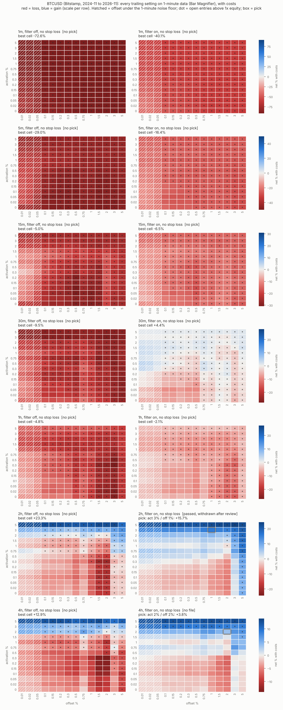
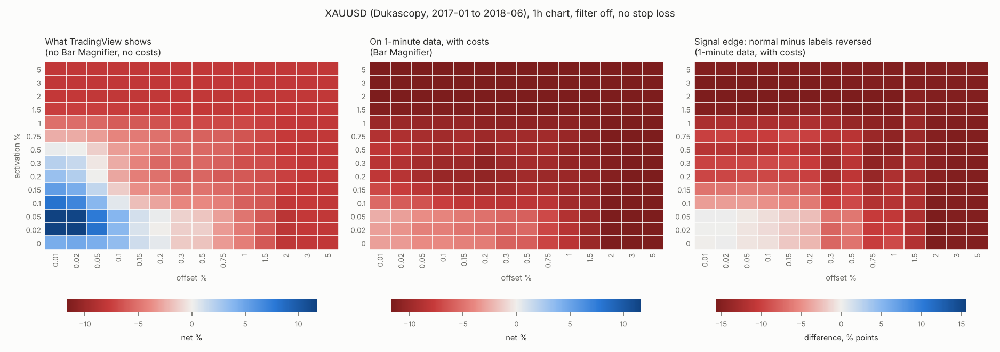

# XPW Orientation TDI v2.8 (trailing TP): results by timeframe

File tested: [`xpw_orientation_tdi_v2.8_strategy_trailtp_FGF.pine`](https://github.com/mreyesllc89-creator/master/blob/claude/exciting-tesla-xk8lqw/xpw_orientation_tdi_v2.8_strategy_trailtp_FGF.pine). With "Enable filter" off it trades exactly like your pasted v2.8 (`xpw_orientation_tdi_v2.8_strategy_trailtp.pine`). With it on, it uses the FlashGold Direction Filter defaults. Every other input is at the file's defaults: trailing TP on, $2.0 activation, $1.0 offset (price units), no stop loss, 10% of equity per entry, up to 20 open entries.

## How it was tested

- **Replica.** A Python replica of the script, built independently twice for each part (the filter, the XPW ladder and labels, the orders and TradingView's broker), then compared trade by trade and audited line by line against the Pine. The two builds agree on every trade. The audit found no code defects.
- **Fills.** Same rules as TradingView's Strategy Tester without Bar Magnifier. Signals fill at the close of the label's candle. Inside a candle, TradingView assumes price goes open → high → low → close when the high is nearer the open, otherwise open → low → high → close.
- **BTCUSD.** Bitstamp 1-minute data, 2024-11-17 to 2026-11-17 (2 years, average price about $89,000).
- **XAUUSD.** Dukascopy 1-minute data, 2017-01-02 to 2018-06-19 (gold near $1,280). This is the most recent gold history available here.
- **Money.** $10,000 start. Each entry is 10% of equity, compounding.
- **Costs** (the bold columns): gold $0.30 per ounce per round trip; BTC 0.02% per side plus $0.20 per round trip. TradingView shows the "no costs" figure, because the script's properties have commission 0 and slippage 0.
- **Control column.** "Labels reversed" is the script with "Reverse every label" on (every buy becomes a sell and vice versa). If the reversed script makes about the same money, the profit does not come from the signals.

## Results

### BTCUSD (2024-11 to 2026-11)

| TF | Filter off: trades | no costs | with costs | win % | PF (costs) | Filter on: trades | no costs | with costs | win % | PF (costs) | Labels reversed, filter off, with costs |
|---|---|---|---|---|---|---|---|---|---|---|---|
| 1m | 63,358 | +249.0% | **-72.7%** | 88 | 0.45 | 22,169 | +49.9% | **-38.6%** | 88 | 0.42 | -73.7% |
| 5m | 23,789 | +288.0% | **+49.0%** | 94 | 1.55 | 8,831 | +59.5% | **+11.8%** | 93 | 1.37 | +39.9% |
| 15m | 11,644 | +261.7% | **+126.4%** | 97 | 3.62 | 4,728 | +66.0% | **+37.2%** | 97 | 3.32 | +124.3% |
| 30m | 6,945 | +196.9% | **+124.5%** | 98 | 5.02 | 2,943 | +58.7% | **+41.0%** | 98 | 4.62 | +130.5% |
| 1h | 3,886 | +143.7% | **+108.4%** | 98 | 6.96 | 1,807 | +50.6% | **+40.0%** | 98 | 5.17 | +126.1% |
| 2h | 1,826 | +87.0% | **+73.8%** | 99 | 9.17 | 849 | +33.5% | **+29.0%** | 99 | 7.00 | +78.1% |
| 4h | 1,094 | +69.1% | **+61.8%** | 99 | 14.01 | 486 | +25.7% | **+23.3%** | 99 | 12.75 | +72.3% |

**These BTC profits are not real, and TradingView will show them too.**

- **Why.** On BTC the default trail ($2 activation, $1 offset) is about 0.002% of the price. A typical 1-minute BTC candle moves about $30 (0.034%), so the trail is about 15-30 times smaller than one candle.
- **What the backtest does with it.** With a trail that small, the backtest exit is decided by the assumed path inside the next candle. That candle almost always rises $2 above a long's entry at some point, so the trail arms. The assumed path then has price fall back, so the long exits $1 under the candle's high. Shorts mirror this and exit $1 above the low.
- **What that produces.**
  - Win rates of 94-99% and profit factors up to 14.
  - The reversed labels make the same money, or more.
  - The 1m chart only loses because its costs are larger.
- **What happens live.** Price moves $1 in a fraction of a second, so the trail is hit almost as soon as it arms. That leaves at most about $1 per trade, which is less than the spread.

### XAUUSD (2017-01 to 2018-06)

| TF | Filter off: trades | no costs | with costs | win % | PF (costs) | Filter on: trades | no costs | with costs | win % | PF (costs) | Labels reversed, filter off, with costs |
|---|---|---|---|---|---|---|---|---|---|---|---|
| 1m | 29,828 | +2.6% | **-49.1%** | 51 | 0.48 | 10,795 | +0.4% | **-22.1%** | 50 | 0.46 | -49.3% |
| 5m | 11,022 | +0.9% | **-22.1%** | 56 | 0.65 | 4,268 | +1.0% | **-8.6%** | 56 | 0.66 | -18.8% |
| 15m | 5,395 | +2.0% | **-10.1%** | 62 | 0.77 | 2,213 | +2.4% | **-2.8%** | 63 | 0.84 | -10.6% |
| 30m | 3,117 | +4.3% | **-3.1%** | 67 | 0.90 | 1,312 | +1.7% | **-1.4%** | 68 | 0.90 | -4.8% |
| 1h | 1,772 | -0.1% | **-4.2%** | 73 | 0.83 | 811 | -1.5% | **-3.4%** | 73 | 0.75 | +2.9% |
| 2h | 855 | +7.1% | **+5.0%** | 84 | 1.49 | 398 | +2.5% | **+1.6%** | 82 | 1.31 | +3.1% |
| 4h | 544 | +4.0% | **+2.6%** | 84 | 1.31 | 247 | +1.6% | **+1.0%** | 81 | 1.24 | +3.1% |

On gold near $1,280, $2 / $1 is 0.16% / 0.08% of the price, a sensible size.

- **1m to 1h.** About break-even before costs, and costs make every one of these timeframes lose.
- **2h and 4h.** Small gains of +5.0% and +2.6% over 18 months. The reversed labels make about the same, so this is not a signal edge either.

### Filter on vs off

The filter removes 53-65% of the entries on both pairs.

- **Where the strategy makes money,** it cuts the profit by at least as much as the trades: BTC 15m goes from +126% to +37%, and gold 2h from +5.0% to +1.6%.
- **Where the strategy loses to costs** (BTC 1m, gold 1m-30m), it loses less, only because it trades less.
- **Overall,** it does not turn any timeframe from losing to winning. This matches the October finding on the S2/S3 version.

## Limits of this test

- **Margin.** Margin calls are not modelled. On gold the default stacks up to 20 open entries, about 2x equity. TradingView, whose v6 default margin is 100%, would cut some of those positions.
- **Lower-timeframe history.** The script reads the 1m and 5m ladder rungs on higher charts. TradingView may only serve the most recent part of that lower-timeframe history. Here it is complete, so very old windows on TradingView can show fewer "<<" entries.
- **FIFO pairing.** TradingView's default FIFO rule can pair a trail exit with an older open entry in its List of Trades. Totals are unaffected; per-trade win rate and PF can differ.
- **Gold data age.** The gold data is from 2017-2018. Gold now trades at several times that price, so fixed dollar distances behave differently today. Distances in percent carry over.

## Every trailing setting on every timeframe

**What was swept.** For each pair, timeframe (1m to 4h) and filter setting (off / on):

- trail activation 0, 0.02, 0.05, 0.1, 0.15, 0.2, 0.3, 0.5, 0.75, 1, 1.5, 2, 3 and 5% of the entry price;
- trail offset 0.01, 0.02, 0.05, 0.1, 0.15, 0.2, 0.3, 0.5, 0.75, 1, 1.5, 2, 3 and 5%;
- stop loss off, or 0.1, 0.25, 0.5, 1, 2 and 4%;
- plus trailing TP off, and your default ($2 / $1).

That is 1,380 settings per cell. Each one was run four ways:

- **Fills:** TradingView's standard backtest, and with exits checked on the 1-minute candles inside each chart candle. The second is what TradingView's Bar Magnifier does and is much closer to live trading.
- **Labels:** as the script gives them, and with every label reversed (the control).

In total 154,560 backtests. Everything below uses 1-minute fills and costs unless it says otherwise. The full grid is in [`trailing_sweep_all.csv.gz`](trailing_sweep_all.csv.gz).

### What it shows

1. **TradingView's standard backtest ranks the tiniest trail first on every timeframe** (activation 0.02%, offset 0.01%) and shows it making +30% to +300%. On 1-minute data with costs, every one of those settings loses. The reason is the same as for your $2 / $1 default above. Don't trust a TradingView result whose trail offset is smaller than a few 1-minute candles. Turn on Bar Magnifier, or use a wider trail.
2. **1m to 1h: no trailing setting makes money after costs** on either pair. The few exceptions (BTC 30m and gold 30m with the filter on) make at most +4.4%, and only with an offset under the 1-minute noise or with positions stacked above 1x equity.
3. **2h and 4h are the only timeframes with a profitable area.**
   - On BTC it is wide trails: activation 3-5% and offset 1-3%. Those hardly ever trigger, so the signals and the filter do the exiting.
   - On gold it is offsets of 0.75% or more.
   - Most of these settings stack open entries above 1x equity, up to 2x. TradingView's default margin of 100% would liquidate part of those positions.
4. **No trailing setting is worth adopting on any timeframe.** Two settings passed the hold-out test (rule below), but a review then refuted both, so neither gets a file (see "Review of the two picks").
   - **BTCUSD 2h, filter on.** The best setting is effectively no trailing take profit at all. With the trail off it makes +18.6% instead of +15.7% for the pick (3% / 1%), and the whole edge is fragile.
   - **XAUUSD 4h.** Nothing usable.
5. **The filter.** On BTC 2h, the filter's closes on blocked opposite signals carry the result: without them +10.2%, and with the filter off +8.6% with a 30% drawdown. Elsewhere it changes how much you lose, not whether you lose.

### By timeframe

"Settings that make money" is the share of the 1,380 settings with a positive result. "Needs over 1x margin" means open entries go above 1x equity at some point.

#### BTCUSD

| TF | Filter | Settings that make money | Best setting (activation / offset) | Needs over 1x margin | TradingView's top setting: TradingView shows / 1-minute data | Your default ($2/$1): TradingView / 1-minute data | Hold-out verdict |
|---|---|---|---|---|---|---|---|
| 1m | off | 0% | 0.02% / 0.01%, SL 0.1%: -71.5% | no | +264.8% / -71.5% | +249.0% / -72.7% | no file |
| 1m | on | 0% | 0.02% / 0.01%, SL 0.1%: -37.2% | no | +53.2% / -37.2% | +49.9% / -38.6% | no file |
| 5m | off | 0% | 0.15% / 0.01%: -29.0% | yes (1.7x) | +299.8% / -29.5% | +288.0% / -33.5% | no file |
| 5m | on | 0% | 0.02% / 0.01%, SL 0.5%: -15.2% | no | +60.7% / -15.6% | +59.5% / -17.3% | no file |
| 15m | off | 0% | 0.3% / 0.01%: -5.0% | yes (2.0x) | +293.5% / -11.8% | +261.7% / -14.6% | no file |
| 15m | on | 0% | 0.1% / 0.01%, SL 0.5%: -6.0% | no | +71.7% / -6.5% | +66.0% / -7.8% | no file |
| 30m | off | 0% | 0.1% / 0.01%, SL 1%: -5.5% | yes (1.1x) | +231.2% / -9.4% | +196.9% / -10.4% | no file |
| 30m | on | 18% | 0.5% / 0.01%: +4.4% | yes (1.6x) | +70.3% / -2.8% | +58.7% / -5.6% | no file |
| 1h | off | 0% | 0.02% / 0.01%, SL 2%: -4.2% | no | +181.9% / -4.2% | +143.7% / -6.6% | no file |
| 1h | on | 0% | 0.3% / 0.01%, SL 2%: -1.6% | no | +61.1% / -4.3% | +50.6% / -5.5% | no file |
| 2h | off | 7% | 5% / 3%: +23.3% | yes (2.0x) | +105.0% / -3.6% | +87.0% / -4.0% | no file (every profitable setting needs over 1x margin) |
| 2h | on | 18% | 5% / 3%: +24.4% | yes (1.2x) | +39.9% / -1.4% | +33.5% / -3.0% | passed (3% / 1%, no SL, +15.7%), **withdrawn after review**: the trail costs money here (trail off +18.6%), and the edge is fragile |
| 4h | off | 3% | 5% / 1.5%: +12.9% | yes (2.0x) | +85.2% / -2.1% | +69.1% / -2.5% | no file (every profitable setting needs over 1x margin) |
| 4h | on | 11% | 5% / 3%: +12.9% | yes (1.2x) | +31.8% / -0.9% | +25.7% / -1.2% | no file (pick 2% / 2%, +3.8%: reversed labels do as well; forward hold-out fails) |

#### XAUUSD

| TF | Filter | Settings that make money | Best setting (activation / offset) | Needs over 1x margin | TradingView's top setting: TradingView shows / 1-minute data | Your default ($2/$1): TradingView / 1-minute data | Hold-out verdict |
|---|---|---|---|---|---|---|---|
| 1m | off | 0% | 0.02% / 0.01%: -43.9% | no | +13.0% / -43.9% | +2.6% / -49.1% | no file |
| 1m | on | 0% | 0% / 0.01%: -19.3% | no | +4.0% / -19.3% | +0.4% / -22.1% | no file |
| 5m | off | 0% | 0.05% / 0.01%: -18.0% | yes (1.1x) | +15.8% / -18.6% | +0.9% / -23.4% | no file |
| 5m | on | 0% | 0.1% / 0.01%, SL 0.25%: -6.6% | no | +6.4% / -7.2% | +1.0% / -9.2% | no file |
| 15m | off | 0% | 0.3% / 0.01%, SL 1%: -6.8% | yes (2.0x) | +17.7% / -9.2% | +2.0% / -12.9% | no file |
| 15m | on | 0% | 1% / 0.01%, SL 1%: -0.3% | yes (1.3x) | +7.9% / -3.0% | +2.4% / -4.4% | no file |
| 30m | off | 0% | 0.3% / 0.01%, SL 1%: -1.3% | yes (1.6x) | +15.7% / -4.9% | +4.3% / -6.9% | no file |
| 30m | on | 37% | 1% / 0.01%, SL 1%: +1.2% | yes (1.4x) | +6.7% / -1.9% | +1.7% / -2.9% | no file |
| 1h | off | 0% | 0.05% / 0.01%, SL 1%: -2.1% | no | +13.9% / -2.9% | -0.1% / -8.8% | no file |
| 1h | on | 0% | 0.05% / 0.01%, SL 1%: -0.5% | no | +7.1% / -0.8% | -1.5% / -5.5% | no file |
| 2h | off | 55% | 0.75% / 1.5%: +8.7% | yes (2.0x) | +14.6% / +6.7% | +7.1% / +0.2% | no file (within 1x margin, only isolated settings are positive in both halves: no plateau) |
| 2h | on | 64% | 0.75% / 1.5%: +3.1% | yes (1.3x) | +6.0% / +2.4% | +2.5% / -0.3% | no file (pick 0.5% / 0.75%, SL 0.5%, +2.2%: both hold-outs fail) |
| 4h | off | 60% | 0.02% / 1.5%, SL 2%: +5.5% | yes (1.2x) | +10.8% / +0.0% | +4.0% / -1.9% | passed (0.75% / 0.05%, SL 0.5%, +1.65%), **withdrawn after review**: not significant, carried by 2018 |
| 4h | on | 48% | 0.75% / 1.5%, SL 2%: +1.7% | no | +4.8% / +0.1% | +1.6% / -1.1% | no file (pick 0.75% / 0.05%, SL 0.5%, +1.1%: both hold-outs fail) |

The gold percentages carry over to today's prices; dollar distances do not. At gold near $4,000, for example, 0.75% is $30.

### Heatmaps

Each panel shows activation (up) against offset (across), coloured by net % with costs on 1-minute data. Hatched cells have an offset under the 1-minute noise; a dot means open entries went above 1x equity; the box is the pick.

What TradingView shows against 1-minute data, and the signal edge (normal minus reversed labels), on the 1h chart with the filter off:

On 1h, reversing every label does better than the labels themselves, for almost every trailing setting on both pairs.

### The rule (rule T)

The same rule was applied to every pair, timeframe and filter setting.

- **Pool.**
  - Offsets of at least twice the median 1-minute candle range (BTC 0.1%, gold 0.05%). Below that, even 1-minute data decides the exit.
  - Open entries never above 1x equity.
  - Settings with identical results count once.
- **Pick.**
  - Candidates: settings positive in both halves of the window, with 30+ trades in each half. Each half is scored from a fresh $10,000.
  - Take the 40 best by their worse half. Score each as 0.5 x its worse half + 0.5 x the mean worse half of its grid neighbours (at least 5 neighbours, positive mean).
  - The best score is the pick.
- **A file is published only if all of these pass:**
  1. **Forward.** The 40 best settings chosen on the first half beat 95% of random 40-setting draws on the second half, and are 60%+ positive there with a positive mean.
  2. **Reverse.** The 40 best chosen on the second half beat 95% of random draws on the first half.
  3. **Signal control.** The pick beats the same setting with every label reversed, in both halves.
  4. **Stressed costs.** It stays positive (BTC 0.035% per side + $0.20 + 1 tick per side; gold $0.50 + 1 tick per side).

### Review of the two picks

Two independent sceptics re-ran each pick with a separate 1-minute reference and reproduced every trade exactly. An auditor re-implemented the rule and got the same verdicts in all 28 cells. Both picks were refuted.

**BTCUSD 2h, filter on, activation 3%, offset 1%, no stop loss (+15.7%, PF 1.20)**

- **The trail does not help.** Trail off makes +18.6%, and is better in both halves. Capped at 10 open entries (the same exposure as the pick), trail off makes +20.6%.
  - The 144 trades the trail closed would each have made 0.24% more if held.
  - The grid is a ramp toward "never trail": activation 2% about +7%, 3% about +15%, 5% about +22%. The pick won only because it is the least-trailing setting that stays within 1x margin.
- **Where the profit does come from.** The signals and the filter's closes on blocked opposite signals. Without those closes: +10.2%. Filter off: +8.6% with a 30% drawdown.
- **That edge is fragile.**
  - Starting 1, 2 or 3 months later gives +13.8%, +6.9% and +2.8%.
  - Without the 10 best entry days: +0.7%.
  - Shorts make +13.6%; longs make +1.9%.
  - Trades entered from March 2025 to August 2026 lose money.
  - Statistically it is not distinguishable from zero (t = 1.24; 11% chance the true total is at or below 0).
- **What TradingView would show.** +24.2% without Bar Magnifier and costs. Its own top settings show +38-40% and all lose on 1-minute data.

**XAUUSD 4h, filter off, activation 0.75%, offset 0.05%, stop loss 0.5% (+1.65%, PF 1.12)**

- **Not significant.** t = 1.0-1.3; 16% chance the true total is at or below 0.
- **Concentrated.** 2018 carries +1.50 of the +1.65, and 2017 makes +0.14 in 12 months. Without the 10 best entry days it loses.
- **Thin against costs.** Break-even is 1.28x the cost; at 2x the cost it makes +0.36%.
- **It doesn't hold up.** Starting 2 or 3 months later, the first half turns negative. The trail adds only 0.48 points over trail off and acts like a fixed take profit near +0.75%.
- **It is borderline under the rule too.** It fails under several equally reasonable readings: a stricter random baseline, the reverse hold-out's own mean (-0.29%), or stressed costs required positive in each half.

**About the rule.** The hold-out tests measure whether a ranking of exits persists from one half to the other. They also pass on reversed labels in several cells, so only the label-reversal control tests the signals. The pick itself uses both halves, so its figures are in-sample: picking on the second half and scoring on the first loses money in both cells.

### Limits

- The windows are short: 2 years of BTC in a strong market, 18 months of gold in 2017-2018.
- On BTC 2h and 4h the best results come from wide or no trailing with fewer open entries: trail off capped at 10 open entries made +20.6% on BTC 2h. That variant was not put through the hold-out rule. It inherits the same fragility (dates, shorts, a few days).
- 1-minute fills still assume a path inside each 1-minute candle, so offsets near the noise floor remain slightly optimistic.
