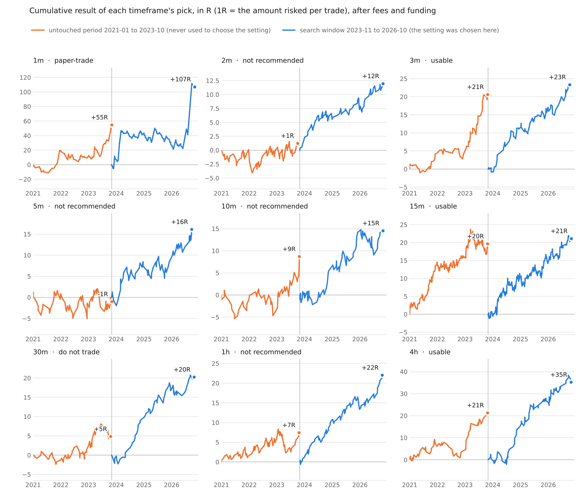
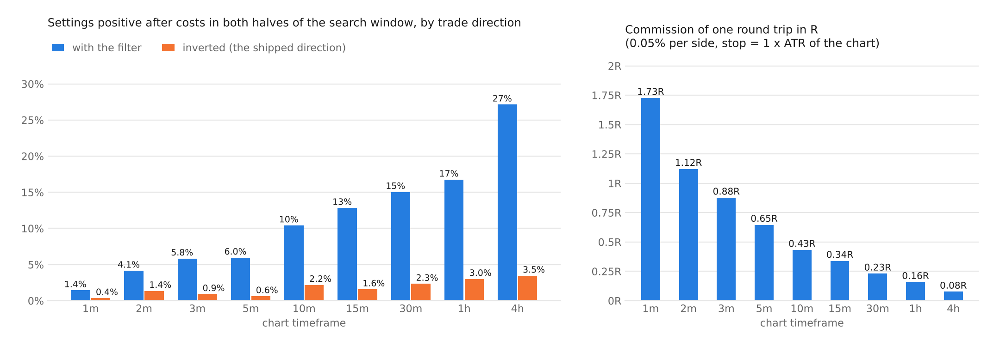

# AMVI strategy on BTCUSDT: every chart timeframe, the trailing stop and the inputs

Date: 2026-11-26. Script: `AMVI_FGF_Inverted_XAUUSD_15m.pine` (closed-candle engine). Market:
BTCUSDT perpetual. Chart timeframes: 1m, 2m, 3m, 5m, 10m, 15m, 30m, 1h, 4h.

110,000 input combinations were backtested over the last three years, each with its stops,
targets and trailing stops filled on the real second-by-second prices; the best were then
tested on the three years before that, which no search had seen. Nothing here ran on
TradingView: the numbers come from a Python copy of the script, checked against two
independent re-implementations of the Pine source and a third of its filter. A calibrated
`.pine` file is in `presets/` for the four timeframes whose pick held up on the older years,
each with its verdict in the title.

## 1. Short version

1. **The file as you run it loses on BTC on every timeframe.** Its inputs were calibrated for
   gold on 15m and it trades against the filter ("Inverted"). On BTCUSDT that lost on all
   nine charts in both periods: from -98R on 4h to -597R on 1m over the last three years, and
   from -36R to -616R on 2021-2023. (1R = the amount risked on one trade.)

2. **Trade with the filter, not against it.** This is the one finding that holds everywhere.
   Among settings that trade with the filter, 4% (1m) to 53% (4h) made money over the last
   three years; among inverted ones 1% to 11%. On 2021-2023, which no search saw: 10% to 83%
   against 2% to 16%. Set **Trade direction** to "Follow the filter"; every pick below does.

3. **No timeframe earned RECOMMENDED. Three files are USABLE (4h, 15m, 3m) and one is
   PAPER-TRADE (1m).** On 1h, 30m, 10m, 5m and 2m the best candidate did not hold up on the
   older data, and no file was written for them.

| Chart | Verdict | On 2021-2023, which it was not chosen on | Last three years, where it was chosen | File |
|---|---|---|---|---|
| 4h | USABLE | +21.4R in 69 trades | +35.2R in 100 trades | `AMVI_FGF_BTCUSDT_4h.pine` |
| 1h | NOT RECOMMENDED | +7.5R in 98 trades, positive in 86% of resamples | +22.0R in 101 trades | none |
| 30m | DO NOT TRADE | +4.8R in 68 trades, positive in 77% of resamples | +20.2R in 74 trades | none |
| 15m | USABLE | +19.7R in 232 trades | +21.1R in 284 trades | `AMVI_FGF_BTCUSDT_15m.pine` |
| 10m | NOT RECOMMENDED | +8.7R in 65 trades, positive in 81% of resamples | +14.5R in 85 trades | none |
| 5m | NOT RECOMMENDED | -1.0R in 70 trades | +16.1R in 68 trades | none |
| 3m | USABLE | +20.6R in 72 trades | +23.4R in 79 trades | `AMVI_FGF_BTCUSDT_3m.pine` |
| 2m | NOT RECOMMENDED | +1.3R in 108 trades (-3.4R at stressed costs) | +12.0R in 97 trades | none |
| 1m | PAPER-TRADE | +54.8R in 93 trades, positive in 93% of resamples | +107.1R in 145 trades | `AMVI_FGF_BTCUSDT_1m.pine` |

4. **Expect little.** The three USABLE picks each made about +20R on 2021-2023 and +21R to
   +35R on the last three years: +10% to +18% in three years at the files' 0.5% risk per
   trade, with drawdowns of 1.4% to 4%. They trade two to eight times a month. The 1m file
   made more (+55R and +107R) with about one winner in five trades and drawdowns of 15R to
   29R; its older result rests on fewer good weeks, hence PAPER-TRADE.

5. **Fine-tuning does not carry; the direction does.** Inside the last three years none of
   the 27 hold-out tests passes: the best settings of one part made about nothing on the
   other part, and in the most recent year settings chosen on the two years before it landed
   between -6R and +6R. What does carry is the family: the candidates of the last three years
   made money as a group on 2021-2023 on 8 of 9 charts. That period had bigger moves and
   longer trends, so commission weighed less. Read the strategy as a trend-following filter
   that pays in trending years and roughly breaks even in choppy ones.

6. **Which charts got a file is partly the luck of one pick.** On 1h, 10m, 5m and 2m the 25
   candidates did well as a group on the older data (72% to 92% of them positive), but the
   one candidate the rule had chosen did not clear the bar. I did not swap picks after seeing
   that: it would be choosing with hindsight.

7. **Filter timeframe: 4h or 1D. Not the chart's own low timeframe, and not seconds.** On
   every chart below 4h a filter several steps above the chart beats a fast one, before fees
   too. The 1-second filter in your screenshot could not be tested (there is no seconds
   history), and with a no-trade band 1.6 USD wide it flips on almost every tick.

8. **Trailing stop: leave it off.** I ran 200 to 300 settings per chart with the trailing
   stop off and with each of the 42 activation / offset pairs, nothing else changed. On 4h it
   makes no difference (14.7% of the settings positive in both halves without it, 14.2% with
   a typical pair). On every chart below 4h it makes them worse: 8 of 336 pairs came out
   above "off", and the shipped pair (1.5 / 1.0 ATR) roughly halves the share of profitable
   settings. **TradingView's tester will tell you the opposite.** It walks the chart's
   candles, which lets a tight trailing stop exit near the best price of every candle. Tested
   that way, 49% of the 4h settings with a 0.5 / 0.5 ATR trailing stop look profitable in both
   halves; on the real second-by-second prices 4% are.

9. **Fees decide the low timeframes.** With a stop of 1 x ATR, the commission of one round
   trip is 0.08R on 4h, 0.34R on 15m, 0.65R on 5m and 1.73R on 1m. Below 15m the typical
   with-the-filter setting loses heavily; the low-timeframe picks survive only by trading
   rarely with a wide stop.

10. **The other inputs mostly change how often it trades, not how well.** Before fees,
    target, time stop, band and High Vol level all land within a few points of each other,
    and stop size matters mostly through commission. After fees the versions that trade less
    look better. Tight targets (1 to 2 ATR) and short time stops are the two things that
    reliably cost money.

**What I would do.** Forward-test the 4h or the 15m file on TradingView with alerts only (your
lab is testnet-only anyway), Script executions on "On bar close", for a few weeks, and compare
its List of Trades with `results/trades_BTCUSDT_4h.csv`. Until that matches, treat every
number here as unverified on TradingView. Do not run the 1-second filter or the inverted
direction on BTC.

**Why this could fail.** The edge is trend following: it disappears in choppy markets, and in
the most recent year settings chosen on earlier data made nothing. The support comes from
2021-2023, a period of unusually long trends. Each file has 70 to 280 trades per three
years: a few trades decide a year. The data is Binance, your chart is Bitget. And nothing
here has run on TradingView itself.





## 2. What was run, and how faithfully

**The strategy.** `AMVI_FGF_Inverted_XAUUSD_15m.pine` in its closed-candle version (one decision
per candle at its close, fill at the next open: the version from earlier today). TradingView
does not run in this environment, so the script was rebuilt in Python
(`tools/amvi_engine.py`): the AMVI trigger on every enabled timeframe, the FlashGold direction
filter (signal, zones, band, permission), and the orders (reversal, ATR stop, target, trailing
stop, volatility exit, time stop, wait). It was checked four ways:

- two more copies were written independently from the Pine source; the engine agrees with
  them bar for bar on the signals and trade for trade on the orders, on 72 + 72 random
  settings (`results/checks/difftest_*.txt`) and on the picks themselves
  (`results/checks/replicate_picks.txt`);
- a third, literal statement-by-statement copy of the filter agreed on 49.8 million chart bars;
- 8 hand-computed order scenarios (`tools/test_orders.py`);
- a look-ahead test: no decision reads a candle that has not closed.

It has **not** been compared with TradingView itself, and the Pine files were not compiled
there. Before relying on any number, load the file and compare the Strategy Tester's List of
Trades with `results/trades_BTCUSDT_<tf>.csv`.

**Data.** Binance BTCUSDT perpetual from the exchange's public archive: 1-minute candles
2020-01 to 2026-10, and every trade 2021-01 to 2026-10 (file checksums verified) reduced to
one-second bars (180 million of them; 99.996% of all minutes have their seconds,
`results/checks/seconds_coverage.txt`). Funding: Binance's 8-hourly rates. 367 minutes in which
the exchange did not trade are not candles, as on TradingView. Your chart is Bitget's
BTCUSDT.P: the same market, a few dollars apart, with its own wicks and funding.

**Order fills.** Market orders fill at the next candle's open, 1 tick against you. Stops, targets and
trailing stops are followed **second by second** through the real trades. A coarser path
flatters a trailing stop: it assumes price ran straight to the candle's high and only then
came back (section 5). TradingView's Strategy Tester walks the chart's own candles unless Bar
Magnifier is on, so its trailing-stop results are the most flattering of all.

**Costs.** Base: 0.05% commission per side, 1 tick slippage on market and stop fills, funding
(your crypto lab's rule). Stress: 0.10% per side and 3 ticks. Bitget's standard taker fee of
0.06% is shown for every pick, and the calibrated files ship with 0.06%.

**Results are in R.** 1R = the amount risked on one trade (stop distance x position size).
With the files' Risk 0.5% sizing, 1R = 0.5% of the account: +20R is about +10%. Where a stop
is so tight that 0.5% risk would need more than 5x leverage, the files' 5x cap makes the
position smaller; the per-timeframe sections give the result in % with that cap applied.

**Timeframes.** Chart: 1m, 2m, 3m, 5m, 10m, 15m, 30m, 1h, 4h. AMVI timeframes and filter
timeframe: 1m, 5m, 15m, 30m, 1h, 4h, 1D, with two restrictions so that a result can be
replayed on TradingView:

- a timeframe at or above the chart must be a whole multiple of it (15m on a 10m chart reads
  a different candle live than after a reload);
- a timeframe below the chart must be at least 15m (TradingView keeps about 100,000 intrabars
  per request: 69 days of 1m, 347 days of 5m). In an earlier run without this rule, settings
  that used 1m or 5m under a higher chart were profitable about half as often
  (`results/first_run_low_timeframes.txt`).

Seconds timeframes (1s to 45s) are off everywhere: there is no long seconds history of the
indicator to test them on.

**Inputs searched.** Everything that changes a trade: AMVI periods (fast and slow ATR, StdDev,
candle range, normalisation), the four weights (five presets), High Vol level, which
timeframes are on and how many must be hot, trade direction (with the filter / inverted),
filter timeframe, level mode and entry distance, band, trades against the signal, allowed
side, burst and zone rules, drift filter, parent timeframe, minimum aligned zones, TDI
lengths, permission (until next signal / n candles), check price on, stop, target, trailing
stop with activation and offset, volatility exit and Low Vol level, time stop, exit ATR
length, and candles to wait after an entry. Sizing inputs do not change a result in R and were
set to your lab's limits (0.5% risk, 5x leverage cap). Display inputs were left alone.

## 3. How a setting was judged

1. **Random search.** 110,000 settings in total (16,000 per chart on 4h, 1h, 30m and 15m,
   12,000 on 10m and 5m, 8,000 on 3m and 2m, 6,000 on 1m), each backtested over the search
   window 2023-11-01 to 2026-10-31.
2. **Hold-out tests inside the window.** Take the 40 steadiest settings of the first half and
   score them on the second half, which they have never seen; the same the other way round;
   and the best of the first two years on the third. A test passes when those 40 are positive
   on average, beat 95% of random groups of 40, and stay positive in 95% of resamples of the
   months. If the best of one half are not good on the other, "the best setting" is the
   luckiest of thousands, not a find.
3. **Candidates and the pick.** Settings positive in both halves at base and stressed costs
   are candidates. For the 20 steadiest, every numeric input is moved one step, one at a time.
   The pick is the candidate with the largest share of neighbours still positive in both
   halves (ties: the steadier neighbourhood). This screens out settings that hang on one
   input's exact value. It does not screen out luck: neighbours take mostly the same trades,
   and a lucky candidate passes it about nine times in ten.
4. **The untouched period.** 2021-01-01 to 2023-10-31 (the 2021 top, the May 2021 crash, the
   2022 bear market, FTX) was not used to find or choose anything. Each pick is run on it
   once. Separately, the candidates of a timeframe are compared there with 400 random
   settings, and with random settings of their own trade direction: does choosing on the
   search window help on data it never saw, and does it help beyond choosing the direction?
5. **Luck-only benchmark.** The same counts are repeated in 1,000 shuffled worlds per
   timeframe in which no setting has an edge (`tools/luck.py`). They show how many "winners"
   chance alone produces, what a pick looks like when nothing is there, and how often chance
   would earn each verdict.
6. **Verdict** (`tools/report.py`). "Holds up on the untouched period" = positive there at base
   and at stressed costs with at least 50 trades, and not fragile.

   | Verdict | Means | Luck alone earns it or better |
   |---|---|---|
   | RECOMMENDED | holds up on the untouched period, that result stays positive in 95% of resamples of its weeks, and all four hold-out tests pass | never in 9,000 shuffled worlds |
   | USABLE | holds up, positive in 95% of resamples, and at least one hold-out test passes | 0.1% to 1.1% of timeframes |
   | PAPER-TRADE | holds up and is positive in 90% of resamples, but the hold-out tests fail: watch it, do not fund it | 4.6% to 7.3% of timeframes |
   | NOT RECOMMENDED | the search shows more than luck would, but the pick does not hold up on the untouched period | |
   | DO NOT TRADE | the search found no more winners than luck would, and the best candidate does not hold up | |

   A calibrated file is written only for PAPER-TRADE and better: a file is an invitation to
   trade. The rules were tightened after an independent statistics review and before the
   final run. The first version gave PAPER-TRADE to a setting with no edge about one time in
   three; the review measured that in shuffled worlds, and the last column is the same
   measurement for the final rules. RECOMMENDED is strict on purpose: a moderate real edge
   would rarely reach it in three years of data.

## 4. Results

### 4.1 The pick of each timeframe

The pick of each timeframe. Net of 0.05% per side, 1 tick slippage and funding. R = amount risked per trade. The untouched period comes
first because the pick was not chosen on it; the search-window figure is the best of thousands of settings and is flattered by that choice.

| Chart | Verdict | Untouched 2021-01 to 2023-10 (not chosen on it) | Stressed costs | Positive in resamples of its weeks | Search window 2023-11 to 2026-10 (chosen here) | Halves | File |
|---|---|---|---|---|---|---|---|
| 1m | PAPER-TRADE | +54.8R, 93 trades, PF 1.75, DD 15.2R | +49.0R | 93% | +107.1R, 145 trades, PF 1.83, DD 29.2R | +50.2 / +56.9R | `presets/AMVI_FGF_BTCUSDT_1m.pine` |
| 2m | NOT RECOMMENDED | +1.3R, 108 trades, PF 1.05, DD 4.2R | -3.4R | 60% | +12.0R, 97 trades, PF 1.81, DD 2.6R | +6.5 / +5.5R | none |
| 3m | USABLE | +20.6R, 72 trades, PF 2.56, DD 2.9R | +16.9R | 100% | +23.4R, 79 trades, PF 2.13, DD 2.9R | +11.3 / +12.0R | `presets/AMVI_FGF_BTCUSDT_3m.pine` |
| 5m | NOT RECOMMENDED | -1.0R, 70 trades, PF 0.98, DD 6.7R | -4.8R | 45% | +16.1R, 68 trades, PF 1.51, DD 5.2R | +7.1 / +9.1R | none |
| 10m | NOT RECOMMENDED | +8.7R, 65 trades, PF 1.31, DD 6.4R | +6.0R | 81% | +14.5R, 85 trades, PF 1.44, DD 5.7R | +7.3 / +7.2R | none |
| 15m | USABLE | +19.7R, 232 trades, PF 1.41, DD 7.0R | +14.7R | 99% | +21.1R, 284 trades, PF 1.35, DD 3.7R | +10.7 / +10.4R | `presets/AMVI_FGF_BTCUSDT_15m.pine` |
| 30m | DO NOT TRADE | +4.8R, 68 trades, PF 1.22, DD 3.8R | +3.1R | 77% | +20.2R, 74 trades, PF 2.22, DD 3.3R | +12.3 / +8.0R | none |
| 1h | NOT RECOMMENDED | +7.5R, 98 trades, PF 1.29, DD 6.0R | +3.8R | 86% | +22.0R, 101 trades, PF 2.32, DD 3.2R | +11.1 / +10.9R | none |
| 4h | USABLE | +21.4R, 69 trades, PF 1.71, DD 8.3R | +18.9R | 98% | +35.2R, 100 trades, PF 1.84, DD 5.7R | +22.4 / +12.9R | `presets/AMVI_FGF_BTCUSDT_4h.pine` |

### 4.2 What the search itself says

Best 40 = the 40 steadiest settings of one part of the data, scored on another part. A test passes when their mean is positive,
above 95% of random groups of 40, and stays positive in 95% of resamples of the months. Being positive is the hard part: random
settings mostly bleed commission, so beating them is easy.

| Chart | Settings tried | Positive before costs | Positive after costs | Positive in both halves | First half -> second (best 40) | Second -> first | Walk-forward | Search window -> untouched period (candidates) |
|---|---|---|---|---|---|---|---|---|
| 1m | 6,000 | 58% | 2% | 0.9% | -9.9R, 25% positive, months 22% (fail) | -0.3R, 50% positive, months 46% (fail) | -3.2R, 38% positive, months 38% (fail) | +60.3R, 83% positive, months 97% (pass); random settings of the same direction -1438.1R (beaten) |
| 2m | 8,000 | 51% | 6% | 2.8% | -3.7R, 48% positive, months 25% (fail) | +10.6R, 52% positive, months 87% (fail) | +6.2R, 62% positive, months 77% (fail) | +54.0R, 72% positive, months 96% (pass); random settings of the same direction -50.2R (beaten) |
| 3m | 8,000 | 52% | 6% | 3.3% | -5.0R, 40% positive, months 12% (fail) | +3.3R, 60% positive, months 61% (fail) | -1.1R, 50% positive, months 35% (fail) | +18.6R, 80% positive, months 99% (pass); random settings of the same direction -72.3R (beaten) |
| 5m | 12,000 | 54% | 7% | 3.2% | -6.2R, 32% positive, months 16% (fail) | +9.4R, 55% positive, months 80% (fail) | -4.5R, 32% positive, months 22% (fail) | +27.0R, 76% positive, months 99% (pass); random settings of the same direction -150.2R (beaten) |
| 10m | 12,000 | 51% | 13% | 6.3% | -4.3R, 35% positive, months 3% (fail) | +1.1R, 50% positive, months 56% (fail) | +0.7R, 48% positive, months 59% (fail) | +25.3R, 80% positive, months 100% (pass); random settings of the same direction -19.8R (beaten) |
| 15m | 16,000 | 49% | 15% | 7.1% | -5.5R, 28% positive, months 11% (fail) | -3.3R, 40% positive, months 9% (fail) | -2.8R, 32% positive, months 18% (fail) | +14.7R, 84% positive, months 100% (pass); random settings of the same direction -16.1R (beaten) |
| 30m | 16,000 | 50% | 19% | 8.6% | -5.0R, 42% positive, months 20% (fail) | +2.2R, 57% positive, months 80% (fail) | -6.3R, 35% positive, months 20% (fail) | +12.1R, 84% positive, months 93% (fail); random settings of the same direction -8.6R (not beaten) |
| 1h | 16,000 | 51% | 23% | 9.9% | -2.0R, 45% positive, months 37% (fail) | +0.9R, 55% positive, months 79% (fail) | -2.8R, 32% positive, months 26% (fail) | +17.1R, 92% positive, months 100% (pass); random settings of the same direction +4.7R (beaten) |
| 4h | 16,000 | 50% | 32% | 15.3% | -3.6R, 30% positive, months 17% (fail) | -1.1R, 45% positive, months 16% (fail) | -2.6R, 35% positive, months 31% (fail) | +12.5R, 68% positive, months 97% (pass); random settings of the same direction +11.9R (not beaten) |

**None of the 27 hold-out tests inside the last three years passes.** The 40 steadiest
settings of one part made between -10R and +11R on the other part: around zero. They do far
better than random settings, which lose from 4R on 4h to more than 700R on 1m, but "less bad
than random" is not a profit. The walk-forward column is the most recent year, scored with settings chosen on the
two years before it: between -6R and +6R on every chart.

**The last column does pass, on 8 of 9 charts.** The candidates of the whole three years, run
on the older years they never saw, made money as a group: +12R to +60R on average, 68% to
92% of them positive. On 30m the same result misses the bar by a hair (93% of resamples
instead of 95%). On the low timeframes they beat random settings of their own direction by a
wide margin, but mostly because random settings there are eaten by commission; on 4h, where
commission is small, the candidates do no better than a random with-the-filter setting
(+12.5R against +11.9R). The direction is the find, not the fine-tuning.

### 4.3 The two trade directions on data the search never saw

400 random settings of the search per timeframe (at least 30 trades in each half of the search window), run over the untouched
period 2021-01 to 2023-10 and split by trade direction; then the same split on the search window for all settings of the search.
"Positive" = net result above zero over the whole period after 0.05% per side, 1 tick and funding. The last two columns:
positive in both halves of the search window, after costs / before costs.

| Chart | Untouched: with the filter positive | Median | Untouched: inverted positive | Median | Search window: with the filter positive | Median | Inverted positive | Median | Both halves, with the filter | Both halves, inverted |
|---|---|---|---|---|---|---|---|---|---|---|
| 1m | 10% of 202 | -134.5R | 2% of 198 | -181.1R | 4% | -241.3R | 1% | -292.3R | 1.4% / 38.3% | 0.4% / 33.0% |
| 2m | 16% of 198 | -28.4R | 11% of 202 | -28.0R | 8% | -45.0R | 3% | -48.1R | 4.1% / 30.6% | 1.4% / 23.1% |
| 3m | 15% of 202 | -26.3R | 10% of 198 | -34.6R | 11% | -41.1R | 2% | -60.4R | 5.8% / 41.9% | 0.9% / 19.0% |
| 5m | 26% of 184 | -24.0R | 6% of 216 | -55.6R | 13% | -47.3R | 2% | -76.7R | 6.0% / 48.0% | 0.6% / 16.1% |
| 10m | 30% of 212 | -9.6R | 16% of 188 | -15.8R | 21% | -15.1R | 6% | -29.0R | 10.4% / 41.0% | 2.2% / 13.7% |
| 15m | 43% of 208 | -3.4R | 9% of 192 | -25.1R | 25% | -12.7R | 5% | -34.7R | 12.8% / 47.7% | 1.6% / 12.0% |
| 30m | 55% of 199 | +1.4R | 10% of 201 | -28.3R | 31% | -7.9R | 7% | -29.8R | 15.0% / 48.3% | 2.3% / 11.9% |
| 1h | 66% of 210 | +5.1R | 4% of 190 | -26.0R | 37% | -4.4R | 8% | -24.7R | 16.7% / 47.0% | 3.0% / 10.7% |
| 4h | 83% of 203 | +8.1R | 10% of 197 | -14.1R | 53% | +0.7R | 11% | -12.6R | 27.1% / 47.7% | 3.5% / 8.2% |

**With the filter is the better side in both periods, on every chart.** The share of
with-the-filter settings that made money rises with the timeframe, because commission weighs
less: from 4% on 1m to 53% on 4h in the last three years, from 10% to 83% on 2021-2023. The
inverted direction, which the shipped file uses, stays between 1% and 16% everywhere. Before
costs the gap is as wide (last column), so it is not a commission effect.

**2021-2023 was the kinder period.** On every chart more with-the-filter settings made money
then than in the last three years (4h: 83% against 53%; 15m: 43% against 25%). The market
moved more per candle, so the same commission cost less in R (section 4.6), and trends ran
further. A result on that period is real evidence, but it flatters what the same file would
have done since.

### 4.4 Is there more here than luck?

The same counts in 1,000 no-skill worlds per timeframe: the months of the real search drawn at random, each month's result of all
settings flipped by one coin toss, so that no setting has an edge before costs while fees, trade counts and the likeness between
settings stay real. A real count inside the luck-only range is no evidence of an edge.

| Chart | Positive in both halves: real | Luck alone (5% to 95% of worlds) | Worlds with at least as many | Candidates: real | Luck alone | Worlds with at least as many | With the filter minus inverted: real | Luck alone | Worlds with a gap this large |
|---|---|---|---|---|---|---|---|---|---|
| 1m | 0.9% | 0.5% (0.2 to 1.1%) | 10% | 12 | 5 (1 to 20) | 17% | +1.1 points | -0.5 to +1.1 | 6% |
| 2m | 2.8% | 1.4% (0.6 to 2.7%) | 4% | 39 | 13 (3 to 37) | 5% | +2.8 points | -1.7 to +1.9 | 3% |
| 3m | 3.3% | 1.6% (0.7 to 2.9%) | 2% | 52 | 18 (6 to 44) | 2% | +5.0 points | -1.8 to +2.8 | 0% |
| 5m | 3.2% | 1.6% (0.8 to 3.2%) | 5% | 79 | 32 (12 to 88) | 7% | +5.3 points | -2.1 to +3.1 | 1% |
| 10m | 6.3% | 4.1% (2.2 to 7.1%) | 10% | 115 | 66 (27 to 152) | 12% | +8.4 points | -6.1 to +7.4 | 5% |
| 15m | 7.1% | 4.2% (2.3 to 7.1%) | 5% | 221 | 111 (49 to 236) | 7% | +11.3 points | -6.3 to +7.6 | 2% |
| 30m | 8.6% | 5.4% (3.2 to 8.9%) | 7% | 302 | 167 (82 to 341) | 9% | +12.9 points | -8.1 to +9.7 | 2% |
| 1h | 9.9% | 7.1% (4.0 to 11.9%) | 15% | 423 | 262 (128 to 526) | 14% | +14.0 points | -10.3 to +13.6 | 6% |
| 4h | 15.3% | 11.9% (7.0 to 19.3%) | 20% | 751 | 551 (291 to 1074) | 22% | +23.8 points | -23.0 to +25.6 | 11% |

What a pick is worth when nothing is there: the steadiest candidate of each no-skill world, and how often luck alone meets the
conditions of each verdict (plateau leg taken as passed, months standing in for weeks).

| Chart | Luck's pick on the search window (median, 95th percentile) | Luck's pick on fresh months | Positive on fresh months | At base and stressed costs with 50+ trades | Luck passes at least one hold-out test | Luck earns PAPER-TRADE or better | USABLE or better | RECOMMENDED |
|---|---|---|---|---|---|---|---|---|
| 1m | +65.4R, +365.5R | -12.1R | 33% | 20% | 2.9% | 6.5% | 1.1% | 0.0% |
| 2m | +52.2R, +236.4R | -9.0R | 32% | 20% | 3.4% | 4.9% | 0.6% | 0.0% |
| 3m | +45.3R, +180.9R | -7.9R | 33% | 21% | 3.3% | 4.9% | 0.3% | 0.0% |
| 5m | +36.1R, +152.0R | -8.4R | 28% | 17% | 3.1% | 4.8% | 0.1% | 0.0% |
| 10m | +31.0R, +122.8R | -5.1R | 32% | 20% | 3.7% | 5.4% | 0.2% | 0.0% |
| 15m | +28.9R, +95.4R | -4.6R | 33% | 21% | 3.3% | 5.1% | 0.4% | 0.0% |
| 30m | +28.4R, +103.0R | -4.9R | 32% | 20% | 3.4% | 4.6% | 0.7% | 0.0% |
| 1h | +27.3R, +88.7R | -3.9R | 34% | 22% | 5.2% | 5.2% | 0.3% | 0.0% |
| 4h | +24.3R, +74.7R | -2.7R | 36% | 27% | 6.4% | 7.3% | 0.7% | 0.0% |

Inside the search window the share of settings positive in both halves sits above what luck
typically produces (1.3 to 2.1 times the luck-only median) but mostly inside its range: on 4h
and 1h one no-skill world in five to seven finds as many winners. Only on 3m, 2m, 5m and 15m
is it at or beyond the 95% mark. The direction gap is clearer: on 2m, 3m, 5m, 15m and 30m
fewer than 5% of the no-skill worlds show a gap this large, on 10m, 1h and 1m about 5% to 6%,
on 4h 11%.

The second table is the yardstick for the verdicts. When nothing is there, the pick still
shows +24R to +65R on the search window (it was chosen for that) and loses on fresh months.
It is positive on fresh months one time in three, which is why "positive on the untouched
period" alone proves little. With the final rules luck earns PAPER-TRADE or better on about
5% to 7% of timeframes, USABLE on 0.1% to 1.1%, RECOMMENDED never in 9,000 worlds. Over
nine timeframes that is roughly a 40% chance of at least one PAPER-TRADE from luck alone, and
roughly 4% of at least one USABLE. Three USABLE files are not a coin-toss result. But the
coin-toss worlds have no good and bad years, and the real market does (section 4.3): the
test says the older period really paid, not that the next one will.

### 4.5 The file as shipped (your current inputs) on BTCUSDT

The inputs of AMVI_FGF_Inverted_XAUUSD_15m.pine unchanged (calibrated for gold on 15m), run on each BTC chart timeframe.
On the 2m and 10m charts the 15m AMVI does not line up with the chart's candles; the numbers there are what a reloaded chart shows.

| Chart | Search window (2023-11 to 2026-10) | Stressed costs | Untouched 2021-01 to 2023-10 |
|---|---|---|---|
| 1m | -597.0R, 726 trades, PF 0.52, DD 686.9R | -1187.4R | -616.0R, 674 trades, PF 0.40 |
| 2m | -507.2R, 742 trades, PF 0.54, DD 541.6R | -946.0R | -376.1R, 652 trades, PF 0.57 |
| 3m | -420.7R, 754 trades, PF 0.60, DD 453.1R | -794.4R | -376.1R, 657 trades, PF 0.56 |
| 5m | -294.8R, 755 trades, PF 0.69, DD 372.4R | -598.3R | -372.4R, 688 trades, PF 0.56 |
| 10m | -214.8R, 561 trades, PF 0.68, DD 285.6R | -394.8R | -35.7R, 527 trades, PF 0.94 |
| 15m | -188.7R, 597 trades, PF 0.72, DD 244.6R | -338.1R | -49.6R, 541 trades, PF 0.91 |
| 30m | -137.5R, 529 trades, PF 0.75, DD 177.5R | -239.0R | -72.0R, 472 trades, PF 0.85 |
| 1h | -105.0R, 902 trades, PF 0.87, DD 141.6R | -239.5R | -238.0R, 811 trades, PF 0.68 |
| 4h | -97.6R, 671 trades, PF 0.80, DD 115.2R | -149.8R | -57.7R, 575 trades, PF 0.86 |

### 4.6 What one trade costs

Commission of a round trip at 0.05% per side, in R, when the stop is 1 x ATR(14) of the chart (a 2 x ATR stop halves it). The market
moved more per candle in 2021-2023, so the same commission was a smaller share of the risk then.

| Chart | Search window: median ATR(14) as % of price | Round-trip commission in R | Untouched 2021-2023: median ATR(14) | Round-trip commission in R |
|---|---|---|---|---|
| 1m | 0.058% | 1.73R | 0.089% | 1.12R |
| 2m | 0.089% | 1.12R | 0.134% | 0.75R |
| 3m | 0.114% | 0.88R | 0.170% | 0.59R |
| 5m | 0.155% | 0.65R | 0.229% | 0.44R |
| 10m | 0.231% | 0.43R | 0.334% | 0.30R |
| 15m | 0.295% | 0.34R | 0.419% | 0.24R |
| 30m | 0.433% | 0.23R | 0.607% | 0.16R |
| 1h | 0.630% | 0.16R | 0.883% | 0.11R |
| 4h | 1.305% | 0.08R | 1.859% | 0.05R |

This table explains most of the rest. On the 5m chart a round trip costs two thirds of the
amount risked before the trade has earned anything; on 1m more than one and a half times.
A setting survives there only by trading rarely and with a wide stop, which is what every
low-timeframe pick does. Your own crypto lab dropped 5m bars on 2026-11-13 after all 34
five-minute combinations of its first run lost to fees: the same wall.

## 5. Trailing stop

The same settings (a random sample of the search: 300 per timeframe, 200 on 5m and below) with the trailing stop off and with
each of the 42 Trail Activation x Trail Offset pairs, nothing else changed, on the second-by-second price path. "Both halves" =
share of the settings positive after costs in both halves of the search window. The best of 42 pairs is partly the luckiest of
42, so it was chosen on one random half of the settings and is read on the other half.

| Chart | Trailing off: both halves | With trailing: median of the 42 pairs | Pairs above "off" | Best pair chosen on half the settings (activation / offset) | On the other half: with it vs trailing off | Shipped pair 1.5 / 1.0 | It makes a setting better / leaves it unchanged / worse | Chart-candle testing claims for 0.5 / 0.5 | Second by second it is |
|---|---|---|---|---|---|---|---|---|---|
| 1m | 0.0% | 0.0% | 7 of 42 | 0.5 / 0.5 | 0.0% vs 0.0% | 0.0% | 42% / 10% / 49% | 0.0% (+0.07R per trade too good) | 0.0% |
| 2m | 6.5% | 1.0% | 0 of 42 | 1 / 2 | 0.0% vs 7.0% | 1.0% | 44% / 18% / 38% | 0.5% (+0.05R per trade too good) | 0.0% |
| 3m | 3.0% | 1.0% | 0 of 42 | 2 / 0.5 | 1.0% vs 3.0% | 1.0% | 42% / 10% / 48% | 0.0% (+0.07R per trade too good) | 0.0% |
| 5m | 4.5% | 1.5% | 0 of 42 | 6 / 3 | 0.0% vs 1.0% | 1.5% | 34% / 16% / 50% | 1.5% (+0.08R per trade too good) | 0.0% |
| 10m | 7.3% | 3.5% | 0 of 42 | 6 / 1.5 | 4.7% vs 8.7% | 2.7% | 37% / 16% / 48% | 7.7% (+0.07R per trade too good) | 0.7% |
| 15m | 11.3% | 6.8% | 0 of 42 | 6 / 1.5 | 12.0% vs 14.0% | 6.0% | 38% / 13% / 49% | 13.3% (+0.09R per trade too good) | 0.3% |
| 30m | 10.0% | 6.8% | 1 of 42 | 3 / 3 | 5.3% vs 8.7% | 4.3% | 33% / 16% / 51% | 20.0% (+0.09R per trade too good) | 0.7% |
| 1h | 13.0% | 9.2% | 0 of 42 | 4 / 3 | 7.3% vs 11.3% | 7.0% | 33% / 13% / 53% | 43.0% (+0.10R per trade too good) | 3.3% |
| 4h | 14.7% | 14.2% | 17 of 42 | 0.5 / 3 | 20.7% vs 17.3% | 8.7% | 38% / 17% / 45% | 49.0% (+0.08R per trade too good) | 4.3% |

Full grids per timeframe (share of settings positive in both halves; rows = Trail Activation, columns = Trail Offset, x ATR):

**1m** (trailing off: 0.0%)

| Activation \ Offset | 0.5 | 1 | 1.5 | 2 | 3 | 4 |
|---|---|---|---|---|---|---|
| 0.5 | 0.0% | 0.0% | 0.5% | 0.5% | 0.5% | 0.0% |
| 1 | 0.0% | 0.0% | 0.0% | 0.5% | 0.5% | 0.0% |
| 1.5 | 0.0% | 0.0% | 0.0% | 0.0% | 0.5% | 0.0% |
| 2 | 0.0% | 0.0% | 0.0% | 0.0% | 0.5% | 0.0% |
| 3 | 0.0% | 0.0% | 0.0% | 0.0% | 0.0% | 0.0% |
| 4 | 0.0% | 0.0% | 0.0% | 0.0% | 0.0% | 0.0% |
| 6 | 0.0% | 0.0% | 0.0% | 0.0% | 0.0% | 0.0% |

**2m** (trailing off: 6.5%)

| Activation \ Offset | 0.5 | 1 | 1.5 | 2 | 3 | 4 |
|---|---|---|---|---|---|---|
| 0.5 | 0.0% | 0.0% | 0.5% | 0.5% | 1.0% | 1.0% |
| 1 | 1.0% | 0.0% | 0.5% | 1.0% | 0.5% | 1.0% |
| 1.5 | 1.0% | 1.0% | 0.5% | 0.5% | 1.0% | 1.0% |
| 2 | 1.0% | 0.5% | 0.5% | 0.5% | 1.5% | 1.0% |
| 3 | 1.0% | 1.0% | 1.0% | 1.5% | 2.0% | 1.5% |
| 4 | 1.5% | 1.5% | 1.5% | 1.5% | 1.0% | 1.0% |
| 6 | 2.0% | 2.0% | 2.0% | 2.0% | 2.0% | 1.5% |

**3m** (trailing off: 3.0%)

| Activation \ Offset | 0.5 | 1 | 1.5 | 2 | 3 | 4 |
|---|---|---|---|---|---|---|
| 0.5 | 0.0% | 0.0% | 0.5% | 1.0% | 2.0% | 1.0% |
| 1 | 0.0% | 0.5% | 1.0% | 1.0% | 1.5% | 1.0% |
| 1.5 | 0.5% | 1.0% | 1.0% | 1.0% | 1.5% | 1.0% |
| 2 | 1.5% | 1.0% | 1.0% | 1.5% | 1.0% | 1.5% |
| 3 | 0.5% | 0.5% | 0.5% | 1.5% | 1.0% | 1.5% |
| 4 | 2.0% | 1.5% | 2.0% | 1.0% | 2.0% | 1.5% |
| 6 | 1.0% | 1.0% | 1.0% | 1.0% | 1.5% | 1.5% |

**5m** (trailing off: 4.5%)

| Activation \ Offset | 0.5 | 1 | 1.5 | 2 | 3 | 4 |
|---|---|---|---|---|---|---|
| 0.5 | 0.0% | 0.5% | 0.0% | 0.5% | 2.0% | 2.0% |
| 1 | 0.5% | 1.5% | 0.5% | 1.5% | 2.0% | 2.0% |
| 1.5 | 1.5% | 1.5% | 1.0% | 1.5% | 2.5% | 2.0% |
| 2 | 1.5% | 2.0% | 1.5% | 1.5% | 2.5% | 2.5% |
| 3 | 1.5% | 1.5% | 1.5% | 1.5% | 1.5% | 2.0% |
| 4 | 1.5% | 1.0% | 1.5% | 1.0% | 1.0% | 1.5% |
| 6 | 2.0% | 1.5% | 1.5% | 2.0% | 2.5% | 2.0% |

**10m** (trailing off: 7.3%)

| Activation \ Offset | 0.5 | 1 | 1.5 | 2 | 3 | 4 |
|---|---|---|---|---|---|---|
| 0.5 | 0.7% | 1.0% | 2.7% | 2.3% | 3.7% | 3.0% |
| 1 | 1.7% | 1.3% | 2.0% | 2.7% | 3.0% | 2.7% |
| 1.5 | 2.7% | 2.7% | 2.7% | 4.0% | 4.7% | 3.7% |
| 2 | 3.3% | 3.0% | 3.3% | 3.3% | 3.3% | 3.7% |
| 3 | 3.0% | 2.3% | 3.7% | 4.3% | 4.7% | 3.7% |
| 4 | 5.3% | 5.3% | 4.3% | 4.3% | 4.7% | 5.0% |
| 6 | 5.7% | 5.7% | 6.0% | 6.3% | 5.3% | 4.0% |

**15m** (trailing off: 11.3%)

| Activation \ Offset | 0.5 | 1 | 1.5 | 2 | 3 | 4 |
|---|---|---|---|---|---|---|
| 0.5 | 0.3% | 1.7% | 2.7% | 3.3% | 7.3% | 7.3% |
| 1 | 3.3% | 3.3% | 3.7% | 5.0% | 7.3% | 7.7% |
| 1.5 | 5.0% | 6.0% | 6.0% | 7.3% | 7.3% | 6.3% |
| 2 | 4.7% | 5.3% | 6.3% | 7.3% | 7.0% | 6.7% |
| 3 | 5.7% | 6.7% | 6.3% | 6.7% | 8.0% | 6.7% |
| 4 | 7.0% | 7.3% | 9.0% | 8.7% | 9.0% | 7.3% |
| 6 | 9.7% | 9.7% | 10.0% | 9.7% | 9.0% | 7.7% |

**30m** (trailing off: 10.0%)

| Activation \ Offset | 0.5 | 1 | 1.5 | 2 | 3 | 4 |
|---|---|---|---|---|---|---|
| 0.5 | 0.7% | 1.0% | 3.0% | 3.0% | 5.0% | 6.7% |
| 1 | 3.3% | 3.0% | 5.7% | 3.7% | 5.3% | 7.0% |
| 1.5 | 4.7% | 4.3% | 5.3% | 5.0% | 5.7% | 7.7% |
| 2 | 5.3% | 5.3% | 6.0% | 6.3% | 6.3% | 7.0% |
| 3 | 7.0% | 7.3% | 7.7% | 8.0% | 8.0% | 7.7% |
| 4 | 9.0% | 9.0% | 9.0% | 10.0% | 9.0% | 7.7% |
| 6 | 8.0% | 9.3% | 10.3% | 9.3% | 9.0% | 8.0% |

**1h** (trailing off: 13.0%)

| Activation \ Offset | 0.5 | 1 | 1.5 | 2 | 3 | 4 |
|---|---|---|---|---|---|---|
| 0.5 | 3.3% | 3.7% | 4.3% | 4.3% | 9.0% | 9.3% |
| 1 | 5.7% | 6.0% | 7.3% | 5.3% | 9.7% | 10.0% |
| 1.5 | 6.7% | 7.0% | 9.0% | 9.3% | 10.3% | 10.3% |
| 2 | 7.0% | 6.3% | 9.0% | 8.3% | 9.7% | 10.0% |
| 3 | 9.0% | 8.7% | 9.3% | 9.0% | 10.3% | 10.7% |
| 4 | 9.0% | 9.7% | 9.3% | 9.0% | 11.0% | 10.3% |
| 6 | 10.7% | 9.7% | 9.7% | 10.0% | 11.7% | 10.7% |

**4h** (trailing off: 14.7%)

| Activation \ Offset | 0.5 | 1 | 1.5 | 2 | 3 | 4 |
|---|---|---|---|---|---|---|
| 0.5 | 4.3% | 6.0% | 9.0% | 10.7% | 18.0% | 16.0% |
| 1 | 6.0% | 7.7% | 8.7% | 11.0% | 16.0% | 15.0% |
| 1.5 | 9.3% | 8.7% | 12.0% | 9.7% | 16.7% | 15.3% |
| 2 | 10.3% | 12.3% | 12.7% | 11.7% | 17.0% | 15.7% |
| 3 | 13.7% | 14.7% | 16.3% | 15.0% | 16.3% | 15.3% |
| 4 | 14.0% | 13.3% | 14.3% | 15.0% | 15.7% | 15.7% |
| 6 | 13.0% | 15.7% | 14.7% | 14.7% | 15.0% | 14.0% |

**No pair of trailing settings improves the strategy.** On 4h the trailing stop is neutral:
17 of 42 pairs are a little above "off", 25 at or below it, and the best pair chosen on half
of the settings is only slightly ahead on the other half (20.7% against 17.3%), which is
within noise for 150 settings. The pairs that do best there have a wide offset (3 ATR). On
every chart below 4h the typical pair cuts the share of profitable settings: by about a third
on 1h and 30m, by half or more below that (1h: 13.0% without, 9.2% with; 15m: 11.3% and 6.8%;
5m: 4.5% and 1.5%). The best pair found on one half of the settings is below "off" on the
other half on every one of those charts except 1m, where both are zero. Of the 336 pairs
below 4h only 8 are above "off": one on 30m and seven on 1m, where next to nothing is
positive either way (0 of 200 settings without trailing, 1 of 200 with).

The shipped pair (activation 1.5, offset 1.0) is one of the weaker ones. It makes somewhat
more settings worse than better (on 1h 53% worse, 33% better, 13% unchanged), and the share
of settings positive in both halves falls to about 60% of the "off" figure on 4h, about half
on 1h and 15m, and a third or less from 10m down.

**Why TradingView shows the opposite.** The last two columns are the same settings with a
tight trailing stop (0.5 / 0.5 ATR), walked the way the Strategy Tester walks them without Bar
Magnifier (open, nearer extreme, other extreme, close of each chart candle) and on the real
second-by-second prices. The chart-candle walk lets the stop trail up to the candle's high
and then exit just below it, as if price had gone there in a straight line. That is worth
0.05R to 0.10R per trade of profit that never existed: on 4h it turns 4% of settings positive
in both halves into 49%, on 1h 3% into 43%. If a trailing stop has looked excellent in your
own TradingView tests, this is the most likely reason.

### How fine must the price path be?

The pick of each timeframe, and the same pick with a tight trailing stop (activation 0.5 x ATR,
offset 0.5 x ATR), with the orders walked on ever finer bars. Search window, net of costs.

| Chart | Setting | Chart candles | 1-minute bars | 15-second bars | 5-second bars | 1-second bars |
|---|---|---|---|---|---|---|
| 1m | the pick | +107.1R | +107.1R | +107.1R | +107.1R | +107.1R |
| 1m | the pick with a 0.5 / 0.5 trailing stop | -9.3R | -9.3R | -12.1R | -12.8R | -12.8R |
| 2m | the pick | +12.0R | +12.0R | +12.0R | +12.0R | +12.0R |
| 2m | the pick with a 0.5 / 0.5 trailing stop | +2.2R | +1.5R | +1.3R | +1.3R | +0.6R |
| 3m | the pick | +23.4R | +23.4R | +23.4R | +23.4R | +23.4R |
| 3m | the pick with a 0.5 / 0.5 trailing stop | +2.7R | +0.5R | -0.3R | -0.4R | -0.5R |
| 5m | the pick | +16.1R | +16.1R | +16.1R | +16.1R | +16.1R |
| 5m | the pick with a 0.5 / 0.5 trailing stop | -0.3R | -1.8R | -2.5R | -2.8R | -2.9R |
| 10m | the pick (uses the trailing stop) | +16.8R | +14.5R | +14.5R | +14.5R | +14.5R |
| 10m | the pick with a 0.5 / 0.5 trailing stop | +5.4R | +3.5R | +3.1R | +3.0R | +3.0R |
| 15m | the pick | +21.1R | +21.1R | +21.1R | +21.1R | +21.1R |
| 15m | the pick with a 0.5 / 0.5 trailing stop | +11.4R | -2.0R | -2.6R | -2.6R | -2.6R |
| 30m | the pick (uses the trailing stop) | +21.4R | +21.5R | +21.4R | +20.9R | +20.2R |
| 30m | the pick with a 0.5 / 0.5 trailing stop | +11.3R | +3.7R | +3.2R | +3.2R | +3.2R |
| 1h | the pick | +22.0R | +22.0R | +22.0R | +22.0R | +22.0R |
| 1h | the pick with a 0.5 / 0.5 trailing stop | +16.9R | +7.2R | +6.9R | +6.9R | +6.8R |
| 4h | the pick | +32.9R | +35.2R | +35.2R | +35.2R | +35.2R |
| 4h | the pick with a 0.5 / 0.5 trailing stop | +12.6R | -0.5R | -0.5R | -0.5R | -0.5R |

For the picks the price path hardly matters. Only the three that can have two orders close
together inside one candle change at all when the candle is opened up: 4h (stop and target;
+32.9R on chart candles, +35.2R from 1-minute bars down), 10m (trailing stop; +16.8R and
+14.5R) and 30m (trailing stop; +21.4R down to +20.2R).

With a tight trailing stop the chart-candle figure is too good on every chart, by 2R to 14R
over the three years. One-minute bars remove most of that error, and the 5-second and
1-second walks agree to within 0.1R in 16 of the 18 rows (0.7R in the other two: the 30m pick
and the tight stop on 2m). Going finer than one second should not move these results by more
than a fraction of an R.

## 6. Inputs

Share of the search's settings positive in both halves, by one input's value (all other inputs random). Each cell: after costs /
before costs / the commission a typical setting of the group paid in three years. Where two values differ after costs but not
before, the difference is commission, not better trades.

| Chart | With the filter | Inverted | Trailing off | Trailing on | Stop up to 1 ATR | Stop 4 ATR and more | No target | Target on | No time stop | Time stop on |
|---|---|---|---|---|---|---|---|---|---|---|
| 1m | 1.4% / 38.3% / 257R | 0.4% / 33.0% / 284R | 1.4% / 32.2% / 267R | 0.1% / 40.9% / 277R | 0.7% / 46.9% / 809R | 1.3% / 30.5% / 119R | 2.3% / 39.8% / 242R | 0.2% / 33.6% / 284R | 1.6% / 35.6% / 286R | 0.1% / 35.7% / 253R |
| 2m | 4.1% / 30.6% / 48R | 1.4% / 23.1% / 42R | 3.9% / 26.1% / 45R | 1.1% / 28.1% / 46R | 0.4% / 26.3% / 165R | 4.3% / 31.1% / 18R | 5.8% / 25.3% / 47R | 1.3% / 27.7% / 45R | 4.7% / 26.2% / 44R | 0.6% / 27.7% / 47R |
| 3m | 5.8% / 41.9% / 51R | 0.9% / 19.0% / 51R | 4.8% / 29.5% / 50R | 1.2% / 31.1% / 52R | 0.5% / 29.8% / 173R | 5.2% / 30.6% / 22R | 5.3% / 30.6% / 47R | 2.3% / 30.0% / 54R | 5.0% / 30.5% / 51R | 1.4% / 29.8% / 50R |
| 5m | 6.0% / 48.0% / 61R | 0.6% / 16.1% / 63R | 4.2% / 32.0% / 62R | 1.8% / 31.2% / 63R | 1.0% / 34.3% / 226R | 4.5% / 29.3% / 27R | 6.1% / 34.3% / 60R | 1.8% / 30.4% / 65R | 4.7% / 32.4% / 64R | 1.5% / 30.8% / 62R |
| 10m | 10.4% / 41.0% / 22R | 2.2% / 13.7% / 21R | 7.7% / 27.5% / 21R | 4.4% / 27.1% / 22R | 2.3% / 27.6% / 78R | 8.6% / 27.4% / 8R | 9.5% / 27.9% / 20R | 4.7% / 27.1% / 22R | 8.5% / 28.7% / 21R | 3.7% / 25.8% / 22R |
| 15m | 12.8% / 47.7% / 24R | 1.6% / 12.0% / 24R | 8.8% / 30.3% / 24R | 4.7% / 28.2% / 24R | 2.6% / 26.6% / 81R | 9.7% / 29.4% / 9R | 9.8% / 28.7% / 22R | 5.7% / 29.8% / 24R | 9.3% / 30.4% / 24R | 4.6% / 28.4% / 24R |
| 30m | 15.0% / 48.3% / 19R | 2.3% / 11.9% / 19R | 10.1% / 30.9% / 19R | 6.3% / 27.9% / 19R | 4.4% / 29.3% / 68R | 9.7% / 26.7% / 7R | 12.7% / 31.8% / 19R | 6.5% / 28.6% / 19R | 9.7% / 29.3% / 19R | 7.2% / 30.1% / 19R |
| 1h | 16.7% / 47.0% / 14R | 3.0% / 10.7% / 15R | 11.6% / 29.7% / 14R | 7.3% / 27.4% / 15R | 4.8% / 26.5% / 56R | 11.7% / 26.1% / 6R | 13.6% / 31.0% / 14R | 8.0% / 27.6% / 15R | 11.0% / 29.1% / 14R | 8.5% / 28.4% / 15R |
| 4h | 27.1% / 47.7% / 6R | 3.5% / 8.2% / 6R | 16.0% / 27.6% / 6R | 14.3% / 28.2% / 6R | 10.5% / 25.1% / 23R | 16.1% / 26.1% / 2R | 19.3% / 30.4% / 6R | 13.3% / 26.6% / 6R | 15.6% / 27.8% / 6R | 14.9% / 27.9% / 6R |

Every input, value by value, for every timeframe: `results/INPUTS.md`.

**Before costs, only one input clearly separates good from bad: the trade direction.** From
5m up, 41% to 48% of with-the-filter settings are positive in both halves before costs,
against 8% to 16% of inverted ones; below 5m the gap narrows (1m: 38% against 33%). Trailing
on or off, target or none, time stop or none: before costs each pair lands within a few
points of the other. Stop size matters a little before costs (a 0.5 ATR stop is the worst)
and a lot after.

**After costs, what looks like "a better value" is mostly a cheaper one.** A stop of 4 ATR or
more pays a fraction of the commission in R of a stop of 1 ATR or less, and looks better for
that reason alone. The same holds for a wider no-trade band, a higher High Vol level, fewer
timeframes switched on, and not allowing trades against the signal's side: each trades less
often. Two things cost money after fees on every chart: a tight target (1 to 2 ATR) and a
short time stop (a dozen candles or fewer). Both close trades early and pay commission again
on the next one.

**Filter timeframe: 4h, or 1D.** Among with-the-filter settings, a filter several steps above
the chart beats a filter on the chart's own timeframe on every chart below 4h, before
costs too (5m chart: 56% positive in both halves before costs with a 4h filter, 35% with a 5m
filter). On the 4h chart the filter timeframe hardly matters. Seconds filters could not be
tested (no history); nothing here suggests a faster filter helps.

## 7. Settings per timeframe

### 1m: PAPER-TRADE

Positive on the untouched period at base and stressed costs, but its untouched result is positive in only 93% of resamples of the weeks. File: `presets/AMVI_FGF_BTCUSDT_1m.pine`.

- On data it was not chosen on (untouched 2021-01 to 2023-10): 93 trades (49L/44S), +54.8R, PF 1.75, 26% winners, max DD 15.2R, longest losing streak 12, 16 of 34 months positive; stressed costs +49.0R; positive in 93% of resamples of its weeks.
- Where it was chosen (search window): 145 trades (73L/72S), +107.1R, PF 1.83, 18% winners, max DD 29.2R, longest losing streak 11, 13 of 36 months positive; halves +50.2 / +56.9R; average trade lasts 5220 candles. In shuffled worlds where no setting has an edge, the same choice still shows about +65R here (95th percentile +365R) and -12R on fresh months.
- With the file's sizing (0.5% of equity at risk per trade, position capped at 5x equity) the search-window result is about +53.6% in three years with a worst drawdown of about 14.6% (no compounding), and the untouched period about +27.4% with a worst drawdown of 7.6%. The stop is 1.29% of price on average, so 0.5% risk asks for about 0.4x leverage.
- Costs (search window): Bitget 0.06% +104.3R; no costs +124.5R; stressed +92.8R; break-even commission 0.424% per side. Fees took 14.3R and funding +3.0R.
- Price path (search window): second by second +107.1R; on 1-minute bars +107.1R; on the chart's candles +107.1R. TradingView's tester (chart candles, the file's 0.06%, no funding) would show about +107.3R with 145 trades; the same costs second by second give +107.3R.
- The selection method on this timeframe, search window -> untouched period: the 12 candidates made +60.3R on average (83% positive, months resampled 97%): pass; random settings of the same trade direction made -1438.1R, so the choice adds something beyond the direction.
- Not fragile: 88% of 25 neighbouring settings positive in both halves; sensitive to: max_bars, norm, tp.
- Concentration (search window): 10 biggest trades +207.5R, all others -100.4R; positive in 91.0% of resamples of its weeks.
- Same inputs, other trade direction: -22.5R.

| Input | Shipped | This file |
|---|---|---|
| Fast ATR Period (`fastATRPeriod`) | 7 | 14 |
| StdDev Period (`stdDevPeriod`) | 20 | 10 |
| Candle Range Period (`candleRangePeriod`) | 20 | 30 |
| AATR Weight (`aatrWeight`) | 0.35 | 0.55 |
| VR Weight (`vrWeight`) | 0.25 | 0.15 |
| NSD Weight (`nsdWeight`) | 0.25 | 0.15 |
| Trade direction (`amviTradeDir`) | "Inverted" | "Follow the filter" |
| Stop Loss (x ATR, 0 = off) (`slMult`) | 1.0 | 8.0 |
| Filter timeframe (`fgfTf`) | "60" | "D" |
| Parent obedience timeframe (`fgfParentTf`) | "60" | "D" |
| Minimum child zones aligned (`fgfMinAligned`) | 0 | 1 |
| 15m (`en15`) | true | false |
| 4h (`en240`) | true | false |

| Year | Trades | Net R | Winners | Max DD |
|---|---|---|---|---|
| 2021 (untouched) | 23 | +18.4 | 35% | 11.1 |
| 2022 (untouched) | 39 | -5.6 | 18% | 14.1 |
| 2023 (untouched) | 31 | +42.0 | 29% | 13.3 |
| 2023 | 10 | +7.4 | 10% | 5.6 |
| 2024 | 43 | +35.0 | 28% | 10.9 |
| 2025 | 55 | -14.7 | 15% | 22.5 |
| 2026 | 37 | +79.4 | 14% | 12.0 |

| Exit (search window) | Trades | Net R | Average |
|---|---|---|---|
| stop loss | 118 | -129.6 | -1.10 |
| reversal | 27 | +236.7 | +8.77 |

### 2m: NOT RECOMMENDED

The search shows more than luck would, but the pick does not hold up: it loses on the untouched period at stressed costs. No file was written: a file is an invitation to trade, and this pick did not earn one. Its inputs are listed below for the record.

- On data it was not chosen on (untouched 2021-01 to 2023-10): 108 trades (53L/55S), +1.3R, PF 1.05, 77% winners, max DD 4.2R, longest losing streak 4, 16 of 34 months positive; stressed costs -3.4R; positive in 60% of resamples of its weeks.
- Where it was chosen (search window): 97 trades (46L/51S), +12.0R, PF 1.81, 86% winners, max DD 2.6R, longest losing streak 2, 24 of 36 months positive; halves +6.5 / +5.5R; average trade lasts 171 candles. In shuffled worlds where no setting has an edge, the same choice still shows about +52R here (95th percentile +236R) and -9R on fresh months.
- With the file's sizing (0.5% of equity at risk per trade, position capped at 5x equity) the search-window result is about +6.0% in three years with a worst drawdown of about 1.3% (no compounding), and the untouched period about +0.6% with a worst drawdown of 2.1%. The stop is 2.20% of price on average, so 0.5% risk asks for about 0.2x leverage.
- Costs (search window): Bitget 0.06% +10.9R; no costs +17.1R; stressed +6.8R; break-even commission 0.166% per side. Fees took 5.2R and funding -0.0R.
- Price path (search window): second by second +12.0R; on 1-minute bars +12.0R; on the chart's candles +12.0R. TradingView's tester (chart candles, the file's 0.06%, no funding) would show about +10.9R with 97 trades; the same costs second by second give +10.9R.
- The selection method on this timeframe, search window -> untouched period: the 25 candidates made +54.0R on average (72% positive, months resampled 96%): pass; random settings of the same trade direction made -50.2R, so the choice adds something beyond the direction.
- Not fragile: 92% of 25 neighbouring settings positive in both halves; sensitive to: band, max_bars.
- Concentration (search window): 10 biggest trades +3.5R, all others +8.4R; positive in 99.5% of resamples of its weeks.
- Same inputs, other trade direction: -22.4R.

| Input | Shipped | This pick |
|---|---|---|
| Fast ATR Period (`fastATRPeriod`) | 7 | 10 |
| StdDev Period (`stdDevPeriod`) | 20 | 30 |
| AATR Weight (`aatrWeight`) | 0.35 | 0.2 |
| VR Weight (`vrWeight`) | 0.25 | 0.5 |
| NSD Weight (`nsdWeight`) | 0.25 | 0.15 |
| High Vol Threshold (`highVolThreshold`) | 60.0 | 50.0 |
| Trade direction (`amviTradeDir`) | "Inverted" | "Follow the filter" |
| Candles to wait after an entry (0 = off) (`amviWait`) | 0 | 20 |
| Stop Loss (x ATR, 0 = off) (`slMult`) | 1.0 | 8.0 |
| Take Profit (x ATR, 0 = off) (`tpMult`) | 0.0 | 3.0 |
| Filter timeframe (`fgfTf`) | "60" | "240" |
| Level (`fgfLvMode`) | "Signal close" | "Entry price" |
| No-trade band, ATR mult (`fgfBandAtr`) | 0.5 | 1.5 |
| Entry distance, ATR mult (ATR unit) (`fgfEntryDistAtr`) | 0.25 | 0.1 |
| Parent obedience timeframe (`fgfParentTf`) | "60" | "D" |
| 15m (`en15`) | true | false |
| 30m (`en30`) | false | true |
| 1h (`en60`) | true | false |
| 4h (`en240`) | true | false |

| Year | Trades | Net R | Winners | Max DD |
|---|---|---|---|---|
| 2021 (untouched) | 30 | -0.9 | 73% | 2.8 |
| 2022 (untouched) | 40 | +1.0 | 78% | 3.1 |
| 2023 (untouched) | 38 | +1.2 | 79% | 2.6 |
| 2023 | 6 | +2.0 | 100% | 0.0 |
| 2024 | 36 | +3.6 | 83% | 1.8 |
| 2025 | 24 | +2.1 | 83% | 2.1 |
| 2026 | 31 | +4.4 | 87% | 1.1 |

| Exit (search window) | Trades | Net R | Average |
|---|---|---|---|
| stop loss | 14 | -14.7 | -1.05 |
| take profit | 83 | +26.7 | +0.32 |

### 3m: USABLE

Holds up on the untouched period beyond what luck gives, and part of the hold-out tests pass. File: `presets/AMVI_FGF_BTCUSDT_3m.pine`.

- On data it was not chosen on (untouched 2021-01 to 2023-10): 72 trades (37L/35S), +20.6R, PF 2.56, 54% winners, max DD 2.9R, longest losing streak 4, 20 of 34 months positive; stressed costs +16.9R; positive in 100% of resamples of its weeks.
- Where it was chosen (search window): 79 trades (45L/34S), +23.4R, PF 2.13, 61% winners, max DD 2.9R, longest losing streak 4, 19 of 36 months positive; halves +11.3 / +12.0R; average trade lasts 73 candles. In shuffled worlds where no setting has an edge, the same choice still shows about +45R here (95th percentile +181R) and -8R on fresh months.
- With the file's sizing (0.5% of equity at risk per trade, position capped at 5x equity) the search-window result is about +11.7% in three years with a worst drawdown of about 1.4% (no compounding), and the untouched period about +10.3% with a worst drawdown of 1.4%. The stop is 1.72% of price on average, so 0.5% risk asks for about 0.3x leverage.
- Costs (search window): Bitget 0.06% +22.2R; no costs +29.0R; stressed +17.7R; break-even commission 0.258% per side. Fees took 5.6R and funding +0.1R.
- Price path (search window): second by second +23.4R; on 1-minute bars +23.4R; on the chart's candles +23.4R. TradingView's tester (chart candles, the file's 0.06%, no funding) would show about +22.3R with 79 trades; the same costs second by second give +22.3R.
- The selection method on this timeframe, search window -> untouched period: the 25 candidates made +18.6R on average (80% positive, months resampled 99%): pass; random settings of the same trade direction made -72.3R, so the choice adds something beyond the direction.
- Not fragile: 93% of 28 neighbouring settings positive in both halves; sensitive to: burst_atr, conf.
- Concentration (search window): 10 biggest trades +14.4R, all others +9.0R; positive in 99.6% of resamples of its weeks.
- Same inputs, other trade direction: -24.3R.

| Input | Shipped | This file |
|---|---|---|
| Fast ATR Period (`fastATRPeriod`) | 7 | 5 |
| Slow ATR Period (`slowATRPeriod`) | 100 | 50 |
| Candle Range Period (`candleRangePeriod`) | 20 | 30 |
| Normalization Period (`normalizationPeriod`) | 200 | 400 |
| AATR Weight (`aatrWeight`) | 0.35 | 0.2 |
| VR Weight (`vrWeight`) | 0.25 | 0.5 |
| NSD Weight (`nsdWeight`) | 0.25 | 0.15 |
| High Vol Threshold (`highVolThreshold`) | 60.0 | 70.0 |
| Trade direction (`amviTradeDir`) | "Inverted" | "Follow the filter" |
| Candles to wait after an entry (0 = off) (`amviWait`) | 0 | 20 |
| Exit ATR Length (`exitAtrLen`) | 14 | 7 |
| Stop Loss (x ATR, 0 = off) (`slMult`) | 1.0 | 4.0 |
| Take Profit (x ATR, 0 = off) (`tpMult`) | 0.0 | 6.0 |
| Time Stop (bars, 0 = off) (`maxBars`) | 0 | 96 |
| Filter timeframe (`fgfTf`) | "60" | "240" |
| No-trade band, ATR mult (`fgfBandAtr`) | 0.5 | 1.5 |
| Allow trading against the signal (`fgfAgainst`) | true | false |
| Require burst gate (`fgfUseBurst`) | false | true |
| Allow any combo (`fgfAnyCombo`) | true | false |
| Parent obedience timeframe (`fgfParentTf`) | "60" | "240" |
| Minimum child zones aligned (`fgfMinAligned`) | 0 | 2 |
| 15m (`en15`) | true | false |
| 30m (`en30`) | false | true |
| 1h (`en60`) | true | false |

| Year | Trades | Net R | Winners | Max DD |
|---|---|---|---|---|
| 2021 (untouched) | 24 | +4.4 | 58% | 2.5 |
| 2022 (untouched) | 15 | -0.2 | 40% | 2.9 |
| 2023 (untouched) | 33 | +16.4 | 58% | 1.7 |
| 2023 | 6 | -0.8 | 50% | 1.2 |
| 2024 | 22 | +11.9 | 73% | 2.2 |
| 2025 | 31 | +6.0 | 55% | 2.9 |
| 2026 | 20 | +6.3 | 60% | 2.9 |

| Exit (search window) | Trades | Net R | Average |
|---|---|---|---|
| stop loss | 14 | -15.1 | -1.08 |
| take profit | 23 | +32.5 | +1.41 |
| time stop | 42 | +6.0 | +0.14 |

### 5m: NOT RECOMMENDED

The search shows more than luck would, but the pick does not hold up: it loses on the untouched 2021-2023 period. No file was written: a file is an invitation to trade, and this pick did not earn one. Its inputs are listed below for the record.

- On data it was not chosen on (untouched 2021-01 to 2023-10): 70 trades (44L/26S), -1.0R, PF 0.98, 46% winners, max DD 6.7R, longest losing streak 5, 20 of 34 months positive; stressed costs -4.8R; positive in 45% of resamples of its weeks.
- Where it was chosen (search window): 68 trades (38L/30S), +16.1R, PF 1.51, 56% winners, max DD 5.2R, longest losing streak 3, 20 of 36 months positive; halves +7.1 / +9.1R; average trade lasts 266 candles. In shuffled worlds where no setting has an edge, the same choice still shows about +36R here (95th percentile +152R) and -8R on fresh months.
- With the file's sizing (0.5% of equity at risk per trade, position capped at 5x equity) the search-window result is about +8.1% in three years with a worst drawdown of about 2.6% (no compounding), and the untouched period about -0.5% with a worst drawdown of 3.3%. The stop is 1.80% of price on average, so 0.5% risk asks for about 0.3x leverage.
- Costs (search window): Bitget 0.06% +15.2R; no costs +20.7R; stressed +11.6R; break-even commission 0.229% per side. Fees took 4.5R and funding +0.0R.
- Price path (search window): second by second +16.1R; on 1-minute bars +16.1R; on the chart's candles +16.1R. TradingView's tester (chart candles, the file's 0.06%, no funding) would show about +15.2R with 68 trades; the same costs second by second give +15.2R.
- The selection method on this timeframe, search window -> untouched period: the 25 candidates made +27.0R on average (76% positive, months resampled 99%): pass; random settings of the same trade direction made -150.2R, so the choice adds something beyond the direction.
- Not fragile: 96% of 28 neighbouring settings positive in both halves; sensitive to: burst_atr.
- Concentration (search window): 10 biggest trades +13.0R, all others +3.2R; positive in 96.0% of resamples of its weeks.
- Same inputs, other trade direction: -26.8R.

| Input | Shipped | This pick |
|---|---|---|
| Slow ATR Period (`slowATRPeriod`) | 100 | 200 |
| Candle Range Period (`candleRangePeriod`) | 20 | 30 |
| Normalization Period (`normalizationPeriod`) | 200 | 400 |
| AATR Weight (`aatrWeight`) | 0.35 | 0.2 |
| VR Weight (`vrWeight`) | 0.25 | 0.5 |
| NSD Weight (`nsdWeight`) | 0.25 | 0.15 |
| Trade direction (`amviTradeDir`) | "Inverted" | "Follow the filter" |
| Candles to wait after an entry (0 = off) (`amviWait`) | 0 | 10 |
| Exit ATR Length (`exitAtrLen`) | 14 | 21 |
| Stop Loss (x ATR, 0 = off) (`slMult`) | 1.0 | 6.0 |
| Take Profit (x ATR, 0 = off) (`tpMult`) | 0.0 | 8.0 |
| Filter timeframe (`fgfTf`) | "60" | "240" |
| Level (`fgfLvMode`) | "Signal close" | "Entry price" |
| Check price on (`fgfCheckIn`) | "Tick" | "Level at candle open" |
| No-trade band, ATR mult (`fgfBandAtr`) | 0.5 | 1.5 |
| Allow trading against the signal (`fgfAgainst`) | true | false |
| Entry distance, ATR mult (ATR unit) (`fgfEntryDistAtr`) | 0.25 | 0.1 |
| Require burst gate (`fgfUseBurst`) | false | true |
| Allow any combo (`fgfAnyCombo`) | true | false |
| Parent obedience timeframe (`fgfParentTf`) | "60" | "240" |
| 5m (`en5`) | false | true |
| 15m (`en15`) | true | false |
| 1h (`en60`) | true | false |
| 4h (`en240`) | true | false |

| Year | Trades | Net R | Winners | Max DD |
|---|---|---|---|---|
| 2021 (untouched) | 19 | +0.9 | 47% | 5.5 |
| 2022 (untouched) | 24 | -2.2 | 42% | 5.9 |
| 2023 (untouched) | 27 | +0.4 | 48% | 5.4 |
| 2023 | 3 | -0.9 | 33% | 2.1 |
| 2024 | 23 | +8.3 | 61% | 3.1 |
| 2025 | 23 | +1.1 | 48% | 5.2 |
| 2026 | 19 | +7.6 | 63% | 2.2 |

| Exit (search window) | Trades | Net R | Average |
|---|---|---|---|
| stop loss | 30 | -31.9 | -1.06 |
| take profit | 38 | +48.0 | +1.26 |

### 10m: NOT RECOMMENDED

The search shows more than luck would, but the pick does not hold up: its untouched result is positive in only 81% of resamples of the weeks, so it rests on a few good weeks. No file was written: a file is an invitation to trade, and this pick did not earn one. Its inputs are listed below for the record.

- On data it was not chosen on (untouched 2021-01 to 2023-10): 65 trades (38L/27S), +8.7R, PF 1.31, 58% winners, max DD 6.4R, longest losing streak 6, 14 of 34 months positive; stressed costs +6.0R; positive in 81% of resamples of its weeks.
- Where it was chosen (search window): 85 trades (45L/40S), +14.5R, PF 1.44, 62% winners, max DD 5.7R, longest losing streak 4, 18 of 36 months positive; halves +7.3 / +7.2R; average trade lasts 99 candles. In shuffled worlds where no setting has an edge, the same choice still shows about +31R here (95th percentile +123R) and -5R on fresh months.
- With the file's sizing (0.5% of equity at risk per trade, position capped at 5x equity) the search-window result is about +7.3% in three years with a worst drawdown of about 2.9% (no compounding), and the untouched period about +4.4% with a worst drawdown of 3.2%. The stop is 2.13% of price on average, so 0.5% risk asks for about 0.2x leverage.
- Costs (search window): Bitget 0.06% +13.6R; no costs +19.2R; stressed +10.2R; break-even commission 0.211% per side. Fees took 4.5R and funding +0.1R.
- Price path (search window): second by second +14.5R; on 1-minute bars +14.5R; on the chart's candles +16.8R. TradingView's tester (chart candles, the file's 0.06%, no funding) would show about +15.9R with 85 trades; the same costs second by second give +13.7R.
- The selection method on this timeframe, search window -> untouched period: the 25 candidates made +25.3R on average (80% positive, months resampled 100%): pass; random settings of the same trade direction made -19.8R, so the choice adds something beyond the direction.
- Not fragile: 94% of 31 neighbouring settings positive in both halves; sensitive to: cr, max_bars.
- Concentration (search window): 10 biggest trades +14.3R, all others +0.2R; positive in 95.3% of resamples of its weeks.
- Same inputs, other trade direction: -28.7R.
- Trailing stop restarted at every candle close (if TradingView does that): search window +15.4R, untouched +7.8R.

| Input | Shipped | This pick |
|---|---|---|
| Fast ATR Period (`fastATRPeriod`) | 7 | 10 |
| StdDev Period (`stdDevPeriod`) | 20 | 30 |
| Normalization Period (`normalizationPeriod`) | 200 | 400 |
| AATR Weight (`aatrWeight`) | 0.35 | 0.2 |
| VR Weight (`vrWeight`) | 0.25 | 0.15 |
| NSD Weight (`nsdWeight`) | 0.25 | 0.5 |
| High Vol Threshold (`highVolThreshold`) | 60.0 | 80.0 |
| Trade direction (`amviTradeDir`) | "Inverted" | "Follow the filter" |
| Candles to wait after an entry (0 = off) (`amviWait`) | 0 | 1 |
| Stop Loss (x ATR, 0 = off) (`slMult`) | 1.0 | 4.0 |
| Take Profit (x ATR, 0 = off) (`tpMult`) | 0.0 | 6.0 |
| Use ATR Trailing Stop (`useTrail`) | false | true |
| Trail Activation (x ATR) (`trailActMul`) | 1.5 | 4.0 |
| Trail Offset (x ATR) (`trailOffMul`) | 1.0 | 1.5 |
| Filter timeframe (`fgfTf`) | "60" | "240" |
| Allow trading against the signal (`fgfAgainst`) | true | false |
| Prior drift bars (`fgfDriftBars`) | 60 | 120 |
| Use prior drift filter (`fgfUseDrift`) | false | true |
| Parent obedience timeframe (`fgfParentTf`) | "60" | "240" |
| 15m (`en15`) | true | false |
| 30m (`en30`) | false | true |
| 4h (`en240`) | true | false |

| Year | Trades | Net R | Winners | Max DD |
|---|---|---|---|---|
| 2021 (untouched) | 17 | -1.0 | 47% | 6.4 |
| 2022 (untouched) | 20 | -2.7 | 50% | 6.0 |
| 2023 (untouched) | 28 | +12.4 | 71% | 2.1 |
| 2023 | 8 | -0.2 | 50% | 2.1 |
| 2024 | 23 | +5.6 | 65% | 3.1 |
| 2025 | 27 | +8.8 | 70% | 3.2 |
| 2026 | 27 | +0.4 | 56% | 5.7 |

| Exit (search window) | Trades | Net R | Average |
|---|---|---|---|
| stop loss | 31 | -32.6 | -1.05 |
| take profit | 10 | +14.3 | +1.43 |
| trailing stop | 43 | +33.1 | +0.77 |
| open at the end | 1 | -0.3 | -0.29 |

### 15m: USABLE

Holds up on the untouched period beyond what luck gives, and part of the hold-out tests pass. File: `presets/AMVI_FGF_BTCUSDT_15m.pine`.

- On data it was not chosen on (untouched 2021-01 to 2023-10): 232 trades (112L/120S), +19.7R, PF 1.41, 56% winners, max DD 7.0R, longest losing streak 5, 22 of 34 months positive; stressed costs +14.7R; positive in 99% of resamples of its weeks.
- Where it was chosen (search window): 284 trades (134L/150S), +21.1R, PF 1.35, 54% winners, max DD 3.7R, longest losing streak 5, 24 of 36 months positive; halves +10.7 / +10.4R; average trade lasts 75 candles. In shuffled worlds where no setting has an edge, the same choice still shows about +29R here (95th percentile +95R) and -5R on fresh months.
- With the file's sizing (0.5% of equity at risk per trade, position capped at 5x equity) the search-window result is about +10.6% in three years with a worst drawdown of about 1.8% (no compounding), and the untouched period about +9.8% with a worst drawdown of 3.5%. The stop is 4.27% of price on average, so 0.5% risk asks for about 0.1x leverage.
- Costs (search window): Bitget 0.06% +19.6R; no costs +28.8R; stressed +13.6R; break-even commission 0.191% per side. Fees took 7.5R and funding +0.1R.
- Price path (search window): second by second +21.1R; on 1-minute bars +21.1R; on the chart's candles +21.1R. TradingView's tester (chart candles, the file's 0.06%, no funding) would show about +19.8R with 284 trades; the same costs second by second give +19.8R.
- The selection method on this timeframe, search window -> untouched period: the 25 candidates made +14.7R on average (84% positive, months resampled 100%): pass; random settings of the same trade direction made -16.1R, so the choice adds something beyond the direction.
- Not fragile: 100% of 23 neighbouring settings positive in both halves.
- Concentration (search window): 10 biggest trades +7.4R, all others +13.7R; positive in 98.9% of resamples of its weeks.
- Same inputs, other trade direction: -32.6R.

| Input | Shipped | This file |
|---|---|---|
| Slow ATR Period (`slowATRPeriod`) | 100 | 50 |
| Candle Range Period (`candleRangePeriod`) | 20 | 10 |
| Normalization Period (`normalizationPeriod`) | 200 | 400 |
| AATR Weight (`aatrWeight`) | 0.35 | 0.55 |
| VR Weight (`vrWeight`) | 0.25 | 0.15 |
| NSD Weight (`nsdWeight`) | 0.25 | 0.15 |
| High Vol Threshold (`highVolThreshold`) | 60.0 | 70.0 |
| Trade direction (`amviTradeDir`) | "Inverted" | "Follow the filter" |
| Stop Loss (x ATR, 0 = off) (`slMult`) | 1.0 | 8.0 |
| Take Profit (x ATR, 0 = off) (`tpMult`) | 0.0 | 6.0 |
| Time Stop (bars, 0 = off) (`maxBars`) | 0 | 96 |
| Filter timeframe (`fgfTf`) | "60" | "D" |
| Parent obedience timeframe (`fgfParentTf`) | "60" | "D" |
| 1h (`en60`) | true | false |
| 4h (`en240`) | true | false |

| Year | Trades | Net R | Winners | Max DD |
|---|---|---|---|---|
| 2021 (untouched) | 75 | +13.5 | 64% | 1.9 |
| 2022 (untouched) | 75 | +2.5 | 53% | 3.0 |
| 2023 (untouched) | 82 | +3.7 | 51% | 7.0 |
| 2023 | 15 | -0.2 | 47% | 1.5 |
| 2024 | 105 | +10.7 | 55% | 3.7 |
| 2025 | 98 | +3.7 | 51% | 3.6 |
| 2026 | 66 | +7.0 | 56% | 2.9 |

| Exit (search window) | Trades | Net R | Average |
|---|---|---|---|
| stop loss | 25 | -25.7 | -1.03 |
| take profit | 93 | +67.2 | +0.72 |
| reversal | 7 | -4.2 | -0.60 |
| time stop | 159 | -16.2 | -0.10 |

### 30m: DO NOT TRADE

The search found no more winners than luck would, no hold-out test passes, and the best candidate does not hold up: its untouched result is positive in only 77% of resamples of the weeks, so it rests on a few good weeks. No file was written: a file is an invitation to trade, and this pick did not earn one. Its inputs are listed below for the record.

- On data it was not chosen on (untouched 2021-01 to 2023-10): 68 trades (35L/33S), +4.8R, PF 1.22, 65% winners, max DD 3.8R, longest losing streak 3, 18 of 34 months positive; stressed costs +3.1R; positive in 77% of resamples of its weeks.
- Where it was chosen (search window): 74 trades (38L/36S), +20.2R, PF 2.22, 76% winners, max DD 3.3R, longest losing streak 2, 23 of 36 months positive; halves +12.3 / +8.0R; average trade lasts 92 candles. In shuffled worlds where no setting has an edge, the same choice still shows about +28R here (95th percentile +103R) and -5R on fresh months.
- With the file's sizing (0.5% of equity at risk per trade, position capped at 5x equity) the search-window result is about +10.1% in three years with a worst drawdown of about 1.7% (no compounding), and the untouched period about +2.4% with a worst drawdown of 1.9%. The stop is 3.83% of price on average, so 0.5% risk asks for about 0.1x leverage.
- Costs (search window): Bitget 0.06% +19.8R; no costs +22.4R; stressed +18.0R; break-even commission 0.510% per side. Fees took 2.2R and funding -0.1R.
- Price path (search window): second by second +20.2R; on 1-minute bars +21.5R; on the chart's candles +21.4R. TradingView's tester (chart candles, the file's 0.06%, no funding) would show about +20.9R with 72 trades; the same costs second by second give +19.7R.
- The selection method on this timeframe, search window -> untouched period: the 25 candidates made +12.1R on average (84% positive, months resampled 93%): fail; random settings of the same trade direction made -8.6R, so the choice adds nothing measurable beyond the direction.
- Not fragile: 100% of 25 neighbouring settings positive in both halves.
- Concentration (search window): 10 biggest trades +12.2R, all others +8.1R; positive in 99.8% of resamples of its weeks.
- Same inputs, other trade direction: -17.2R.
- Trailing stop restarted at every candle close (if TradingView does that): search window +24.0R, untouched +6.7R.

| Input | Shipped | This pick |
|---|---|---|
| Fast ATR Period (`fastATRPeriod`) | 7 | 14 |
| StdDev Period (`stdDevPeriod`) | 20 | 10 |
| Normalization Period (`normalizationPeriod`) | 200 | 100 |
| AATR Weight (`aatrWeight`) | 0.35 | 0.25 |
| ACR Weight (`acrWeight`) | 0.15 | 0.25 |
| High Vol Threshold (`highVolThreshold`) | 60.0 | 50.0 |
| Trade direction (`amviTradeDir`) | "Inverted" | "Follow the filter" |
| Candles to wait after an entry (0 = off) (`amviWait`) | 0 | 20 |
| Stop Loss (x ATR, 0 = off) (`slMult`) | 1.0 | 6.0 |
| Use ATR Trailing Stop (`useTrail`) | false | true |
| Trail Activation (x ATR) (`trailActMul`) | 1.5 | 4.0 |
| Trail Offset (x ATR) (`trailOffMul`) | 1.0 | 1.5 |
| Filter timeframe (`fgfTf`) | "60" | "30" |
| No-trade band, ATR mult (`fgfBandAtr`) | 0.5 | 2.0 |
| 15m (`en15`) | true | false |
| 30m (`en30`) | false | true |

| Year | Trades | Net R | Winners | Max DD |
|---|---|---|---|---|
| 2021 (untouched) | 14 | -1.3 | 57% | 3.3 |
| 2022 (untouched) | 30 | +3.9 | 67% | 3.4 |
| 2023 (untouched) | 24 | +2.3 | 67% | 3.8 |
| 2023 | 4 | -0.7 | 50% | 2.1 |
| 2024 | 23 | +9.7 | 87% | 2.0 |
| 2025 | 28 | +7.7 | 75% | 2.1 |
| 2026 | 19 | +3.5 | 68% | 2.7 |

| Exit (search window) | Trades | Net R | Average |
|---|---|---|---|
| stop loss | 15 | -15.4 | -1.03 |
| trailing stop | 56 | +36.8 | +0.66 |
| reversal | 3 | -1.2 | -0.39 |

### 1h: NOT RECOMMENDED

The search shows more than luck would, but the pick does not hold up: its untouched result is positive in only 86% of resamples of the weeks, so it rests on a few good weeks. No file was written: a file is an invitation to trade, and this pick did not earn one. Its inputs are listed below for the record.

- On data it was not chosen on (untouched 2021-01 to 2023-10): 98 trades (98L/0S), +7.5R, PF 1.29, 74% winners, max DD 6.0R, longest losing streak 3, 19 of 34 months positive; stressed costs +3.8R; positive in 86% of resamples of its weeks.
- Where it was chosen (search window): 101 trades (101L/0S), +22.0R, PF 2.32, 84% winners, max DD 3.2R, longest losing streak 3, 25 of 36 months positive; halves +11.1 / +10.9R; average trade lasts 13 candles. In shuffled worlds where no setting has an edge, the same choice still shows about +27R here (95th percentile +89R) and -4R on fresh months.
- With the file's sizing (0.5% of equity at risk per trade, position capped at 5x equity) the search-window result is about +11.0% in three years with a worst drawdown of about 1.6% (no compounding), and the untouched period about +3.7% with a worst drawdown of 3.0%. The stop is 2.63% of price on average, so 0.5% risk asks for about 0.2x leverage.
- Costs (search window): Bitget 0.06% +21.2R; no costs +26.5R; stressed +17.8R; break-even commission 0.312% per side. Fees took 4.2R and funding +0.3R.
- Price path (search window): second by second +22.0R; on 1-minute bars +22.0R; on the chart's candles +22.0R. TradingView's tester (chart candles, the file's 0.06%, no funding) would show about +21.5R with 101 trades; the same costs second by second give +21.5R.
- The selection method on this timeframe, search window -> untouched period: the 25 candidates made +17.1R on average (92% positive, months resampled 100%): pass; random settings of the same trade direction made +4.7R, so the choice adds something beyond the direction.
- Not fragile: 100% of 22 neighbouring settings positive in both halves.
- Concentration (search window): 10 biggest trades +4.7R, all others +17.3R; positive in 100.0% of resamples of its weeks.
- Same inputs, other trade direction: -23.4R.

| Input | Shipped | This pick |
|---|---|---|
| Fast ATR Period (`fastATRPeriod`) | 7 | 10 |
| Slow ATR Period (`slowATRPeriod`) | 100 | 200 |
| StdDev Period (`stdDevPeriod`) | 20 | 10 |
| Candle Range Period (`candleRangePeriod`) | 20 | 30 |
| Normalization Period (`normalizationPeriod`) | 200 | 100 |
| High Vol Threshold (`highVolThreshold`) | 60.0 | 70.0 |
| Trade direction (`amviTradeDir`) | "Inverted" | "Follow the filter" |
| Candles to wait after an entry (0 = off) (`amviWait`) | 0 | 5 |
| Exit ATR Length (`exitAtrLen`) | 14 | 30 |
| Stop Loss (x ATR, 0 = off) (`slMult`) | 1.0 | 4.0 |
| Take Profit (x ATR, 0 = off) (`tpMult`) | 0.0 | 2.0 |
| No-trade band, ATR mult (`fgfBandAtr`) | 0.5 | 2.0 |
| Allow sells (`fgfAllowSell`) | true | false |
| Parent obedience timeframe (`fgfParentTf`) | "60" | "240" |
| TDI RSI length (`fgfRsiLen`) | 14 | 7 |
| 15m (`en15`) | true | false |
| 30m (`en30`) | false | true |
| 4h (`en240`) | true | false |
| 1D (`enD`) | false | true |

| Year | Trades | Net R | Winners | Max DD |
|---|---|---|---|---|
| 2021 (untouched) | 26 | +1.6 | 73% | 2.6 |
| 2022 (untouched) | 38 | +4.2 | 76% | 2.2 |
| 2023 (untouched) | 34 | +1.7 | 74% | 6.0 |
| 2023 | 5 | +0.8 | 80% | 1.0 |
| 2024 | 34 | +9.6 | 88% | 1.6 |
| 2025 | 33 | +3.0 | 76% | 3.2 |
| 2026 | 29 | +8.7 | 90% | 1.1 |

| Exit (search window) | Trades | Net R | Average |
|---|---|---|---|
| stop loss | 16 | -16.7 | -1.04 |
| take profit | 85 | +38.7 | +0.46 |

### 4h: USABLE

Holds up on the untouched period beyond what luck gives, and part of the hold-out tests pass. File: `presets/AMVI_FGF_BTCUSDT_4h.pine`.

- On data it was not chosen on (untouched 2021-01 to 2023-10): 69 trades (41L/28S), +21.4R, PF 1.71, 58% winners, max DD 8.3R, longest losing streak 6, 19 of 34 months positive; stressed costs +18.9R; positive in 98% of resamples of its weeks.
- Where it was chosen (search window): 100 trades (46L/54S), +35.2R, PF 1.84, 60% winners, max DD 5.7R, longest losing streak 5, 24 of 36 months positive; halves +22.4 / +12.9R; average trade lasts 7 candles. In shuffled worlds where no setting has an edge, the same choice still shows about +24R here (95th percentile +75R) and -3R on fresh months.
- With the file's sizing (0.5% of equity at risk per trade, position capped at 5x equity) the search-window result is about +17.6% in three years with a worst drawdown of about 2.8% (no compounding), and the untouched period about +10.7% with a worst drawdown of 4.1%. The stop is 2.33% of price on average, so 0.5% risk asks for about 0.2x leverage.
- Costs (search window): Bitget 0.06% +34.3R; no costs +40.0R; stressed +30.5R; break-even commission 0.422% per side. Fees took 4.7R and funding +0.0R.
- Price path (search window): second by second +35.2R; on 1-minute bars +35.2R; on the chart's candles +32.9R. TradingView's tester (chart candles, the file's 0.06%, no funding) would show about +32.0R with 100 trades; the same costs second by second give +34.3R.
- The selection method on this timeframe, search window -> untouched period: the 25 candidates made +12.5R on average (68% positive, months resampled 97%): pass; random settings of the same trade direction made +11.9R, so the choice adds nothing measurable beyond the direction.
- Not fragile: 100% of 30 neighbouring settings positive in both halves.
- Concentration (search window): 10 biggest trades +13.2R, all others +22.1R; positive in 99.8% of resamples of its weeks.
- Same inputs, other trade direction: -31.0R.
- This setting reads 15m candles from a 4h chart. TradingView keeps about 100,000 intrabars per request, so its tester can replay it only back to about 2024-01; earlier trades of this record cannot be checked there.

| Input | Shipped | This file |
|---|---|---|
| Fast ATR Period (`fastATRPeriod`) | 7 | 10 |
| Candle Range Period (`candleRangePeriod`) | 20 | 10 |
| Normalization Period (`normalizationPeriod`) | 200 | 400 |
| AATR Weight (`aatrWeight`) | 0.35 | 0.2 |
| VR Weight (`vrWeight`) | 0.25 | 0.5 |
| NSD Weight (`nsdWeight`) | 0.25 | 0.15 |
| High Vol Threshold (`highVolThreshold`) | 60.0 | 65.0 |
| Trade direction (`amviTradeDir`) | "Inverted" | "Follow the filter" |
| Stop Loss (x ATR, 0 = off) (`slMult`) | 1.0 | 1.5 |
| Take Profit (x ATR, 0 = off) (`tpMult`) | 0.0 | 2.0 |
| Filter timeframe (`fgfTf`) | "60" | "D" |
| Check price on (`fgfCheckIn`) | "Tick" | "Level at candle open" |
| No-trade band, ATR mult (`fgfBandAtr`) | 0.5 | 1.5 |
| Burst threshold, ATR mult (ATR unit) (`fgfBurstAtr`) | 0.5 | 0.25 |
| Require burst gate (`fgfUseBurst`) | false | true |
| Allow any combo (`fgfAnyCombo`) | true | false |
| Prior drift bars (`fgfDriftBars`) | 60 | 120 |
| Use prior drift filter (`fgfUseDrift`) | false | true |
| Parent obedience timeframe (`fgfParentTf`) | "60" | "D" |
| Minimum child zones aligned (`fgfMinAligned`) | 0 | 2 |
| 1h (`en60`) | true | false |
| 4h (`en240`) | true | false |

| Year | Trades | Net R | Winners | Max DD |
|---|---|---|---|---|
| 2021 (untouched) | 28 | +6.1 | 54% | 3.1 |
| 2022 (untouched) | 16 | -2.6 | 38% | 7.0 |
| 2023 (untouched) | 25 | +17.9 | 76% | 2.1 |
| 2023 | 4 | +0.4 | 50% | 2.1 |
| 2024 | 33 | +14.5 | 64% | 5.7 |
| 2025 | 31 | +12.0 | 61% | 2.1 |
| 2026 | 32 | +8.3 | 56% | 3.2 |

| Exit (search window) | Trades | Net R | Average |
|---|---|---|---|
| stop loss | 40 | -41.8 | -1.04 |
| take profit | 60 | +77.0 | +1.28 |

## 8. What these numbers do not tell you

1. **Not TradingView.** Every number comes from the Python copy. It matches three independent
   re-implementations of the Pine source, but it has not been compared with TradingView, and
   the Pine files (the closed-candle engine included) have not been compiled there from here.
   If a file does not load, send me the error line.
2. **Binance, not Bitget.** Same market, different exchange: wicks, the exact second a stop is
   touched and funding differ. Expect the same picture, not the same trades.
3. **Three years, one market.** The search window is 2023-11 to 2026-10: a bull market with
   two deep pullbacks. The untouched period adds the 2021 top and the 2022 bear market, but it
   is one more sample, not proof, and it lies before the search window, not after it.
4. **Nine timeframes, one label each.** With nine timeframes tested, one of them looking good
   by chance is expected. Section 4.4 says how often chance alone earns each result.
5. **The untouched period was looked at before the final run, for the 4h chart only.** In a
   dry run of an earlier version I saw the untouched result of three preliminary 4h settings.
   After that look the rules changed, for reasons that came from the code review and not from
   those numbers: ties between plateau candidates go to the steadier one, more inputs are
   stepped in the plateau test, the verdict rules became stricter, fills became second by
   second. Later, while testing the report step, I saw the untouched result of one more 4h
   candidate and of the 4h candidates as a group. Nothing that chooses a pick or a verdict was
   changed after that (the comparison with settings of the same direction was added; it
   decides no verdict). For 4h the untouched period is therefore not as clean as for the
   other charts.
6. **Trailing stop at candle closes.** The script re-sends its exit order at every candle
   close. I assumed TradingView keeps an already trailing stop where it is; I found no
   official statement either way. If it starts the trailing again, trailing settings do
   worse; that variant is shown for every pick that uses a trailing stop, and such a pick
   cannot be rated above PAPER-TRADE unless it survives it.
7. **What TradingView can replay.** A chart holds 5,000 to 40,000 candles depending on the
   plan (20,000 on Premium: 69 days of 5m candles), and a request for a lower timeframe about
   100,000 intrabars. A long test of a low timeframe needs Deep Backtesting; the files that
   read 15m candles from a higher chart say in their header how far back they can be checked.
8. **Small things not modelled.** Liquidation, partial fills, the filter's entry hold (off in
   the shipped file), TradingView's rounding of stop prices to the tick (at most 0.1 USDT). A
   trade's result is booked to the month in which it was opened.
9. **Gold was not calibrated.** This run is BTCUSDT only: there is no recent gold history in
   this checkout (the 2011-2018 files are on another branch). The shipped file's gold
   calibration is untouched by this work.

## 9. Files, and how to rebuild everything

| Path | What it is |
|---|---|
| `presets/AMVI_FGF_BTCUSDT_<tf>.pine` | the script with that timeframe's input defaults; the verdict is in the title and the full record in the header |
| `results/trades_BTCUSDT_<tf>.csv` | every trade of the pick, untouched period and search window, to compare with TradingView's List of Trades |
| `results/equity_all.png`, `results/direction_and_costs.png` | the two charts above |
| `results/INPUTS.md` | every input, value by value, for every timeframe |
| `results/holdout_*.txt`, `plateau_*.txt`, `untouched_check.txt`, `trailing_*.txt`, `luck_*.txt` | the printed output of each step |
| `results/final_<tf>m.json` | every number of a pick |
| `results/checks/` | the engine against the reference versions, the second-by-second walk, data coverage |
| `tools/` | the Python copy of the script and every step (`README.md` lists them) |

Rebuild from public data (about two hours on four cores, 47 GB of downloads streamed and
reduced to 4 GB):

```bash
sh tools/run_all.sh
```

To check a file on TradingView: open BTCUSDT.P on the file's timeframe, paste the file into
the Pine Editor and add it to the chart. In Settings, Properties, leave Script executions on
"On bar close" only (the tick options off), commission 0.06%, slippage 1 tick. The header of
each file says roughly what the Strategy Tester should show. On the lower timeframes the
normal tester only reaches back a few weeks (5,000 to 40,000 candles depending on the plan);
Deep Backtesting (Premium and above) covers up to two million candles.
