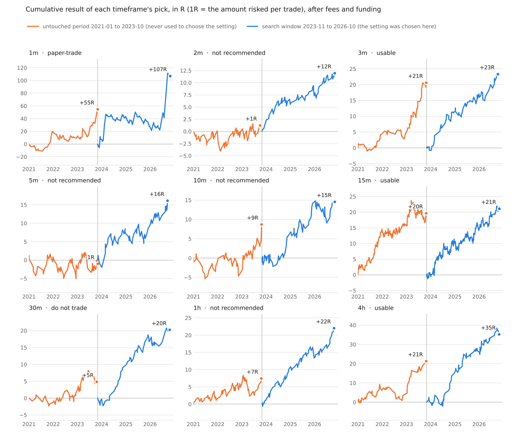
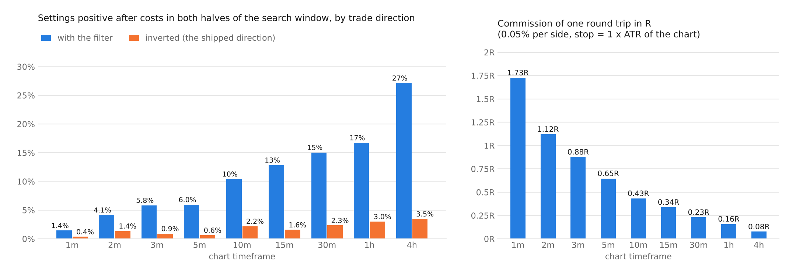

# AMVI strategy on BTCUSDT: every chart timeframe, the trailing stop and the inputs

Date: 2026-11-26. Script: `AMVI_FGF_Inverted_XAUUSD_15m.pine` (closed-candle engine). Market:
BTCUSDT perpetual. Chart timeframes: 1m, 2m, 3m, 5m, 10m, 15m, 30m, 1h, 4h.

110,000 input combinations were backtested over the last three years, each with its stops,
targets and trailing stops filled on the real second-by-second prices; the best were then
tested on three earlier years that no search had seen. Nothing here ran on TradingView: the
numbers come from a Python copy of the script, checked against three independent
re-implementations of the Pine source. One calibrated `.pine` file per timeframe is in
`presets/`, each with its verdict in the title.

## 1. Short version

SHORT_VERSION





## 2. What was run, and how faithfully

**The strategy.** `AMVI_FGF_Inverted_XAUUSD_15m.pine` in its closed-candle version (one decision
per candle at its close, fill at the next open: the version from earlier today). TradingView
does not run in this environment, so the script was rebuilt in Python
(`tools/amvi_engine.py`): the AMVI trigger on every enabled timeframe, the FlashGold direction
filter (signal, zones, band, permission), and the orders (reversal, ATR stop, target, trailing
stop, volatility exit, time stop, wait). It was checked four ways:

- two more copies were written independently from the Pine source; the engine agrees with
  them bar for bar on the signals and trade for trade on the orders (72 + 72 random settings
  on the final code, `results/checks/difftest_*.txt`);
- a third, literal statement-by-statement copy of the filter agreed on 49.8 million chart bars;
- 8 hand-computed order scenarios (`tools/test_orders.py`);
- a look-ahead test: no decision reads a candle that has not closed.

It has **not** been compared with TradingView itself, and the Pine files were not compiled
there. Before relying on any number, load the file and compare the Strategy Tester's List of
Trades with `results/trades_BTCUSDT_<tf>.csv`.

**Data.** Binance BTCUSDT perpetual from the exchange's public archive (checksums verified):
1-minute candles 2020-01 to 2026-10, and every trade 2021-01 to 2026-10 reduced to
one-second bars (180 million of them; 99.996% of all minutes have their seconds,
`results/checks/seconds_coverage.txt`). Funding: Binance's 8-hourly rates. 367 minutes in which
the exchange did not trade are not candles, as on TradingView. Your chart is Bitget's
BTCUSDT.P: the same market, a few dollars apart, with its own wicks and funding.

**Order fills.** Market orders fill at the next candle's open plus 1 tick. Stops, targets and
trailing stops are followed **second by second** through the real trades. A coarser path
flatters a trailing stop: it assumes price ran straight to the candle's high and only then
came back (section 5). TradingView's Strategy Tester walks the chart's own candles unless Bar
Magnifier is on, so its trailing-stop results are the most flattering of all.

**Costs.** Base: 0.05% commission per side, 1 tick slippage on market and stop fills, funding
(your crypto lab's rule). Stress: 0.10% per side and 3 ticks. Bitget's standard taker fee of
0.06% is shown for every pick, and the calibrated files ship with 0.06%.

**Results are in R.** 1R = the amount risked on one trade (stop distance x position size).
With the files' Risk 0.5% sizing, 1R = 0.5% of the account: +20R is about +10%. Where a stop
is so tight that 0.5% risk would need more than 5x leverage, the files' 5x cap makes the
position smaller; the per-timeframe sections give the result in % with that cap applied.

**Timeframes.** Chart: 1m, 2m, 3m, 5m, 10m, 15m, 30m, 1h, 4h. AMVI timeframes and filter
timeframe: 1m, 5m, 15m, 30m, 1h, 4h, 1D, with two restrictions so that a result can be
replayed on TradingView:

- a timeframe at or above the chart must be a whole multiple of it (15m on a 10m chart reads
  a different candle live than after a reload);
- a timeframe below the chart must be at least 15m (TradingView keeps about 100,000 intrabars
  per request: 69 days of 1m, 347 days of 5m). In an earlier run without this rule, settings
  that used 1m or 5m under a higher chart were profitable about half as often
  (`results/first_run_low_timeframes.txt`).

Seconds timeframes (1s to 45s) are off everywhere: there is no long seconds history of the
indicator to test them on.

**Inputs searched.** Everything that changes a trade: AMVI periods (fast and slow ATR, StdDev,
candle range, normalisation), the four weights (five presets), High Vol level, which
timeframes are on and how many must be hot, trade direction (with the filter / inverted),
filter timeframe, level mode and entry distance, band, trades against the signal, allowed
side, burst and zone rules, drift filter, parent timeframe, minimum aligned zones, TDI
lengths, permission (until next signal / n candles), check price on, stop, target, trailing
stop with activation and offset, volatility exit and Low Vol level, time stop, exit ATR
length, and candles to wait after an entry. Sizing inputs do not change a result in R and were
set to your lab's limits (0.5% risk, 5x leverage cap). Display inputs were left alone.

## 3. How a setting was judged

1. **Random search.** 110,000 settings in total (16,000 per chart on 4h, 1h, 30m and 15m,
   12,000 on 10m and 5m, 8,000 on 3m and 2m, 6,000 on 1m), each backtested over the search
   window 2023-11-01 to 2026-10-31.
2. **Hold-out tests inside the window.** Take the 40 steadiest settings of the first half and
   score them on the second half, which they have never seen; the same the other way round;
   and the best of the first two years on the third. A test passes when those 40 are positive
   on average, beat 95% of random groups of 40, and stay positive in 95% of resamples of the
   months. If the best of one half are not good on the other, "the best setting" is the
   luckiest of thousands, not a find.
3. **Candidates and the pick.** Settings positive in both halves at base and stressed costs
   are candidates. For the 20 steadiest, every numeric input is moved one step, one at a time.
   The pick is the candidate with the largest share of neighbours still positive in both
   halves (ties: the steadier neighbourhood). This screens out settings that hang on one
   input's exact value. It does not screen out luck: neighbours take mostly the same trades,
   and a lucky candidate passes it about nine times in ten.
4. **The untouched period.** 2021-01-01 to 2023-10-31 (the 2021 top, the May 2021 crash, the
   2022 bear market, FTX) was not used to find or choose anything. Each pick is run on it
   once. Separately, the candidates of a timeframe are compared there with 400 random
   settings, and with random settings of their own trade direction: does choosing on the
   search window help on data it never saw, and does it help beyond choosing the direction?
5. **Luck-only benchmark.** The same counts are repeated in 1,000 shuffled worlds per
   timeframe in which no setting has an edge (`tools/luck.py`). They show how many "winners"
   chance alone produces, what a pick looks like when nothing is there, and how often chance
   would earn each verdict.
6. **Verdict** (`tools/report.py`). "Holds up on the untouched period" = positive there at base
   and at stressed costs with at least 50 trades, and not fragile.

   | Verdict | Means | Luck alone earns it or better |
   |---|---|---|
   | RECOMMENDED | holds up on the untouched period, that result stays positive in 95% of resamples of its weeks, and all four hold-out tests pass | LUCK_REC |
   | USABLE | holds up, positive in 95% of resamples, and at least one hold-out test passes | LUCK_USABLE |
   | PAPER-TRADE | holds up and is positive in 90% of resamples, but the hold-out tests fail: watch it, do not fund it | LUCK_PAPER |
   | NOT RECOMMENDED | the search shows more than luck would, but the pick does not hold up on the untouched period | |
   | DO NOT TRADE | the search found no more winners than luck would, and the best candidate does not hold up | |

   A calibrated file is written only for PAPER-TRADE and better: a file is an invitation to
   trade. The rules were tightened after an independent statistics review and before the
   final run. The first version gave PAPER-TRADE to a setting with no edge about one time in
   three; the review measured that in shuffled worlds, and the last column is the same
   measurement for the final rules. RECOMMENDED is strict on purpose: a moderate real edge
   would rarely reach it in three years of data.

## 4. Results

### 4.1 The pick of each timeframe

<<Results by timeframe>>

### 4.2 What the search itself says

<<What the search itself says>>

COMMENT_SEARCH

### 4.3 The two trade directions on data the search never saw

<<The two trade directions on data the search never saw>>

COMMENT_DIRECTION

### 4.4 Is there more here than luck?

<<Is there more here than luck?>>

COMMENT_LUCK

### 4.5 The file as shipped (your current inputs) on BTCUSDT

<<The file as shipped (your current inputs) on BTCUSDT>>

### 4.6 What one trade costs

<<What one trade costs>>

COMMENT_COSTS

## 5. Trailing stop

<<Trailing stop>>

COMMENT_TRAILING

### How fine must the price path be?

The pick of each timeframe, and the same pick with a tight trailing stop (activation 0.5 x ATR,
offset 0.5 x ATR), with the orders walked on ever finer bars. Search window, net of costs.

<<include results/convergence.md>>

COMMENT_CONVERGENCE

## 6. Inputs

<<Direction and exits across timeframes>>

COMMENT_INPUTS

## 7. Settings per timeframe

<<Settings per timeframe>>

## 8. What these numbers do not tell you

1. **Not TradingView.** Every number comes from the Python copy. It matches three independent
   re-implementations of the Pine source, but it has not been compared with TradingView, and
   the Pine files (the closed-candle engine included) have not been compiled there from here.
   If a file does not load, send me the error line.
2. **Binance, not Bitget.** Same market, different exchange: wicks, the exact second a stop is
   touched and funding differ. Expect the same picture, not the same trades.
3. **Three years, one market.** The search window is 2023-11 to 2026-10: a bull market with
   two deep pullbacks. The untouched period adds the 2021 top and the 2022 bear market, but it
   is one more sample, not proof, and it lies before the search window, not after it.
4. **Nine timeframes, one label each.** With nine timeframes tested, one of them looking good
   by chance is expected. Section 4.4 says how often chance alone earns each result.
5. **The untouched period was looked at before the final run, for the 4h chart only.** In a
   dry run of an earlier version I saw the untouched result of three preliminary 4h settings.
   After that look the rules changed, for reasons that came from the code review and not from
   those numbers: ties between plateau candidates go to the steadier one, more inputs are
   stepped in the plateau test, the verdict rules became stricter, fills became second by
   second. Later, while testing the report step, I saw the untouched result of one more 4h
   candidate and of the 4h candidates as a group. Nothing that chooses a pick or a verdict was
   changed after that (the comparison with settings of the same direction was added; it
   decides no verdict). For 4h the untouched period is therefore not as clean as for the
   other charts.
6. **Trailing stop at candle closes.** The script re-sends its exit order at every candle
   close. I assumed TradingView keeps an already trailing stop where it is; I found no
   official statement either way. If it starts the trailing again, trailing settings do
   worse; that variant is shown for every pick that uses a trailing stop, and such a pick
   cannot be rated above PAPER-TRADE unless it survives it.
7. **What TradingView can replay.** A chart holds 5,000 to 40,000 candles depending on the
   plan (20,000 on Premium: 69 days of 5m candles), and a request for a lower timeframe about
   100,000 intrabars. A long test of a low timeframe needs Deep Backtesting; the files that
   read 15m candles from a higher chart say in their header how far back they can be checked.
8. **Small things not modelled.** Liquidation, partial fills, the filter's entry hold (off in
   the shipped file), TradingView's rounding of stop prices to the tick (at most 0.1 USDT). A
   trade's result is booked to the month in which it was opened.
9. **Gold was not calibrated.** This run is BTCUSDT only: there is no recent gold history in
   this checkout (the 2011-2018 files are on another branch). The shipped file's gold
   calibration is untouched by this work.

## 9. Files, and how to rebuild everything

| Path | What it is |
|---|---|
| `presets/AMVI_FGF_BTCUSDT_<tf>.pine` | the script with that timeframe's input defaults; the verdict is in the title and the full record in the header |
| `results/trades_BTCUSDT_<tf>.csv` | every trade of the pick, untouched period and search window, to compare with TradingView's List of Trades |
| `results/equity_all.png`, `results/direction_and_costs.png` | the two charts above |
| `results/INPUTS.md` | every input, value by value, for every timeframe |
| `results/holdout_*.txt`, `plateau_*.txt`, `untouched_check.txt`, `trailing_*.txt`, `luck_*.txt` | the printed output of each step |
| `results/final_<tf>m.json` | every number of a pick |
| `results/checks/` | the engine against the reference versions, the second-by-second walk, data coverage |
| `tools/` | the Python copy of the script and every step (`README.md` lists them) |

Rebuild from public data (about two hours on four cores, 47 GB of downloads streamed and
reduced to 4 GB):

```bash
sh tools/run_all.sh
```

To check a file on TradingView: open BTCUSDT.P on the file's timeframe, paste the file into
the Pine Editor and add it to the chart. In Settings, Properties, leave Script executions on
"On bar close" only (the tick options off), commission 0.06%, slippage 1 tick. The header of
each file says roughly what the Strategy Tester should show. On the lower timeframes the
normal tester only reaches back a few weeks (5,000 to 40,000 candles depending on the plan);
Deep Backtesting (Premium and above) covers up to two million candles.
