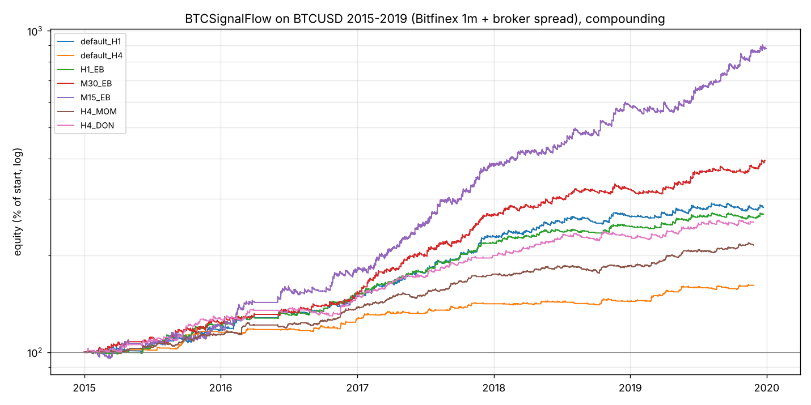

# BTCSignalFlow_Test_EA calibration on BTCUSD

Date: 2026-10-11. Scope: the uploaded `BTCSignalFlow_Test_EA` v1.10 with
`BTCMethodSignals.mqh` (six signal methods), calibrated on BTCUSD the same way
as the RegimeTrend EA on gold (`REPORT.md`): a Python replica of the EA,
exhaustive grid over the signal and risk inputs, one-at-a-time and joint
random sweeps of the EA inputs including proposed improvements, in-sample /
out-of-sample / per-year validation and a cost stress.

## 1. Short version

- The EA as uploaded already works on bitcoin history: the default
  (efficiency breakout, H1, 0.5 % risk) returns +182 % over 2015-2019 with
  a 5.5 % maximum drawdown and is profitable every single year; H4 defaults
  +61 % with 2.7 % drawdown. Every trend-following method is profitable in
  ~100 % of its input combinations on H1 and H4. The range-reversion method
  loses on every timeframe and should not be used.
- The best use of the sweeps is picking the timeframe / method / lookback
  rather than the money-management inputs: M15 and M30 efficiency breakout
  with a longer channel (50 bars) and a wider trail (3.5-5 ATR) triple to
  quadruple the default return at 7-8 % drawdown; H1 with a 20-bar channel,
  ER 0.10, clearance 0.5 and a 3.5 ATR stop gives the best quality per
  trade (profit factor 2.2, 4 % drawdown).
- None of the eight new switches (break-even, R lock-in, partial close,
  trailing activation, chandelier trail, ER exit, no-signal-exit, direction
  filter) improves these configurations; most reduce return or quality.
  They are in v1.11 as inputs, all off by default, so you can test them in
  MT5, but the recommendation is to leave them off.
- Costs matter: 0.05 % commission plus a 0.03 %/day swap cuts returns by
  15-45 % depending on trade frequency (M15 most, H4 least). The spread in
  the data is your broker's (0.0265 % of price).
- The history is the 2015-2019 bitcoin market (Bitfinex 1-minute candles,
  price 200 to 20,000 $), an exceptionally trendy period for a trend
  strategy. Your own July-August 2026 ticks give 4-19 trades per config, all
  positive, but far too few to validate anything. Forward test before
  trading.

## 2. Data and method

| Item | Detail |
|---|---|
| History | Bitfinex BTC/USD 1-minute candles 2015-01-01 to 2019-12-31 (public `Zombie-3000/bitfinex-historical-data`), 2.2 M bars; minutes without trades are absent (2016 has the most gaps) |
| Spread | synthetic, 0.0265 % of price on each bar, the median of your broker's BTCUSD.c ticks |
| Broker sample | your BTCUSD.c tick export 2026-07-01 to 2026-08-31, 7.8 M ticks, 24/7, used as a sanity window only |
| Server time | UTC+3 (summer) / UTC+2, so H4 bars open at 00/04/08.. server time like the MT5 chart |
| Engine | `tools/btc_model.py`: MT5-style ATR (SMA of TR), EMA (seeded on the first price), Bollinger (population std), Wilder RSI, 20-bar ER, H4 EMA50/200/ATR macro on the last H4 bar closed by the decision time, ATR % gate 0.10-4 %, the six methods line by line from the include. Decisions once per bar at its first tick on the last closed bar, stops / TP on every M1 bar (SL before TP, gap fills at the open), trailing = close ∓ TrailATR × ATR through the never-loosen rule, lots = risk % / stop distance, margin cap 10 % at 1:10 |
| Windows | in-sample 2015-01 to 2018-06, out-of-sample 2018-07 to 2019-12, per year, cost stress, broker 2026 |
| Score | in-sample SQN with a minimum trade count per timeframe; PF, return, drawdown reported |

Replica checks: RSI, Bollinger and EMA agree with reference implementations
to the cent; the H4 macro bar for an H1 bar opening at 13:00 is the 08:00
H4 bar (closed at 12:00 before the 14:00 decision); every efficiency-breakout
buy signal satisfies close > channel high + clearance × ATR; with trailing
off every stop exit is exactly -1R or worse.

## 3. Baseline (uploaded defaults, 0.5 % risk)

| TF | window | trades | ret % | CAGR % | PF | win % | max DD % | avg R |
|:--|:--|--:|--:|--:|--:|--:|--:|--:|
| H1 | 2015-2018H1 | 337 | 155.7 | 30.8 | 2.30 | 43.9 | 4.0 | 0.57 |
| H1 | 2018H2-2019 | 162 | 10.0 | 6.6 | 1.23 | 34.6 | 5.5 | 0.13 |
| H4 | 2015-2018H1 | 91 | 43.3 | 10.8 | 3.04 | 46.2 | 2.7 | 0.80 |
| H4 | 2018H2-2019 | 44 | 12.6 | 8.2 | 2.27 | 36.4 | 2.7 | 0.55 |
| M30 | 2015-2018H1 | 660 | 251.1 | 43.2 | 1.87 | 39.7 | 4.7 | 0.40 |
| M30 | 2018H2-2019 | 300 | 23.0 | 14.7 | 1.27 | 32.3 | 12.3 | 0.14 |
| M15 | 2015-2018H1 | 1384 | 65.2 | 15.4 | 1.16 | 30.1 | 19.4 | 0.08 |
| M15 | 2018H2-2019 | 596 | 78.8 | 47.2 | 1.41 | 32.0 | 7.2 | 0.21 |

## 4. Sweeps

### Stage 1: per-method signal grid x risk grid (24,768 combinations)

Signal inputs that each method uses (channel length 10-100, exit bars 5-20,
ER 0.10-0.40, pullback EMA 10-50, clearance 0-0.5) x stop {1.5, 2.5, 3.5}
ATR x trail {0, 2, 3.5, 5} ATR x take-profit {0, 2, 4, 8} R, on M15, M30,
H1, H4.

| TF | method | combos | profitable IS | profitable OOS | median IS ret % | median OOS ret % | median IS DD % |
|:--|--:|--:|--:|--:|--:|--:|--:|
| H1 | 0 trend pullback | 144 | 100 | 92 | 105 | 16 | 7.6 |
| H1 | 1 breakout retest | 576 | 100 | 94 | 62 | 12 | 5.4 |
| H1 | 2 efficiency breakout | 2880 | 100 | 100 | 95 | 17 | 5.8 |
| H1 | 3 range reversion | 192 | 38 | 72 | -5 | 1 | 7.6 |
| H1 | 4 time momentum | 240 | 100 | 100 | 160 | 54 | 12.5 |
| H1 | 5 Donchian trend | 2160 | 100 | 99 | 89 | 26 | 7.0 |
| H4 | 2 efficiency breakout | 2880 | 100 | 100 | 38 | 11 | 3.7 |
| H4 | 4 time momentum | 240 | 100 | 100 | 69 | 17 | 6.9 |
| H4 | 5 Donchian trend | 2160 | 100 | 100 | 43 | 11 | 3.9 |
| M30 | 2 efficiency breakout | 2880 | 91 | 100 | 108 | 25 | 8.0 |
| M30 | 4 time momentum | 240 | 97 | 100 | 152 | 80 | 28.6 |
| M15 | 2 efficiency breakout | 2880 | 64 | 100 | 56 | 53 | 19.8 |
| M15 | 5 Donchian trend | 2160 | 19 | 63 | -49 | 11 | 55.3 |

Main effects (mean in-sample SQN): timeframe H1 3.5 > H4 3.1 > M30 2.1 >
M15 0.0; method 2 (2.9) ≈ 4 (2.6) ≈ 0 (2.6) > 1 (2.0) > 5 (1.5) >> 3
(-1.3); stop 2.5-3.5 ATR (2.5-2.7) > 1.5 (1.3); trail 3.5-5 ATR or none
(2.3-2.6) > 2 ATR (1.3); take-profit off or 8R (2.2-2.4) > 2R (1.7).
In-sample vs out-of-sample SQN correlation across combinations: 0.49.

### Stage 2: EA inputs one at a time (35 variants x 32 best configs)

Median change versus the unchanged EA (`results/btc/btc_stage2_effects.csv`):

| variant | median dSQN IS | better IS | median dReturn % IS | better OOS |
|:--|--:|--:|--:|--:|
| long only | +0.03 | 56 % | -42 | 38 % |
| break-even 2R, lock 3R->1.5R, trail step 0, time stop 96-200 bars, no signal exit, spread cap 0.5 ATR | 0.00 | 9-47 % | 0 | 18-66 % |
| risk 1 % / 2 % | 0.00 | 12-25 % | +264 / +862 (DD +4 / +11 pts) | 16-22 % |
| partial close 2R / 3R | 0.00 | 31-38 % | -21 / -7 | 6-22 % |
| trailing activation 0.5R / 1R / 2R | -0.07 / -0.24 / -0.33 | 6-13 % | -3 / -5 / -11 | 25-34 % |
| break-even 1R / 0.5R | -0.20 / -0.65 | 3-16 % | -14 / -43 | 44-56 % |
| chandelier trail | -0.27 | 25 % | -17 | 63 % |
| time stop 24 bars | -0.56 | 25 % | -22 | 41 % |
| ER exit 0.10 / 0.15 / 0.20 | -0.96 / -1.43 / -1.76 | 9-19 % | -42 / -46 / -57 | 47-59 % |
| short only | -3.51 | 0 % | -119 | 0 % |
| costs: 0.05 % commission + 0.03 %/day swap | -0.54 | 0 % | -16 | 0 % |

Reading: the signal exit almost never fires before the trailing stop (turning
it off changes nothing), early profit-taking of any kind (break-even, partial,
lock-in, ER exit) gives back the trend, and shorts contribute little on this
history (long-only loses return but not quality).

### Stage 3: joint random search (20,000 samples)

Every signal and EA input (including the v1.11 switches) drawn at random,
5,000 samples per timeframe (`results/btc/btc_stage3.csv.gz`). Share of
profitable samples in-sample / out-of-sample: H4 97 % / 96 %, H1 90 % / 93 %,
M30 63 % / 71 %, M15 31 % / 60 %. Main effects on mean in-sample SQN:
efficiency breakout 1.9 > momentum 1.1 ≈ pullback 1.0 ≈ retest 1.0 >
Donchian 0.6; stop 2.5-5 ATR (1.7-1.9) >> 1.0 ATR (-0.2); trail 3.5-7 ATR or
off (1.4-1.5) > 1.5-2 ATR (0.7-0.9); take-profit off or 8R (1.4) > 2R (0.7);
ER exit off 1.7 > 0.10 0.9 > 0.15 0.5; long-only 2.0 vs both 1.0 (but with
40 % less return, see stage 2); short-only -0.6. Break-even, lock-in,
partial close, chandelier trailing, time stops and the signal-exit switch
are all within +/-0.15 of neutral. The highest-SQN random samples
(in-sample SQN 6.3-6.8 with 1.5-3 % drawdown) are long-only or
few-trade variants whose out-of-sample return (+4 to +12 %) is below the
stage 1 picks, so no joint sample replaced a recommendation.

## 5. Recommended configurations

| name | TF | method | length | ER | clearance | stop ATR | trail ATR | TP R |
|:--|:--|:--|--:|--:|--:|--:|--:|--:|
| default_H1 | H1 | 2 efficiency breakout | 30 | 0.20 | 0.2 | 2.5 | 3.5 | 4 |
| H1_EB | H1 | 2 efficiency breakout | 20 | 0.10 | 0.5 | 3.5 | 3.5 | 4 |
| M30_EB | M30 | 2 efficiency breakout | 50 | 0.20 | 0.5 | 2.5 | 3.5 | 4 |
| M15_EB | M15 | 2 efficiency breakout | 50 | 0.10 | 0.2 | 3.5 | 5.0 | 8 |
| H4_MOM | H4 | 4 time momentum | 60 | — | — | 2.5 | 3.5 | 2 |
| H4_DON | H4 | 5 Donchian trend | 20 (exit 10) | — | 0.2 | 1.5 | 3.5 | 4 |

All with 0.5 % risk, 10,000 start, compounding (`results/btc/final/summary.csv`):

| config | window | trades | ret % | CAGR % | PF | win % | max DD % | avg R | SQN |
|:--|:--|--:|--:|--:|--:|--:|--:|--:|--:|
| default_H1 | in-sample | 337 | 155.7 | 30.8 | 2.30 | 43.9 | 4.0 | 0.57 | 5.37 |
| default_H1 | out-of-sample | 162 | 10.0 | 6.6 | 1.23 | 34.6 | 5.5 | 0.13 | 0.99 |
| default_H1 | all, with costs | 499 | 151.3 | 20.2 | 1.65 | 40.5 | 6.0 | 0.38 | 4.56 |
| H1_EB | in-sample | 294 | 138.9 | 28.3 | 2.96 | 50.0 | 2.8 | 0.61 | 6.13 |
| H1_EB | out-of-sample | 142 | 12.2 | 7.9 | 1.41 | 40.1 | 4.1 | 0.17 | 1.43 |
| H1_EB | all, with costs | 436 | 151.1 | 20.2 | 2.04 | 46.1 | 4.3 | 0.43 | 5.59 |
| M30_EB | in-sample | 484 | 202.0 | 37.2 | 2.03 | 41.7 | 5.0 | 0.48 | 5.60 |
| M30_EB | out-of-sample | 217 | 30.3 | 19.2 | 1.51 | 35.0 | 7.1 | 0.25 | 2.21 |
| M30_EB | all, with costs | 701 | 205.8 | 25.1 | 1.59 | 38.7 | 8.7 | 0.34 | 4.83 |
| M15_EB | in-sample | 828 | 335.7 | 52.4 | 1.74 | 36.4 | 7.5 | 0.38 | 4.89 |
| M15_EB | out-of-sample | 382 | 101.6 | 59.4 | 1.73 | 34.6 | 8.1 | 0.39 | 3.27 |
| M15_EB | all, with costs | 1210 | 438.1 | 40.0 | 1.51 | 34.6 | 11.5 | 0.30 | 4.57 |
| H4_MOM | in-sample | 282 | 82.8 | 18.8 | 2.20 | 47.2 | 4.2 | 0.44 | 5.21 |
| H4_MOM | out-of-sample | 139 | 17.9 | 11.6 | 1.60 | 42.5 | 5.3 | 0.24 | 2.29 |
| H4_DON | in-sample | 221 | 119.3 | 25.2 | 2.37 | 38.0 | 5.8 | 0.73 | 4.91 |
| H4_DON | out-of-sample | 114 | 14.2 | 9.2 | 1.37 | 28.1 | 5.5 | 0.25 | 1.33 |

Per-year return % (compounding restarts each year):

| year | default_H1 | H1_EB | M30_EB | M15_EB | H4_MOM | H4_DON | default_H4 |
|--:|--:|--:|--:|--:|--:|--:|--:|
| 2015 | 17.3 | 21.4 | 23.7 | 20.7 | 12.6 | 25.1 | 16.1 |
| 2016 | 25.2 | 22.9 | 18.6 | 47.0 | 18.3 | 10.8 | 5.2 |
| 2017 | 55.3 | 45.9 | 80.8 | 117.6 | 29.0 | 41.4 | 16.1 |
| 2018 | 16.3 | 13.0 | 20.8 | 52.6 | 7.8 | 18.0 | 1.6 |
| 2019 | 6.1 | 8.9 | 22.5 | 50.5 | 15.6 | 9.4 | 11.7 |

Worst single-year drawdown: default_H1 5.5 %, H1_EB 4.0 %, M30_EB 5.0 %,
M15_EB 7.5 %, H4_MOM 5.3 %, H4_DON 5.8 %.

Neighbourhood check (all one-step grid neighbours): every neighbour of every
recommended config is profitable in-sample; median neighbour return is
80-100 % of the pick's (M15_EB 302 % vs 336 %, H1_EB 135 % vs 139 %), so
these are plateaus, not isolated peaks.

Broker sample Jul-Aug 2026: 4-19 trades per config, +1.4 % to +4.6 %. Not
evidence of anything beyond "the replica reads your broker's bars correctly".

## 6. Findings about the code

1. The signal exit (opposite trend / macro / mean) is dominated by the
   trailing stop: switching it off (`InpUseSignalExit=false` in v1.11) did
   not change a single in-sample result on the 32 tested configurations.
2. Method 3 (range reversion) is the only method that loses money; its
   entries fight the strategy's own ATR gate and macro logic. Not
   recommended on any timeframe.
3. Method 5 (Donchian) on M15 is the only trend method that loses on a
   whole timeframe (19 % profitable combos, median -49 %): too many false
   breakouts at that resolution. It works on H4.
4. The margin cap (`InpMaxMarginPct=10`) can bind on crypto accounts with
   low leverage: at 1:2 a 0.5 % risk position on H1 needs more margin than
   10 % of a 10,000 account allows above ~0.03 lots. The replica assumed
   1:10. Check your broker's BTCUSD leverage; raise the cap or accept
   smaller positions.
5. Returns scale almost linearly with `InpRiskPercent` (1 % roughly 2.6x,
   2 % roughly 9x the 0.5 % return) with proportionally deeper drawdowns
   (2 %: +11 points). 0.5-1 % is the sensible range for the 5-8 % drawdowns
   shown.

## 7. Caveats

- 2015-2019 bitcoin is the best case for trend following: two giant bull
  runs and one clean bear. The 2018H2-2019 out-of-sample window (bottoming,
  then a smaller rally) shows what a quieter period does: +10 to +30 %
  instead of +140 to +340 %. Expect the quieter numbers.
- Bitfinex spot candles with a synthetic spread, not your broker's CFD
  quotes: no swaps, no funding, no weekend gaps in quotes. The cost-stress
  rows add 0.05 % commission and 0.03 %/day swap; crypto CFD swaps are often
  larger than that at some brokers, so check yours.
- Minutes without trades are missing from the Bitfinex data, so some
  adverse intrabar paths are invisible; on the minute scale this is a small
  optimism for the stop checks.
- No MetaEditor in this environment: v1.11 is written against the same
  money-manager API the v1.10 source uses, but it has not been compiled
  here. If MetaEditor reports an error, send it back.

## 8. How to use

1. Copy the `MQL5` folder from the package, compile
   `Indicators\BTCSignalFlow\BTCSignalFlow_Test_Signals.mq5` and
   `Experts\BTCSignalFlow\BTCSignalFlow_Test_EA.mq5` (v1.11).
2. Tester: BTCUSD, "Every tick based on real ticks", chart period equal to
   the preset's timeframe (`Presets\BTCSignalFlow\BTCSignalFlow_EA_H1_EB.set`
   on H1, `M30_EB` on M30, `M15_EB` on M15, `H4_MOM` / `H4_DON` on H4,
   `default_H1` = the uploaded settings).
3. `BTCSignalFlow_EA_H1_optimize_template.set` has the signal and risk
   inputs switched on for a genetic run around H1_EB on your broker's data.
