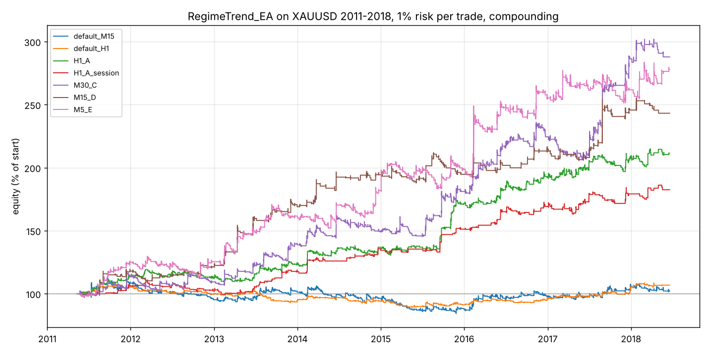

# RegimeTrend_EA calibration on XAUUSD

Date: 2026-10-11. Scope: the uploaded `RegimeTrend` indicator (v1.03) and
`RegimeTrend_EA` (v1.49), calibrated on XAUUSD, plus the v1.50 entry / exit /
trailing improvements added to the EA and tested in the same framework.

## 1. Short version

- The EA as uploaded (defaults, any chart timeframe) is roughly break-even on
  2011-2018 gold: M15 +2 %, H1 +7 % over 7 years at 1 % risk per trade, with
  17-25 % drawdowns. M5 loses 43 %.
- The indicator inputs and the chart timeframe are what matter. Re-tuning them
  turns the same logic into +111 % (H1) to +188 % (M30) over 2011-2018 with
  8-13 % max drawdown, and both stay profitable in the untouched 2017-2018
  out-of-sample window and in 7 of 8 individual years.
- Of the 17 new EA switches, only three add a little: a 07:00-18:00 GMT
  session filter (higher quality per trade, fewer trades), a 2R -> 1R lock-in
  stage, and break-even at 1.5R. Late entry / re-entry, tight trailing,
  fixed take-profit, ATR stops and spread/ER entry filters all make results
  worse on this market. Two existing inputs (`InpExitMode`, and the
  "hold through Neutral" idea behind it) have no effect at all by
  construction, see section 6.
- Recommended starting points, as MT5 `.set` files in `results/final/`:
  `H1_A` (most trades, smoothest), `M30_C` (highest return), `M15_D`
  (fewest trades, highest profit factor). Treat them as a tested starting
  grid for a forward test, not as a finished product: the data is
  2011-2018, gold now trades at 3-4x those prices and your broker's spread
  and swap differ.

## 2. Data and method

| Item | Detail |
|---|---|
| History | Dukascopy XAUUSD ticks, 2011-05-10 to 2018-06-19 (public FX-Data mirror), aggregated to 2.25 M one-minute bid/ask bars |
| Broker sample | Your XAUUSD-ECNc tick export, 2026-07-01 to 2026-08-31 (12 M ticks, gaps 15-29 Jul), used only as a sanity window |
| Server time | UTC+2, UTC+3 during US DST (NY-close convention, matches the EA's tester clock and your broker's 01:00-23:58 session) |
| Engine | Python replica of the indicator and EA (`tools/rt_model.py`), decisions once per chart bar at its first tick on shift-1 values, stops and TP checked on every M1 bar (bid for longs, ask for shorts, SL before TP, gap fills at the open), MT5-style SMA ATR, lot = 1 % of equity / stop distance, floor to 0.01 |
| Costs | Real historical spread from the bid/ask bars (median 0.23-0.40 $). Swaps and commission zero in the sweeps; a cost-stress column adds +10 points spread and -8 $/lot/night |
| Windows | In-sample 2011-2016, out-of-sample 2017-2018H1, plus per-year and the 2026 broker window |
| Score | SQN (sqrt(trades) x mean R / std R) in-sample, with a minimum trade count per timeframe; profit factor, return and drawdown reported alongside |

Replica checks (`tools/test_run.py`, ad-hoc checks in the session): H4
bars open at 00/04/08.. server time, the ER of a 10:15 chart bar is the ER of
the 09:00 H1 bar, ATR equals the SMA of true range, dwell resets to 1 on
every state change, the macro trend only steps on H4 boundaries, and with
trailing off every stop exit is exactly -1R or worse (gaps).

## 3. Baseline (uploaded defaults)

| tf | window | trades | ret % | CAGR % | PF | win % | max DD % | avg R | SQN |
|:---|:---|---:|---:|---:|---:|---:|---:|---:|---:|
| M5 | 2011-2016 | 595 | -46.4 | -9.9 | 0.81 | 30.9 | 56.8 | -0.10 | -2.03 |
| M5 | 2017-18H1 | 126 | 7.1 | 3.5 | 1.12 | 35.7 | 10.4 | 0.06 | 0.50 |
| M15 | 2011-2016 | 450 | -2.4 | -0.4 | 0.99 | 36.4 | 25.5 | 0.00 | 0.01 |
| M15 | 2017-18H1 | 108 | 4.3 | 2.1 | 1.11 | 42.6 | 5.8 | 0.05 | 0.49 |
| M30 | 2011-2016 | 385 | 7.9 | 1.3 | 1.06 | 42.1 | 16.0 | 0.03 | 0.62 |
| M30 | 2017-18H1 | 90 | 16.1 | 7.7 | 1.67 | 48.9 | 6.3 | 0.17 | 1.78 |
| H1 | 2011-2016 | 334 | -4.0 | -0.7 | 0.95 | 42.5 | 17.0 | 0.00 | -0.13 |
| H1 | 2017-18H1 | 73 | 10.9 | 5.3 | 1.70 | 52.1 | 2.9 | 0.16 | 1.42 |

## 4. Sweeps

"All combinations" of 30+ inputs is not computable (10^20+), so the search was
staged: an exhaustive grid where it is affordable, one-factor and factorial
sweeps for the EA inputs, and a 24,000-sample joint random search for
interactions. Every row of every stage is in `results/`.

### Stage 1: exhaustive indicator grid (11,664 combinations, EA at defaults)

Grid: chart TF {M5, M15, M30, H1} x ER period {10, 20, 30} x enter
{0.30, 0.42, 0.55} x exit {0.10, 0.18, 0.28} x ATR period {10, 14, 20} x ATR
mult {2, 3, 4, 5} x min dwell {2, 6, 10} x shock {2.5, 3, 5}.

| chart TF | combos | profitable in-sample | profitable out-of-sample | median IS return % | median IS DD % |
|:--|--:|--:|--:|--:|--:|
| H1 | 2916 | 61 % | 86 % | 3.3 | 15.1 |
| M30 | 2916 | 52 % | 82 % | 0.7 | 20.1 |
| M15 | 2916 | 43 % | 77 % | -3.5 | 25.9 |
| M5 | 2916 | 16 % | 17 % | -35.0 | 48.2 |

Main effects (mean in-sample SQN per level, all TFs pooled): ER period 20
(0.08) beats 10 (-0.62) and 30 (-0.29); enter 0.55 (0.12) beats 0.42 (-0.36)
and 0.30 (-0.59); shock 5.0 (0.36) beats 3.0 (-0.36) and 2.5 (-0.83); ATR
mult 3 is best (-0.05); exit level and ATR period hardly matter. The
in-sample vs out-of-sample SQN correlation across combinations is 0.54, so
the ranking carries information but is far from perfect.

### Stage 2: EA inputs one at a time (92 variants x 24 best indicator configs)

Median change versus the unchanged EA on the same indicator settings
(`results/stage2_effects.csv` has every variant):

| variant | median dSQN in-sample | better in-sample | median dReturn % | better out-of-sample |
|:--|--:|--:|--:|--:|
| session 07-18 GMT | +0.14 | 58 % | -3.4 | 71 % |
| session 08-16 GMT | +0.06 | 58 % | -7.8 | 58 % |
| lock 2R -> 1R | +0.05 | 54 % | +0.8 | 46 % |
| break-even 1.5R | +0.03 | 63 % | +0.9 | 58 % |
| trail step 0 | +0.01 | 54 % | +0.3 | 58 % |
| exit mode strict | 0.00 | 0 % | 0.0 | 0 % |
| raw SuperTrend flip exit | 0.00 | 33 % | 0.0 | 8 % |
| ER exit 0.15 / time stop 96-192 bars | 0.00 | 8-38 % | 0.0 | 25-37 % |
| break-even 0.5R | -0.25 | 4 % | -13.9 | 46 % |
| take profit 3R / 2R / 1.5R | -0.49 / -0.88 / -1.29 | 29-33 % | -24 / -39 / -48 | 20-46 % |
| Chandelier trail k=3 / k=2 | -0.44 / -1.43 | 0 % | -23 / -59 | 33 % |
| tight SuperTrend trail 2.0 / 1.5 | -0.68 / -1.27 | 0 % | -33 / -50 | 21 % |
| ATR stop 1.0-3.0 x ATR | -0.13 to -0.96 | 0-33 % | -11 to -28 | 33-58 % |
| macro filter off | -1.02 | 0 % | -28 | 33 % |
| min ER at entry 0.6 | -0.98 | 4 % | -53 | 71 % |
| late entry 2-8 bars (+/- re-entry) | -1.37 to -1.85 | 0-21 % | -62 to -74 | 8-25 % |
| cost stress (+10 pt spread, -8 $/lot/night) | -0.33 | 0 % | -12 | 0 % |

Reading: the regime transition bar is the edge; anything that enters later,
takes profit early or trails tighter than the signal SuperTrend gives the
edge back. The macro filter and strict macro agreement are worth keeping.

### Stage 2b: factorial of the helpful inputs (96 combos x 24 configs)

Session x break-even x lock stage x trail step x strict shorts x min stop
ATR. All main effects are within +/-0.1 SQN; the session filter trades
return for quality (H1: 151 trades, +69 % vs 437 trades, +92 % in-sample).

### Stage 3: joint random search (24,000 samples, every input incl. v1.50)

With every switch drawn at random the share of profitable samples drops
(H1 42 %, M30 34 %, M15 27 %, M5 16 % in-sample): most of the new switches
reduce the edge. The best random samples reach in-sample SQN 2.7-3.2 but
with 80-190 trades and weak out-of-sample results (several negative),
i.e. they are curve-fit. None beats the stage 1/2b picks below on trades,
out-of-sample return and neighbourhood stability. Full table:
`results/stage3_random_joint.csv.gz`.

## 5. Recommended configurations

Changes from the uploaded defaults (everything else unchanged):

| name | chart TF | ER period | enter / exit | ATR period x mult | min dwell | shock | EA changes |
|:--|:--|--:|--:|--:|--:|--:|:--|
| H1_A | H1 | 10 | 0.42 / 0.10 | 14 x 3.0 | 10 | 2.5 | lock stage 2R -> 1R |
| H1_A_session | H1 | 10 | 0.42 / 0.10 | 14 x 3.0 | 10 | 2.5 | + session 07-18 GMT, trail step 0 |
| M30_C | M30 | 20 | 0.30 / 0.10 | 10 x 2.0 | 10 | 5.0 | min stop 1.5 ATR, break-even 1.5R |
| M15_D | M15 | 20 | 0.55 / 0.10 | 20 x 3.0 | 2 | 5.0 | session 07-18 GMT, trail step 0, lock 2R -> 1R |
| M5_E | M5 | 30 | 0.30 / 0.28 | 14 x 5.0 | 6 | 5.0 | session 07-18, strict shorts off, trail step 0, lock 2R -> 1R, min stop 1.5 ATR |

Results, 10,000 start, 1 % risk, compounding (`results/final/summary.csv`):

| config | window | trades | ret % | CAGR % | PF | win % | max DD % | avg R | SQN |
|:--|:--|--:|--:|--:|--:|--:|--:|--:|--:|
| H1_A | 2011-2016 in-sample | 437 | 92.2 | 11.5 | 1.60 | 47.4 | 8.3 | 0.16 | 3.31 |
| H1_A | 2017-18H1 out-of-sample | 100 | 9.7 | 4.8 | 1.32 | 51.0 | 6.3 | 0.10 | 1.05 |
| H1_A | all, cost stress | 537 | 84.2 | 7.9 | 1.41 | 46.2 | 8.7 | 0.12 | 2.92 |
| H1_A_session | 2011-2016 in-sample | 151 | 69.2 | 9.2 | 2.28 | 52.3 | 9.3 | 0.37 | 3.42 |
| H1_A_session | 2017-18H1 out-of-sample | 46 | 8.0 | 3.9 | 1.44 | 45.7 | 5.2 | 0.17 | 0.94 |
| M30_C | 2011-2016 in-sample | 328 | 124.5 | 14.4 | 1.71 | 37.2 | 13.0 | 0.27 | 2.68 |
| M30_C | 2017-18H1 out-of-sample | 74 | 28.1 | 13.2 | 1.92 | 37.8 | 8.6 | 0.36 | 1.47 |
| M30_C | all, cost stress | 401 | 114.9 | 10.0 | 1.55 | 36.7 | 15.4 | 0.21 | 2.44 |
| M15_D | 2011-2016 in-sample | 143 | 114.4 | 13.6 | 2.26 | 43.4 | 9.4 | 0.57 | 3.11 |
| M15_D | 2017-18H1 out-of-sample | 32 | 13.3 | 6.5 | 1.88 | 37.5 | 6.1 | 0.42 | 0.99 |
| M5_E | 2011-2016 in-sample | 413 | 155.3 | 16.9 | 1.70 | 40.0 | 12.8 | 0.24 | 3.13 |
| M5_E | 2017-18H1 out-of-sample | 94 | 8.9 | 4.4 | 1.24 | 29.8 | 9.3 | 0.10 | 0.70 |

Per-year return % (compounding restarts each year; 2011 from May, 2018 to June):

| year | H1_A | H1_A_session | M15_D | M30_C | M5_E | default_H1 | default_M15 |
|--:|--:|--:|--:|--:|--:|--:|--:|
| 2011 | 14.4 | 6.2 | 17.9 | 13.6 | 24.9 | 5.4 | 8.4 |
| 2012 | -1.7 | -4.0 | 2.8 | -3.4 | 0.4 | -5.2 | -12.1 |
| 2013 | 9.5 | 15.2 | 39.8 | 26.6 | 28.2 | -5.3 | 5.9 |
| 2014 | 10.3 | 14.2 | 15.0 | 7.3 | 13.7 | -0.3 | -4.7 |
| 2015 | 26.3 | 12.3 | 0.3 | 21.1 | 9.3 | -2.8 | -9.5 |
| 2016 | 11.6 | 11.6 | 10.0 | 24.0 | 28.2 | 5.5 | 11.1 |
| 2017 | 8.4 | 5.9 | 14.5 | 27.6 | 2.6 | 7.6 | 8.0 |
| 2018H1 | 1.1 | 1.9 | -1.0 | 0.6 | 6.3 | 1.6 | -3.3 |

Worst single-year drawdown: H1_A 6.3 %, M30_C 11.5 %, M15_D 8.1 %, M5_E 12.8 %.

Neighbourhood check (every one-step neighbour of the config in the stage 1
grid): H1_A 10/10 neighbours profitable in-sample (median +34 %), M30_C 8/8
(median +55 %), M15_D 9/9 (median +72 %), M5_E 6/9 (median +48 %, worst
-38 %). M5 is the least stable and is not recommended.

Broker sample Jul-Aug 2026: 2-8 trades per config, between -0.6 % and +2.5 %.
Too few trades to conclude anything; the point of that run was that the
replica reads your broker's server time and bars correctly (it does).

## 6. Findings about the code itself

1. `InpExitMode` does nothing. In `RegimeStateMachine.mqh::Step()` a trending
   state can only move to Range (ER below the exit level) or stay trending;
   Neutral is never a target while in a trend. So "hold through Neutral" and
   "exit when leaving Trending" fire on the same bar, which stage 2 confirms
   (0.00 difference in all 24 configs). The input can be removed or the state
   machine changed if a Neutral pass-through is really wanted.
2. `InpExitOnStFlip` (new) is almost always redundant for the same reason:
   when the raw SuperTrend flips and the dwell lock has expired, the state
   flips on the same bar and the original "direction flipped" exit fires.
   It only differs inside the dwell lock, and there it does not help.
3. Trailing with the signal SuperTrend is already close to the best exit.
   Every tighter trail (second SuperTrend, Chandelier, ATR-close) lost
   money across the board; only a lock-in stage at 2R and break-even at
   1.5R were neutral to slightly positive.
4. Shock multiplier 2.5-3 (the default is 3) hurts on most timeframes
   because gold's news bars kick the machine into Range and the EA out of
   good trends; 5.0 (practically off) is better everywhere except the H1_A
   corner, where 2.5 and 5.0 both work.
5. The default M15 behaviour has 70 % of exits at the stop and a 25 %
   drawdown; the calibrated H1 setting cuts stop exits to 32 % and the
   drawdown to 8 %.

## 7. Caveats

- History is 2011-2018 (1,050-1,900 $ gold). Point-based inputs
  (`InpTrailStepPoints`, `InpBreakEvenBuffer`, `InpMinStopPoints`) scale
  with price; ATR-based ones do not. At 3,000-4,500 $ a 50-point step is
  relatively 2-3x smaller than it was; the sweeps found step size does not
  matter much, so this is minor, but re-check in a forward test.
- No swap or commission in the main numbers; the cost-stress rows show the
  effect of +10 points spread and -8 $/lot/night (roughly XM standard gold):
  returns drop 10-30 %, all recommended configs stay profitable.
- The replica is not MT5. It reproduces the indicator buffers and the EA's
  decisions to the tick-level rules described above, but MT5's tester will
  differ slightly (tick modelling, order fills, session gaps). Confirm each
  `.set` in the MT5 tester with "Every tick based on real ticks" before
  trading it.
- In-sample selection bias is real: the best of 11,664 combinations is
  optimistic by construction. The honest numbers are the out-of-sample and
  per-year rows, not the in-sample ones.

## 8. How to use

1. Compile `MQL5/Indicators/Foundry/RegimeTrend.mq5` first, then
   `MQL5/Experts/Foundry/RegimeTrend_EA.mq5` (v1.50).
2. Load `results/final/RegimeTrend_EA_H1_A.set` (or M30_C / M15_D) in the
   tester on XAUUSD, matching chart timeframe (H1 / M30 / M15), "Every tick
   based on real ticks", 1 % risk.
3. `results/final/RegimeTrend_EA_H1_optimize_template.set` has the
   optimisation ranges switched on for a genetic run around the H1_A plateau
   in your own broker's data (expect ~2 M combinations on full grid; use
   genetic).
4. To rerun the Python calibration: see `README.md` in this folder.
