# SpeedAlert FlashGold Micro v1.501: calibration of every input and of the trailing

Date: 2026-11-15. Input: `components.zip` (`speedalert-flashgold-micro`, development build 1.501, tester only,
five `*_DISABLED.set` presets). MetaTrader does not run in this environment, so the EA was ported to a tick
replay and checked against the 2,584 real trades stored in the package's own `basis/saved_chart.chr`.
Every number below is in points per 0.01 lot (1 point = $0.01 of price = $0.01 per 0.01 lot) and can be
regenerated with the commands in section 13.

## 1. Short version

1. **The shipped settings lose money, on the real account and in the replay.** The saved chart holds
   2,584 real trades of this EA from 7 September to 8 October 2026: profit factor **0.83**,
   36% winners, -8.5 points per trade, -21,951 points in total. The replay of the shipped
   reference preset over nine other calendar months gives **0.72** on 9,282 trades and is below 1 in
   every month (0.61 to 0.89). In October-November 2026, the months next to the real
   trades, it gives 0.83.
2. **The reason is cost, not exits.** After a fill the price keeps moving in the trade's favour by at most
   about 11 points on average, while a round trip costs about 37 points in spread and
   slippage. Stops, targets and trailing cannot change that sign: across 105 stop/target/exit
   combinations the result stays between -26 and -13 points per trade.
3. **No single input fixes it.** 74 inputs were varied one at a time (316 replays): the
   profit factor stays between 0.67 and 0.81. 85 of the 400 inputs are
   telemetry and cannot change an order at all.
4. **Trailing does not fix it either.** As shipped, neither trailing mechanism can ever act: `TrailStartPoints`
   270 lies beyond the 180 target, and the burst-settle rule waits for a 100 pip pullback. Switched on, on the
   shipped entries, simple trailing gives 0.76 to 0.79 and the best
   "let it run" exit 0.82.
5. **A combination gets it to about break-even, slightly above.** Trade only bursts that are large against
   the spread (`MaxTrailingMultiplier` 7.5 to 30), cap the spread near its median (`MaxSpreadPoints` 31 to 14),
   drop the fade and market routes (`EntryRouterMode` StopOnly), move the target out (180 to 600), switch the
   fixed 100 point speed exit off and trail 150 points behind the best price. In the replay that preset makes
   **1.15** on 1,234 trades (calibration months 1.16, validation months 1.06,
   October-November 2026 1.39), 10 points per trade.
6. **That number is thin, and it should be read as "about 1.0 to 1.15".** The average of 384
   neighbouring input sets is 1.06. 4 of 9 months are positive. The profit comes from
   buys (1.49) and not from sells (0.97). A 7 point commission leaves 1.04,
   strict fills 1.04, both together 0.95. If stop losses slip twice as far as quoted
   instead of 1.5 times, it is 1.06.
7. **Three things to know before any Strategy Tester run.**
   - The four micro presets place **0 trades** as shipped: the quote-bucket series blocks
     for good after 4,096 occupied buckets (about 68 minutes at 1 s) until the EA is restarted.
   - The tester fills orders on the tick that sends them. With that, every search here kept choosing market
     entries on the signal tick. The best such set makes 1.07 with no delay and 0.83 with the
     150 ms delay that the real fills show. Set an execution delay in the tester.
   - The order-flow feed (terminal global variables) does not exist in the tester, so a tester run never
     takes the market route that produced 74% of the real trades. Live and tester are different programs
     unless `UseOrderFlow` is false.

Deliverables: calibrated presets and optimiser range files in `presets/`, all result tables in `results/`,
the replay and every study in `tools/`. Nothing here has been run in MetaTrader; section 11 says how to
check it there.

## 2. What the EA does, in the order the replay follows

| stage | rule (shipped preset values) |
| --- | --- |
| speed alert | mid price moved over the last `SpeedLookbackSeconds` (10 s) by at least max(`MinSpeedAlertPoints` 37, spread x `MaxTrailingMultiplier` 7.5); it stays active until 20 s after the start of that window |
| direction score | speed direction 1.0, forming M1 candle body of at least 21 points 1.5, break of the 10 s high or low by 3 points 1.5, spread inside `MaxSpreadPoints` 0.5, plus up to three order-flow votes of 1.0. A side needs 4.0 and a lead of 1.5. Without the flow feed that means speed, body and micro-break must all agree |
| router | exhaustion (wick rejection, snap-back, opposite pressure): limit order 35 points against the burst (EXHL). Follow-through with flow agreement: market order (FOLM). Otherwise a stop order 35 points ahead (FLXQ, BNO, CONT...). Pending orders are deleted after 5 s |
| gates | FlashGold direction filter (BUY/SELL area of the last signal bar), entry hold (wait 1100 ms and need +5 points), price drift over the last 60 minutes on the trade's side, continuation filter (tick rate, quote gap, range against cost), one order and one position per scenario, lockout after three defensive closes |
| exits | stop 90 (market 80), target 180 (market/limit 160). EA-side exits are locked until the trade has first been more than 6.8 pips (68 points) in profit; that gate is a constant in the code, not an input. Then: close at 100+ points when a new alert on the trade's side is active (speed profit exit), close a trade that fell back to a loss (retest and pressure shields), trailing |

Of the 400 inputs, 224 can change an order in a tester run and are replayed,
85 are telemetry, logging, visuals or shadow scorecards, 53 are labels, comments and
file names, 11 belong to the order-flow feed, 8 are position sizing (irrelevant to the profit
factor at the fixed 0.01 lot) and 19 are not replayed (percentile threshold modes, retry
timers and the like). `results/inputs_classification.csv` lists every input with its class and the profit
factor range found for it.

## 3. The real trades in the saved chart

`basis/saved_chart.chr` was saved with trade history on, so it contains every closed trade of the account as
chart objects. `tools/chart_trades.py` reads them back: 2,584 trades with a `SAR:` comment on
22 trading days (about 117 a day), all 0.01 lot, symbol XAUUSD-ECN with 2 digits. The
chart's own EA inputs are identical to the shipped reference preset except `TradingEnabled`, and the exit mix
shows the 6.8 pip gate was already active. Profit is price difference only; commission and swap are not on the
chart.

Overall: profit factor **0.83**, 36% winners, average win +117, average loss
-80, -21,951 points ($219.51 lost at 0.01 lot).

| entry route | trades | share % | profit factor | win % | points per trade | net points |
| --- | ---: | ---: | ---: | ---: | ---: | ---: |
| market order after follow-through (FOLM) | 1,911 | 74 | 0.84 | 36 | -7.8 | -15,001 |
| stop order with the burst (FLXQ) | 394 | 15 | 0.87 | 39 | -7.4 | -2,916 |
| limit order against the burst (EXHL) | 236 | 9 | 0.74 | 34 | -13.4 | -3,172 |
| other stop orders (CONT, BNO) | 43 | 2 | 0.67 | 40 | -20.0 | -862 |

| closed by | trades | share % | points per trade | net points | median seconds held |
| --- | ---: | ---: | ---: | ---: | ---: |
| stop loss | 1,370 | 53 | -89.4 | -122,530 | 14 |
| speed profit exit (SA_PROFIT_EXIT) | 785 | 30 | 117.7 | 92,378 | 20 |
| defensive close (SA_...) | 283 | 11 | -28.8 | -8,157 | 41 |
| take profit | 90 | 3 | 160.8 | 14,469 | 52 |
| other | 56 | 2 | 33.7 | 1,889 | 15 |

Two things stand out. Half of all trades end at the stop, and a third of all trades are closed within 10
seconds: those carry nearly the whole loss.

| time in the trade | trades | profit factor | net points |
| --- | ---: | ---: | ---: |
| closed within 10 s | 821 | 0.58 | -20,300 |
| 10 to 40 s | 1,114 | 0.78 | -12,594 |
| longer than 40 s | 649 | 1.44 | 10,943 |

And the order-flow feed did not pick better trades. Entries the feed agreed with did worse than the ones it
disagreed with:

| order-flow label on the entry | trades | profit factor | win % | points per trade |
| --- | ---: | ---: | ---: | ---: |
| feed agreed with the trade (FA) | 1,609 | 0.80 | 35 | -9.8 |
| feed disagreed (FD) | 409 | 0.92 | 39 | -4.2 |
| no label | 566 | 0.85 | 37 | -7.8 |

## 4. The replay, and how far it can be trusted

**Data.** XAUUSD ticks from Dukascopy: November 2025 to May 2026 (via the public Hugging Face copy
`CarlosSilva1/xauusd-ticks`, CC-BY-4.0) and 6 October to 13 November 2026 (downloaded directly): nine calendar
months, 38 trading weeks, about 62 million quotes after rebuilding. The direct download is throttled hard
(roughly a hundred hourly files, then a long block), so June to September 2026 is missing; of the real-trade
window only 6 to 8 October and 17 separate hours could be fetched. Dukascopy quotes 3 digits
with a spread near 55 points, which the EA's own spread caps reject, so the replay keeps the Dukascopy mid
price and tick times and rebuilds a 2-digit bid/ask around it with the spread scaled to a median of 12 points
in October-November 2026 (15 over all months).

**Split.** Calibration November 2025 to February 2026, validation March to May 2026, hold-out October to
November 2026. Every table shows the three separately. The calibrated preset was chosen after looking at all
three, so the hold-out is not a clean out-of-sample test any more; treat it as a third sample.

**Execution model, calibrated on the real fills.** Three things were fitted to the account's own fills: a
stop or stop loss touched within 10 points of its level fills at the level; an order the EA sends takes
150 ms to reach the server; and a stop loss that is not filled at its level slips 1.5 times as far as the
Dukascopy quote shows.

| fill | real account, 7 Sep to 8 Oct 2026 | replay, Oct-Nov 2026 |
| --- | --- | --- |
| stop-loss fills exactly at the stop level | 74% of 1,363 | 77% of 547 |
| slip of a stop-loss fill, points: mean / 90th / 95th / 99th percentile | 8.3 / 31 / 44 / 91 | 8.0 / 28 / 42 / 79 |
| stop-order entries exactly at the order price | 77% of 219 | 77% of 915 |
| slip of a stop-order entry, points: mean / 90th percentile | 6.0 / 29 | 4.8 / 17 |
| market entry against the price when the EA decided, points: 5th / 25th / 50th / 75th / 90th percentile | -24 / -3 / 0 / +3 / +13 (1,006 entries) | -20 / -5 / 0 / +6 / +15 with an order delay of 150 ms (2,469 entries) |
| limit orders and take profits | filled at the market, with price improvement | same |

The last factor matters. Without it the replay's stop losses slip 5.3 points on average against
8.3 on the account (1,363 real stop-loss fills). On the 145 trades where both
the account and the replay ended at the stop, the account slipped 8.1 points and the replay
(with the factor) 9.2. The calibrated preset closes nearly every trade through a stop, so its
result moves with this factor: section 10 shows it at 1.0, 1.5 and 2.0.

"Real fills" in every table means this model. "Strict fills" means no snapping to the level, no price
improvement on limits and targets, and a 250 ms delay.

**Does it reproduce the real account?** For the stop and limit routes (the replay has no order-flow feed, so
it cannot take the market route), real September-October against the replay of October-November and of all
months (the earlier months were faster and cost more):

| route | real trades | real profit factor | replay, Oct-Nov 2026 | replay, all months | real win % | replay win % | real avg win / loss | replay avg win / loss |
| --- | ---: | ---: | ---: | ---: | ---: | ---: | --- | --- |
| FLXQ:BS | 183 | 0.84 | 0.91 | 0.76 | 40 | 39 | 121 / -96 | 121 / -103 |
| FLXQ:SS | 211 | 0.89 | 0.82 | 0.80 | 38 | 40 | 125 / -87 | 126 / -105 |
| EXHL:BL | 125 | 0.77 | 0.61 | 0.62 | 36 | 29 | 113 / -83 | 141 / -91 |
| EXHL:SL | 111 | 0.71 | 0.80 | 0.57 | 32 | 27 | 113 / -76 | 141 / -91 |

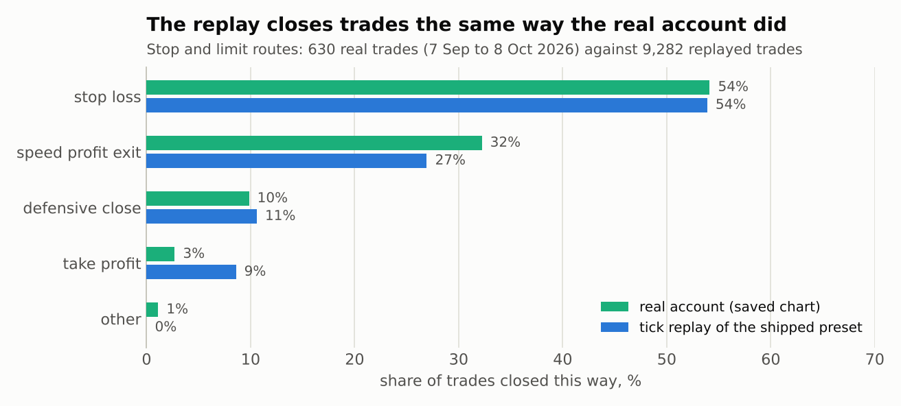

For 283 real trades on 11 days whose ticks could be downloaded, the replay was given the real
entries and only managed the exits: -14.0 points per trade against -9.3 real (profit
factor 0.74 against 0.81), 90% of the trades ending on the same side, correlation
0.85. On the same entries the replay is -4.7 points per trade away from the account, on the
pessimistic side.

The same real entries with other exit inputs (small sample, direction only):

| exit inputs applied to the real entries | profit factor | points per trade |
| --- | ---: | ---: |
| as traded: shipped reference preset exits | 0.74 | -14.0 |
| calibrated exits (target 600, speed exit off, trail layer 100) | 0.82 | -9.3 |
| simple trailing on (start 69, behind 20), speed exit kept | 0.79 | -10.4 |
| simple trailing on (start 80, behind 40), speed exit kept | 0.77 | -11.4 |
| trail layer on (reference spread 15, factor 1.0) | 0.78 | -10.7 |
| speed profit exit off (stop/target only) | 0.76 | -13.3 |
| speed profit exit at 170 instead of 100 | 0.76 | -13.3 |
| runner: speed exit off, target 600, trail 160/60 | 0.82 | -9.8 |
| runner + stop 200 | 1.03 | 2.3 |
| runner + stop 300, no post-entry validation | 1.13 | 13.5 |
| stop 60 (tighter), exits as traded | 0.71 | -13.5 |
| stop 130, exits as traded | 0.81 | -12.2 |
| stop 200, exits as traded | 0.91 | -6.5 |
| post-entry validation off | 0.71 | -17.1 |
| what-if: no 6.8 pip exit gate (not an input) | 0.41 | -13.6 |

**Self-test.** `tools/selftest.py` runs the package's own quote-bucket cases (`tests/test_bucket_host.py`)
against the port, checks the continuation filter and the TDI direction against plain numpy/pandas, and checks
that skipping idle ticks and re-injecting the replay's own fills change nothing: 1,222 checks pass.

**Not replayed.** The order-flow feed (it does not exist in the tester either), PERCENTILE threshold modes,
`CandleIndexToCheck` other than 0, broker stop/freeze levels (taken as 0), frozen-order retry paths, the
quote-session calendar of the FlashGold bars, and the "observed live" commits of the FlashGold parent/zone
directions. Trade-for-trade parity with MetaTrader is not claimed.

## 5. Baseline: the shipped presets

| preset | execution | trades | profit factor | Nov-Feb | Mar-May | Oct-Nov 2026 | points per trade |
| --- | --- | ---: | ---: | ---: | ---: | ---: | ---: |
| 1s_Expiry250ms | real fills | 68 | 1.01 | 1.03 | 0.94 | 1.51 | 0.5 |
| 1s_Expiry5seconds | real fills | 5,195 | 0.71 | 0.71 | 0.70 | 0.75 | -18.5 |
| Micro1s | real fills | 9,111 | 0.71 | 0.68 | 0.73 | 0.77 | -18.2 |
| Micro250ms | real fills | 8,378 | 0.69 | 0.65 | 0.72 | 0.77 | -19.6 |
| NativeReference | real fills | 9,282 | 0.72 | 0.69 | 0.72 | 0.83 | -17.9 |
| 1s_Expiry250ms | real fills, micro capacity block as shipped | 0 | n/a | n/a | n/a | n/a | n/a |
| 1s_Expiry5seconds | real fills, micro capacity block as shipped | 0 | n/a | n/a | n/a | n/a | n/a |
| Micro1s | real fills, micro capacity block as shipped | 0 | n/a | n/a | n/a | n/a | n/a |
| Micro250ms | real fills, micro capacity block as shipped | 0 | n/a | n/a | n/a | n/a | n/a |
| NativeReference | tester fills (no order delay) | 10,002 | 0.71 | 0.67 | 0.73 | 0.80 | -18.6 |
| NativeReference | strict fills | 8,939 | 0.59 | 0.55 | 0.61 | 0.71 | -29.0 |
| NativeReference | real fills, FlashGold filter off | 11,108 | 0.71 | 0.69 | 0.69 | 0.86 | -18.6 |
| source code defaults | real fills | 106,575 | 0.70 | 0.67 | 0.70 | 0.81 | -18.8 |

The five presets are one configuration with different FlashGold filter modes, and the filter mode barely
matters: with the filter off the reference preset makes 0.71 on 11,108 trades. The
250 ms expiry preset lets almost nothing through (68 trades), too few to judge. The source code
defaults (which differ from the presets in eleven EA inputs and the FlashGold timeframes) make 0.70 on
106,575 trades.

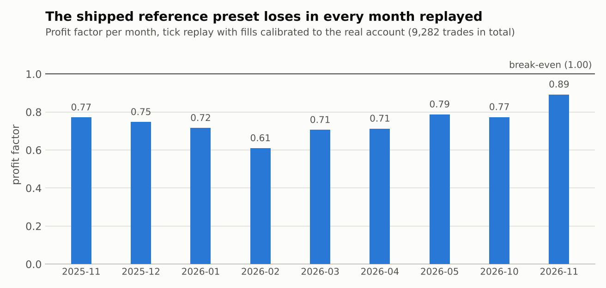

| month | trades | profit factor | win % | points per trade | net points |
| --- | ---: | ---: | ---: | ---: | ---: |
| 2025-11 | 624 | 0.77 | 37 | -13.2 | -8,234 |
| 2025-12 | 710 | 0.75 | 36 | -14.8 | -10,500 |
| 2026-01 | 1,366 | 0.72 | 35 | -18.4 | -25,067 |
| 2026-02 | 1,314 | 0.61 | 33 | -29.2 | -38,395 |
| 2026-03 | 2,138 | 0.71 | 37 | -20.0 | -42,786 |
| 2026-04 | 1,038 | 0.71 | 36 | -18.5 | -19,156 |
| 2026-05 | 958 | 0.79 | 38 | -12.7 | -12,127 |
| 2026-10 | 589 | 0.77 | 37 | -12.3 | -7,241 |
| 2026-11 | 545 | 0.89 | 39 | -5.5 | -2,998 |
| ALL | 9,282 | 0.72 | 36 | -17.9 | -166,504 |

## 6. Why the shipped settings lose

For every replayed entry of the reference preset, the table follows the mid price after the fill, in the
trade's direction, with no stop or target.

| seconds after the fill | stop entries: mid-price move | stop entries: result if closed then | limit fades: mid-price move | limit fades: result if closed then |
| ---: | ---: | ---: | ---: | ---: |
| 1 | 3.4 | -10.8 | -3.8 | -22.6 |
| 2 | 4.3 | -9.9 | -4.7 | -23.5 |
| 5 | 7.1 | -7.1 | -2.7 | -21.5 |
| 10 | 4.5 | -9.8 | -4.6 | -23.5 |
| 20 | 7.2 | -7.0 | -10.2 | -29.1 |
| 30 | 10.7 | -3.6 | -9.0 | -27.9 |
| 60 | 1.2 | -13.1 | -9.9 | -28.8 |
| 120 | 4.0 | -10.4 | -19.7 | -38.6 |
| 300 | -2.9 | -17.2 | -28.0 | -46.9 |
| 600 | -13.2 | -27.5 | -21.0 | -39.9 |

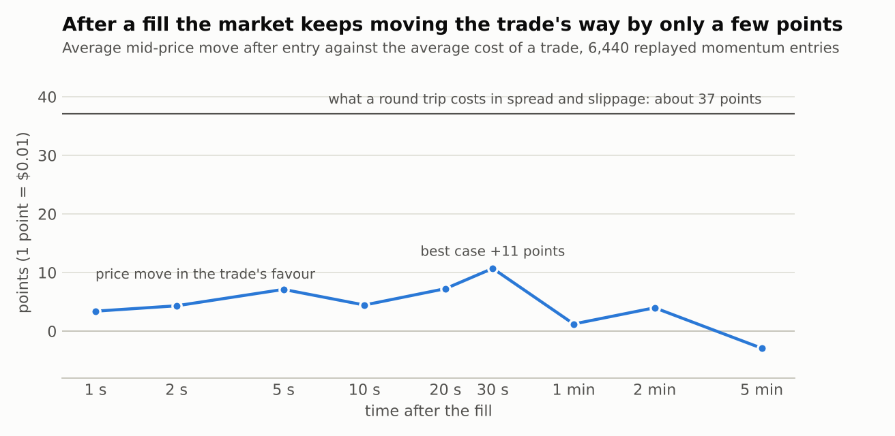

The momentum stop entries are right about direction, by a few points. They pay about 16 points of
spread and 12 points of entry slippage, and half of them pay stop-loss slippage on top. The limit
fades are wrong about direction from the first second. This is why every exit variant in sections 8 and 9
loses about the same number of points per trade.

## 7. Every input, one at a time

Each input was varied alone around the shipped reference preset, over the whole feed.

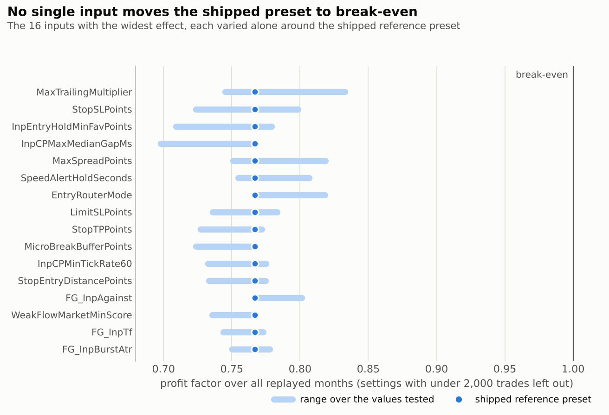

| input | shipped | values tested | lowest | highest | best value | best: Nov-Feb / Mar-May / Oct-Nov |
| --- | --- | --- | ---: | ---: | --- | --- |
| InpCPMaxMedianGapMs | 215 | 0, 100, 150, 215, 300 | 0.67 | 0.76 | 150 | 0.72 / 0.78 / 0.85 |
| MaxTrailingMultiplier | 7.5 | 3, 4, 5, 6, 7.5, 9, 11, 13, 16, 20, 25 | 0.74 | 0.81 | 25 | 0.76 / 0.81 / 1.01 |
| StopSLPoints | 90 | 40, 60, 75, 90, 110, 130, 160, 200, 300 | 0.71 | 0.78 | 200 | 0.76 / 0.80 / 0.85 |
| MaxSpreadPoints | 31 | 12, 14, 16, 20, 31, 60 | 0.74 | 0.81 | 14 | 0.82 / 0.79 / 0.83 |
| SpeedAlertHoldSeconds | 20 | 11, 13, 15, 20, 30, 45, 60 | 0.75 | 0.81 | 11 | 0.86 / 0.78 / 0.74 |
| InpCPMinTickRate60 | 3.8 | 0, 2, 3, 3.8, 5, 6.5, 8 | 0.72 | 0.77 | 0 | 0.74 / 0.77 / 0.89 |
| InpEntryHoldMinFavPoints | 5 | -20, 0, 5, 10, 20, 35 | 0.72 | 0.77 | -20 | 0.74 / 0.79 / 0.85 |
| LimitSLPoints | 90 | 40, 60, 90, 130, 200 | 0.73 | 0.77 | 200 | 0.72 / 0.81 / 0.87 |
| StopEntryDistancePoints | 35 | 5, 10, 20, 35, 50, 70, 100 | 0.72 | 0.77 | 10 | 0.72 / 0.79 / 0.85 |
| InpEntryHoldMs | 1100 | 250, 500, 800, 1100, 1500, 2000, 3000 | 0.74 | 0.78 | 250 | 0.74 / 0.80 / 0.89 |
| MicroBreakBufferPoints | 3 | 0, 3, 6, 10, 20 | 0.72 | 0.76 | 3 | 0.72 / 0.78 / 0.84 |
| StopTPPoints | 180 | 60, 80, 100, 130, 180, 250, 400, 1000 | 0.73 | 0.76 | 180 | 0.72 / 0.78 / 0.84 |
| EntryRouterMode | 2 | 0, 1, 2 | 0.76 | 0.80 | 0 | 0.79 / 0.80 / 0.82 |
| FG_InpAgainst | 1 | 0, 1 | 0.76 | 0.80 | 0 | 0.80 / 0.78 / 0.83 |

Settings with fewer than 2,000 trades are left out of the table. Full results: `results/oat_native_all.csv`
(reference preset) and `results/oat_micro1s_fg.csv` (1 FlashGold inputs around the 1 s micro
preset, profit factor 0.75 to 0.76).

Inputs that change nothing at the shipped values, because another setting makes them unreachable:
`DowngradeNeutralSellMarketToStop`, `FG_InpMinutes`, `FG_InpSeconds`, `InpBurstThresholdPts`, `InpCPRequireCostCoverage`, `InpUse1000msHold`, `InpUseTrailLayer`, `InpWaitForBurstSettle`, `MarketFollow37Points`, `MinScoreEdge`, `PredictiveExitMinProfitPoints`, `RetestFailedEarlyLossPoints`, `TrailBehindPoints`, `TrailStartPoints`, `TrailStepPoints`, `UseDefensiveCloseLockout`, `UseTrailing`.

One code constant matters more than any input: without the 6.8 pip exit gate (`minimumProfitPips` in
`TrailingActivationProfitReached`) the replay falls to 0.52. The gate is doing useful work; it would
be worth exposing as an input.

## 8. Trailing on the shipped entries

The EA has three pieces:

- **Simple trailing** (`UseTrailing`, `TrailStartPoints`, `TrailBehindPoints`, `TrailStepPoints`): once the
  trade is `TrailStart` points up, keep the stop `TrailBehind` points behind the price.
- **Trail layer** (`InpUseTrailLayer` and the `internal*` inputs): after the trade is 68 points up, keep the
  stop behind the best price by a multiple of max(spread, `InpReferenceSpreadPts`). The multiple is
  `internalOrderDistance` clamped between `internalMinTrailing` and `internalMaxTrailing`, and the distance is
  capped at `InpTrailOuterCapPts`: 100 points at the shipped values. `internalMaxTrailing` must equal
  `internalMinTrailing` x `internalMultiplier` or the EA refuses to start, so the practical way to change the
  distance is `InpReferenceSpreadPts` (30 = 100 points, 45 = 150, 60 = 200).
- **Burst settle** (`InpWaitForBurstSettle` and four inputs): both mechanisms may only tighten the stop after
  the price has pulled back `InpBurstSettlePullbackPips` from its best and stayed calm for
  `InpBurstSettleQuietMs`.

**As shipped nothing trails.** `TrailStartPoints` = 270 is beyond the 180 point target, the trail layer is
off, and the settle rule asks for a 100 pip ($10) pullback inside a trade whose stop is 90 points away.
Changing `TrailStart`, `TrailBehind` or `TrailStep` alone therefore does nothing.

**Simple trailing on the shipped entries** (settle rule off, speed exit kept; preset without trailing:
0.77):

| TrailStartPoints / TrailBehindPoints | behind 20 | behind 30 | behind 40 | behind 60 | behind 80 | behind 110 |
| --- | ---: | ---: | ---: | ---: | ---: | ---: |
| start 69 | 0.79 | 0.78 | 0.78 | 0.77 | 0.77 | 0.76 |
| start 80 | 0.78 | 0.78 | 0.78 | 0.77 | 0.77 | 0.77 |
| start 100 | 0.77 | 0.77 | 0.77 | 0.77 | 0.76 | 0.76 |
| start 130 | 0.76 | 0.76 | 0.77 | 0.76 | 0.76 | 0.76 |
| start 160 | 0.77 | 0.77 | 0.77 | 0.77 | 0.77 | 0.77 |

With the settle rule on (source defaults and four variants) the range is 0.77 to
0.77: the rule mostly prevents the trail from acting.

**Trail layer on the shipped entries:**

| reference spread | min / order distance factor | about points behind the peak | profit factor | win % | points per trade |
| ---: | ---: | ---: | ---: | ---: | ---: |
| 15 | 1.00 | 15 | 0.79 | 47 | -11.4 |
| 15 | 2.00 | 30 | 0.78 | 46 | -12.3 |
| 30 | 1.00 | 30 | 0.78 | 47 | -12.1 |
| 15 | 3.33 | 50 | 0.77 | 44 | -12.6 |
| 30 | 2.00 | 60 | 0.77 | 44 | -12.6 |
| 15 | 5.00 | 75 | 0.77 | 40 | -13.0 |
| 30 | 3.33 | 100 | 0.77 | 36 | -13.6 |
| 30 | 5.00 | 150 | 0.77 | 36 | -14.0 |

**Letting winners run** (speed profit exit off, far target, late trail) is the best exit structure for the
shipped entries, and still below 1:

| trail start | trail behind | target | profit factor | Nov-Feb | Mar-May | Oct-Nov 2026 | win % | points per trade |
| ---: | ---: | ---: | ---: | ---: | ---: | ---: | ---: | ---: |
| 160 | 110 | 600 | 0.82 | 0.78 | 0.83 | 0.98 | 28 | -11.3 |
| 160 | 30 | 600 | 0.82 | 0.81 | 0.81 | 0.93 | 28 | -11.3 |
| 160 | 60 | 600 | 0.82 | 0.80 | 0.82 | 0.94 | 28 | -11.4 |
| 69 | 30 | 600 | 0.82 | 0.79 | 0.82 | 0.95 | 47 | -9.9 |
| 69 | 60 | 600 | 0.82 | 0.78 | 0.82 | 0.99 | 44 | -10.1 |
| 100 | 110 | 600 | 0.81 | 0.76 | 0.83 | 0.98 | 32 | -11.2 |
| 69 | 110 | 600 | 0.81 | 0.76 | 0.82 | 0.99 | 32 | -11.1 |
| 100 | 60 | 600 | 0.81 | 0.78 | 0.82 | 0.93 | 38 | -11.2 |

Trailing on the calibrated entries is in section 10.

## 9. Stops, targets and the speed profit exit

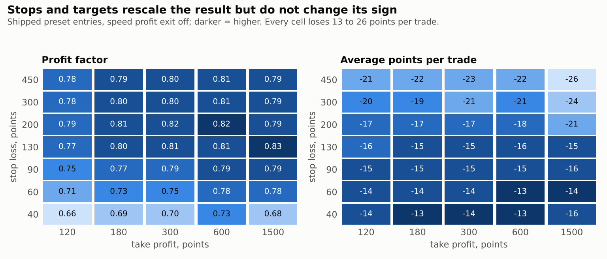

Profit factor, speed profit exit off:

| stop loss / take profit | target 120 | target 180 | target 300 | target 600 | target 1500 |
| --- | ---: | ---: | ---: | ---: | ---: |
| stop 40 | 0.66 | 0.69 | 0.70 | 0.73 | 0.68 |
| stop 60 | 0.71 | 0.73 | 0.75 | 0.78 | 0.78 |
| stop 90 | 0.75 | 0.77 | 0.79 | 0.79 | 0.79 |
| stop 130 | 0.77 | 0.80 | 0.81 | 0.81 | 0.83 |
| stop 200 | 0.79 | 0.81 | 0.82 | 0.82 | 0.79 |
| stop 300 | 0.78 | 0.80 | 0.80 | 0.81 | 0.79 |
| stop 450 | 0.78 | 0.79 | 0.80 | 0.81 | 0.79 |

Points per trade, same grid:

| stop loss / take profit | target 120 | target 180 | target 300 | target 600 | target 1500 |
| --- | ---: | ---: | ---: | ---: | ---: |
| stop 40 | -14.0 | -13.3 | -13.7 | -12.7 | -16.0 |
| stop 60 | -14.2 | -14.1 | -14.1 | -13.2 | -13.6 |
| stop 90 | -15.3 | -14.6 | -14.5 | -14.8 | -15.5 |
| stop 130 | -16.3 | -15.0 | -15.4 | -15.5 | -14.7 |
| stop 200 | -17.2 | -16.5 | -17.0 | -17.6 | -21.1 |
| stop 300 | -19.6 | -19.4 | -21.3 | -20.7 | -23.6 |
| stop 450 | -21.5 | -22.1 | -22.6 | -22.3 | -26.5 |

The profit factor moves because the size of wins and losses moves. The points lost per trade do not. The
highest profit factor in the whole grid (with the speed exit off, at 100 or at 200) is 0.83.

## 10. What gets closest: large bursts at a tight spread

### First, a trap: the order delay

A joint random search over 23 inputs without any order delay (300 sets, then 220 in the
best region, then a grid) kept finding the same recipe: market entries the instant the score is met, no entry
hold. It reported profit factors up to 1.45 on all three samples (before the stop-loss factor of
section 4 was added). It is an artefact. Those entries are sent in the middle of a burst. With a 150 ms
delay they fill 11 points worse on average, which is more than the 5 points per trade
the best of those sets makes without a delay.

| input set | 0 ms | 50 ms | 100 ms | 150 ms | 250 ms | 400 ms |
| --- | ---: | ---: | ---: | ---: | ---: | ---: |
| shipped reference preset (stop and limit orders) | 0.71 | 0.73 | 0.72 | 0.72 | 0.72 | 0.73 |
| shipped preset with the market route opened (the live route, without the flow feed) | 0.67 | 0.66 | 0.66 | 0.66 | 0.66 | 0.65 |
| calibrated preset (stop orders, large bursts, tight spread) | 1.17 | 1.16 | 1.16 | 1.15 | 1.16 | 1.18 |
| best set found with no order delay (market entries on the signal tick) | 1.07 | 0.88 | 0.85 | 0.83 | 0.80 | 0.81 |

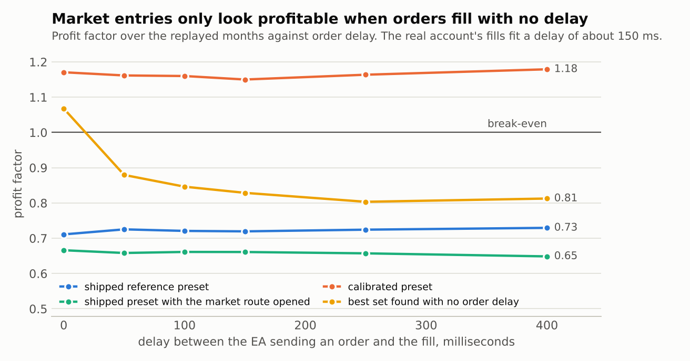

The second row is the shipped preset with the market route opened without the flow feed, which is the
closest the replay can get to the live route: it loses at every delay. The Strategy Tester has the same blind
spot as the first search unless an execution delay is set. Results of the no-delay searches are kept in
`results/zero_latency/` for comparison.

### What separates good from bad: burst size against spread

With the delay, stop orders are what remains: they rest at the server, so the delay only matters while they
are being placed (an order whose price the market has passed by then is refused). The alert already scales
with the spread, so raising `MaxTrailingMultiplier` from 7.5 to 30 means "only bursts of 30 spreads in 10
seconds". That is the EA's own idea, turned up.

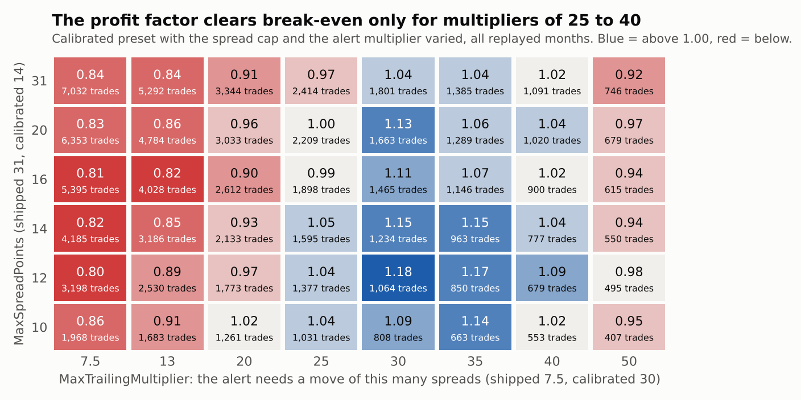

| MaxSpreadPoints / MaxTrailingMultiplier | x7.5 | x13 | x20 | x25 | x30 | x35 | x40 | x50 |
| --- | ---: | ---: | ---: | ---: | ---: | ---: | ---: | ---: |
| spread cap 31 | 0.84 | 0.84 | 0.91 | 0.97 | 1.04 | 1.04 | 1.02 | 0.92 |
| spread cap 20 | 0.83 | 0.86 | 0.96 | 1.00 | 1.13 | 1.06 | 1.04 | 0.97 |
| spread cap 16 | 0.81 | 0.82 | 0.90 | 0.99 | 1.11 | 1.07 | 1.02 | 0.94 |
| spread cap 14 | 0.82 | 0.85 | 0.93 | 1.05 | 1.15 | 1.15 | 1.04 | 0.94 |
| spread cap 12 | 0.80 | 0.89 | 0.97 | 1.04 | 1.18 | 1.17 | 1.09 | 0.98 |
| spread cap 10 | 0.86 | 0.91 | 1.02 | 1.04 | 1.09 | 1.14 | 1.02 | 0.95 |

(The calibrated preset with only these two inputs changed; trade counts are in the figure.) Below a
multiplier of 20 nothing reaches break-even (best 0.91); the band of 25 to 40 does, at a spread cap
of 12 to 20. The same grid without the entry hold and the post-entry validation, with a 200 point stop, stays
between 0.90 and 1.15 (`results/grid_stops.csv`), so the other settings of the preset matter too.

### The calibrated preset

| input | shipped | calibrated | what it does |
| --- | ---: | ---: | --- |
| `MaxTrailingMultiplier` | 7.5 | 30 | alert only on a move of 30 spreads within the lookback |
| `MaxSpreadPoints` | 31 | 14 | no entry while the spread is above about its median (15 over the replayed months; use your symbol's median) |
| `EntryRouterMode` | StopMarketLimit | StopOnly | no limit fades (they lose from the first second) and no market entries (they lose to the order delay) |
| `StopEntryDistancePoints` | 35 | 50 | the burst has to continue a little further before the stop order fills (effect inside the noise, see below) |
| `StopTPPoints` (and market/limit targets) | 180 (160) | 600 | let the winners run |
| `UseSpeedProfitExit` | true | false | do not close at +100 while the move continues |
| `InpUseTrailLayer`, `InpWaitForBurstSettle`, `UseTrailing` | false, true, true | true, false, false | trail layer allowed to act; simple trailing off |
| `InpReferenceSpreadPts` | 30 | 45 | trail layer 150 points behind the best price instead of 100 |
| `UseOrderFlow` | true | false | makes a live run the same program as the tester run that was calibrated |

Everything else stays as shipped, including the entry hold, the 60 minute drift filter, the FlashGold filter
and the 90 point stop.

Result over the replayed months, real fills: **profit factor 1.15** (1.16 / 1.06 /
1.39), 1,234 trades (about 8 a day), 33% winners, average win
+230, average loss -99, 10.0 points per trade, maximum drawdown 4,631
points. The t-statistic of the mean trade is 1.7; resampling the trades gives a 5%-95% range of
1.00 to 1.30 for the profit factor, with 5% of resamples below 1.

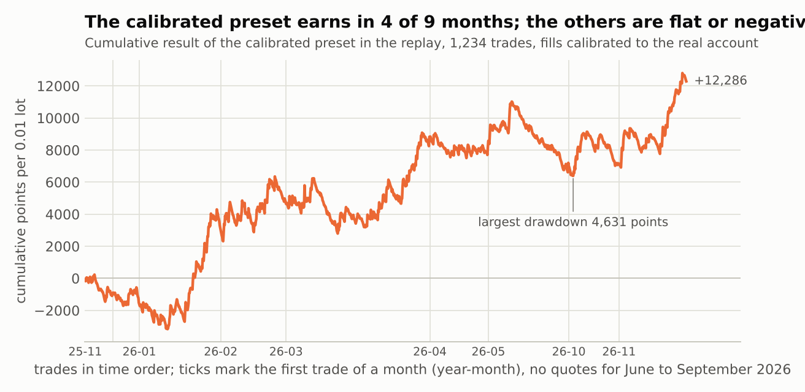

| month | trades | profit factor | points per trade | net points |
| --- | ---: | ---: | ---: | ---: |
| 2025-11 | 57 | 0.74 | -16.3 | -929 |
| 2025-12 | 54 | 0.82 | -11.0 | -592 |
| 2026-01 | 167 | 1.40 | 27.9 | 4,667 |
| 2026-02 | 134 | 1.14 | 12.2 | 1,641 |
| 2026-03 | 295 | 1.19 | 13.7 | 4,037 |
| 2026-04 | 120 | 0.92 | -5.3 | -635 |
| 2026-05 | 165 | 0.90 | -6.0 | -990 |
| 2026-10 | 103 | 0.98 | -1.1 | -112 |
| 2026-11 | 139 | 1.75 | 37.4 | 5,199 |

4 of 9 months are positive. The three best (2026-11, 2026-01, 2026-03) earn 13,903 points; the
other 6 together make -1,617.

These are very short trades in the fastest part of the market: the average alert is 360 points,
half the trades are over within 6 seconds, the average spread at entry is
16 points and the stop order fills 18 points beyond its price on average.
86% of the trades end at a stop:

| closed by | trades | share % | points per trade | net points | median seconds held |
| --- | ---: | ---: | ---: | ---: | ---: |
| stop loss (original) | 553 | 45 | -125.1 | -69,197 | 2.7 |
| trailing stop (trail layer) | 505 | 41 | 70.2 | 35,447 | 10.0 |
| take profit | 80 | 6 | 607.3 | 48,580 | 10.5 |
| EA-side close | 96 | 8 | -26.5 | -2,544 | 6.9 |

And the profit is one-sided:

| side | trades | profit factor | win % | points per trade | net points |
| --- | ---: | ---: | ---: | ---: | ---: |
| buy stops | 488 | 1.49 | 37 | 28.8 | 14,048 |
| sell stops | 746 | 0.97 | 31 | -2.4 | -1,762 |

Gold rose over most of the replayed months, so this may be the market and not the EA. It is not a reason to
switch sells off.

### How much of that is real: 384 neighbouring sets

A single replay of about 1,200 trades has a standard error of about 0.09 in the profit factor, and
the preset was picked from many, so its own number says little. A joint grid replaces it with averages: every combination of six multipliers, four spread
caps, four trailing variants, two entry holds and two stops.

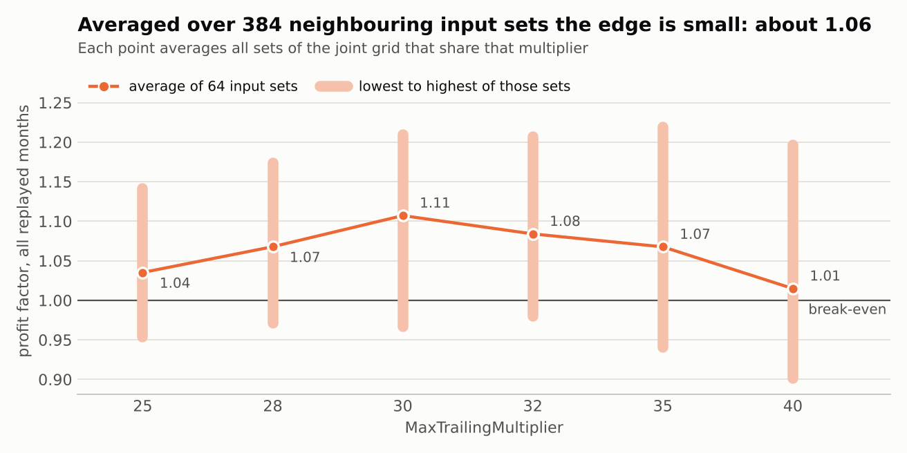

| input | value | sets | average profit factor | Nov-May | Oct-Nov 2026 | sets at or above 1, % | average drawdown, points |
| --- | --- | ---: | ---: | ---: | ---: | ---: | ---: |
| `MaxTrailingMultiplier` | 25 | 64 | 1.04 | 1.00 | 1.23 | 80 | 8,099 |
| `MaxTrailingMultiplier` | 28 | 64 | 1.07 | 1.04 | 1.24 | 95 | 6,673 |
| `MaxTrailingMultiplier` | 30 | 64 | 1.11 | 1.07 | 1.29 | 97 | 5,566 |
| `MaxTrailingMultiplier` | 32 | 64 | 1.08 | 1.05 | 1.28 | 94 | 6,331 |
| `MaxTrailingMultiplier` | 35 | 64 | 1.07 | 1.02 | 1.36 | 77 | 6,760 |
| `MaxTrailingMultiplier` | 40 | 64 | 1.01 | 0.97 | 1.33 | 53 | 6,710 |
| `MaxSpreadPoints` | 12 | 96 | 1.09 | 1.04 | 1.35 | 90 | 5,500 |
| `MaxSpreadPoints` | 14 | 96 | 1.08 | 1.03 | 1.32 | 88 | 5,978 |
| `MaxSpreadPoints` | 16 | 96 | 1.05 | 1.02 | 1.26 | 80 | 6,820 |
| `MaxSpreadPoints` | 20 | 96 | 1.03 | 1.01 | 1.23 | 73 | 8,460 |
| trailing | none | 96 | 1.10 | 1.05 | 1.35 | 97 | 7,904 |
| trailing | layer 100 | 96 | 1.03 | 1.00 | 1.21 | 68 | 6,467 |
| trailing | layer 150 | 96 | 1.07 | 1.03 | 1.33 | 88 | 6,486 |
| trailing | simple 100/110 | 96 | 1.05 | 1.01 | 1.26 | 78 | 5,901 |
| `InpEntryHoldMs` | 1100 | 192 | 1.09 | 1.06 | 1.30 | 93 | 6,063 |
| `InpEntryHoldMs` | 2000 | 192 | 1.03 | 0.99 | 1.28 | 72 | 7,317 |
| `StopSLPoints` | 90 | 192 | 1.06 | 1.02 | 1.34 | 86 | 6,270 |
| `StopSLPoints` | 130 | 192 | 1.06 | 1.03 | 1.24 | 79 | 7,109 |

Over all 384 sets the profit factor has a median of 1.06 (0.90 to 1.22);
83% are at or above 1. In the months to May the median is 1.02, in October-November
2026 it is 1.28, and every set is above 1 there: those two months were kind to the whole region,
with a tighter spread and smaller slips. Inside the region one sample does not predict another: the rank
correlation between the November-February and the March-May profit factor of a set is 0.06,
and between the months to May and October-November 0.27. So the differences between
neighbouring sets are noise, the region as a whole is slightly above break-even, and the preset's
1.15 sits at the upper end of what to expect. The averages support the calibrated values: the
multiplier peaks at 30 with a smooth fall on both sides, a tighter spread cap is better, the shipped entry
hold of 1100 ms is better than 2000, and the stop makes no difference.

The sets ranked by the months to May alone, with the two later months as a check:

| multiplier | spread cap | trailing | entry hold ms | stop | trades | Nov-May | Nov-Feb | Mar-May | Oct-Nov 2026 (not used for ranking) | all months | max drawdown, points |
| ---: | ---: | --- | ---: | ---: | ---: | ---: | ---: | ---: | ---: | ---: | ---: |
| 35 | 12 | none | 1,100 | 130 | 836 | 1.20 | 1.05 | 1.32 | 1.30 | 1.22 | 4,997 |
| 35 | 14 | none | 1,100 | 130 | 943 | 1.19 | 1.13 | 1.24 | 1.29 | 1.21 | 5,488 |
| 35 | 12 | layer 150 | 1,100 | 130 | 848 | 1.18 | 1.23 | 1.15 | 1.38 | 1.21 | 3,901 |
| 30 | 12 | none | 1,100 | 130 | 1,045 | 1.18 | 1.16 | 1.20 | 1.35 | 1.21 | 5,068 |
| 30 | 12 | layer 150 | 1,100 | 130 | 1,065 | 1.17 | 1.28 | 1.10 | 1.35 | 1.20 | 4,804 |
| 32 | 12 | none | 1,100 | 130 | 945 | 1.17 | 1.07 | 1.24 | 1.38 | 1.21 | 4,703 |
| 30 | 14 | simple 100/110 | 1,100 | 130 | 1,233 | 1.17 | 1.23 | 1.13 | 1.23 | 1.18 | 3,180 |
| 35 | 14 | layer 150 | 1,100 | 130 | 959 | 1.17 | 1.19 | 1.15 | 1.37 | 1.20 | 4,014 |

### How fragile is it?

| change to the calibrated preset | trades | profit factor | Nov-Feb | Mar-May | Oct-Nov 2026 | points per trade | max drawdown, points |
| --- | ---: | ---: | ---: | ---: | ---: | ---: | ---: |
| no trailing at all (trail layer off) | 1,217 | 1.12 | 1.10 | 1.06 | 1.35 | 9.3 | 6,220 |
| trail layer 100 points behind (shipped distance) | 1,237 | 1.11 | 1.08 | 1.08 | 1.29 | 7.1 | 3,492 |
| tester fills (no order delay) | 1,339 | 1.17 | 1.12 | 1.15 | 1.37 | 11.5 | 3,531 |
| order delay 400 ms | 1,116 | 1.18 | 1.20 | 1.13 | 1.26 | 12.0 | 5,796 |
| stop-loss slip as quoted (factor 1.0 instead of 1.5) | 1,234 | 1.25 | 1.28 | 1.16 | 1.46 | 15.6 | 4,084 |
| stop-loss slip factor 2.0 | 1,234 | 1.06 | 1.06 | 0.97 | 1.33 | 4.3 | 5,171 |
| strict fills (no snap, limits at price, delay 250 ms) | 1,172 | 1.04 | 1.10 | 0.95 | 1.20 | 3.0 | 5,340 |
| extra slip 2 points on every stop/stop-loss fill | 1,233 | 1.10 | 1.11 | 1.02 | 1.35 | 7.2 | 4,949 |
| extra slip 5 points on every stop/stop-loss fill | 1,234 | 1.02 | 1.03 | 0.94 | 1.21 | 1.4 | 5,651 |
| commission 3 points per round trip | 1,234 | 1.10 | 1.12 | 1.02 | 1.32 | 7.0 | 5,009 |
| commission 7 points per round trip | 1,234 | 1.04 | 1.06 | 0.96 | 1.24 | 3.0 | 5,677 |
| strict fills + commission 7 | 1,172 | 0.95 | 1.00 | 0.86 | 1.07 | -4.0 | 9,622 |
| FlashGold micro 1 s (capacity restart) | 955 | 1.14 | 1.20 | 0.99 | 1.56 | 9.5 | 4,843 |
| FlashGold micro 1 s as shipped (capacity block) | 0 | n/a | n/a | n/a | n/a | n/a | 0 |
| FlashGold filter off | 1,771 | 1.05 | 1.09 | 0.97 | 1.24 | 3.6 | 6,778 |

### Trailing on the calibrated entries

Same entries, only the trailing differs (78 variants, `results/study_trailing_calibrated.csv`).

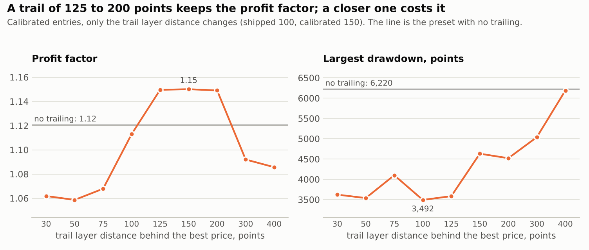

| trail layer | trades | profit factor | Nov-Feb | Mar-May | Oct-Nov 2026 | win % | points per trade | max drawdown, points | trades whose stop was moved, % |
| --- | ---: | ---: | ---: | ---: | ---: | ---: | ---: | ---: | ---: |
| no trailing | 1,217 | 1.12 | 1.10 | 1.06 | 1.35 | 16 | 9.3 | 6,220 | 0 |
| trail layer 30 points behind (`InpReferenceSpreadPts` 9) | 1,254 | 1.06 | 1.06 | 1.01 | 1.24 | 48 | 3.6 | 3,622 | 55 |
| trail layer 50 points behind (`InpReferenceSpreadPts` 15) | 1,249 | 1.06 | 1.05 | 0.99 | 1.29 | 48 | 3.5 | 3,538 | 55 |
| trail layer 75 points behind (`InpReferenceSpreadPts` 22.5) | 1,239 | 1.07 | 0.99 | 1.04 | 1.35 | 44 | 4.0 | 4,100 | 55 |
| trail layer 100 points behind (`InpReferenceSpreadPts` 30) | 1,237 | 1.11 | 1.08 | 1.08 | 1.29 | 39 | 7.1 | 3,492 | 55 |
| trail layer 125 points behind (`InpReferenceSpreadPts` 37.5) | 1,233 | 1.15 | 1.18 | 1.07 | 1.30 | 36 | 9.7 | 3,585 | 55 |
| trail layer 150 points behind (`InpReferenceSpreadPts` 45) | 1,234 | 1.15 | 1.16 | 1.06 | 1.39 | 33 | 10.0 | 4,631 | 55 |
| trail layer 200 points behind (`InpReferenceSpreadPts` 60) | 1,230 | 1.15 | 1.14 | 1.04 | 1.48 | 29 | 10.2 | 4,520 | 47 |
| trail layer 300 points behind (`InpReferenceSpreadPts` 90) | 1,222 | 1.09 | 1.03 | 1.02 | 1.44 | 23 | 6.8 | 5,038 | 31 |
| trail layer 400 points behind (`InpReferenceSpreadPts` 120) | 1,218 | 1.09 | 1.03 | 1.03 | 1.37 | 20 | 6.4 | 6,188 | 23 |

Simple trailing alone (trail layer off, settle rule off), profit factor:

| `TrailStartPoints` / `TrailBehindPoints` | behind 30 | behind 60 | behind 110 | behind 160 | behind 200 |
| --- | ---: | ---: | ---: | ---: | ---: |
| start 69 | 1.02 | 1.03 | 1.13 | 1.13 | 1.14 |
| start 100 | 1.04 | 1.07 | 1.16 | 1.14 | 1.14 |
| start 160 | 1.09 | 1.10 | 1.15 | 1.14 | 1.15 |
| start 270 | 1.11 | 1.11 | 1.13 | 1.12 | 1.12 |
| start 400 | 1.11 | 1.10 | 1.13 | 1.12 | 1.12 |

and largest drawdown in points:

| `TrailStartPoints` / `TrailBehindPoints` | behind 30 | behind 60 | behind 110 | behind 160 | behind 200 |
| --- | ---: | ---: | ---: | ---: | ---: |
| start 69 | 4,398 | 3,979 | 3,526 | 4,985 | 4,627 |
| start 100 | 4,066 | 3,685 | 3,392 | 4,938 | 4,627 |
| start 160 | 3,639 | 3,965 | 4,078 | 4,890 | 4,615 |
| start 270 | 4,017 | 4,270 | 4,495 | 5,243 | 5,352 |
| start 400 | 3,955 | 3,953 | 4,304 | 4,286 | 4,809 |

What the tables say:

- No trailing at all makes 1.12 with a drawdown of 6,220 points.
- A trail 110 to 200 points behind the price keeps the profit factor (1.12 to 1.16) and
  lowers the drawdown to 3,392-5,352 points.
- A trail closer than about 100 points costs profit factor (1.02 to 1.10): every exit
  becomes a stop fill, and a stop fill costs slippage.
- In the joint grid, where each trailing variant is averaged over 96 entry sets, no trailing is the best for
  the profit factor and the trail layer at 150 points is close behind it with a lower drawdown. The shipped
  distance of 100 points is the worst of the four. That is why the calibrated preset uses 150, and
  `FlashGold_NativeReference_Calibrated_NoTrailing_DISABLED.set` is the variant without any trailing.
- `TrailStepPoints` hardly matters (step 1: 1.14, step 5: 1.15, step 20: 1.16, step 40: 1.18). Trail layer and simple trailing together give
  160/110: 1.12, 270/60: 1.10, 400/200: 1.12.

The burst-settle rule on top of a trail (trail layer 100 or simple 160/110):

| trailing | settle rule | profit factor | max drawdown, points | trades whose stop was moved, % |
| --- | --- | ---: | ---: | ---: |
| simple 160/110 | quiet 250 ms, pullback 0.5 pips, speed 1 / 20 | 1.19 | 3,226 | 28 |
| simple 160/110 | quiet 500 ms, pullback 2 pips, speed 0.35 / 2 | 1.12 | 5,981 | 5 |
| simple 160/110 | quiet 500 ms, pullback 0.5 pips, speed 0.6 / 5 | 1.12 | 4,399 | 14 |
| simple 160/110 | quiet 1500 ms, pullback 2 pips, speed 0.35 / 2 | 1.11 | 6,819 | 1 |
| simple 160/110 | quiet 1500 ms, pullback 1 pips, speed 0.6 / 5 | 1.14 | 5,560 | 8 |
| simple 160/110 | quiet 7000 ms, pullback 100 pips, speed 0.35 / 100 | 1.12 | 6,220 | 0 |
| trail layer 100 | quiet 250 ms, pullback 0.5 pips, speed 1 / 20 | 1.19 | 4,090 | 41 |
| trail layer 100 | quiet 500 ms, pullback 2 pips, speed 0.35 / 2 | 1.14 | 6,689 | 4 |
| trail layer 100 | quiet 500 ms, pullback 0.5 pips, speed 0.6 / 5 | 1.12 | 6,170 | 17 |
| trail layer 100 | quiet 1500 ms, pullback 2 pips, speed 0.35 / 2 | 1.12 | 6,284 | 1 |
| trail layer 100 | quiet 1500 ms, pullback 1 pips, speed 0.6 / 5 | 1.12 | 6,399 | 9 |
| trail layer 100 | quiet 7000 ms, pullback 100 pips, speed 0.35 / 100 | 1.12 | 6,220 | 0 |

With the shipped settle values (last row of each block) the stop is never moved. A short quiet time and a
small pullback let the trail act and give the best single numbers of the study, but the gain is the size of
the noise.

Stop and target under the trail layer at 100 points:

| trail layer 100: stop / target | target 300 | target 600 | target 1000 | target 1500 |
| --- | ---: | ---: | ---: | ---: |
| stop 60 | 0.98 | 1.02 | 0.99 | 0.99 |
| stop 90 | 1.07 | 1.11 | 1.10 | 1.11 |
| stop 130 | 1.12 | 1.16 | 1.15 | 1.17 |

and at 200 points:

| trail layer 200: stop / target | target 300 | target 600 | target 1000 | target 1500 |
| --- | ---: | ---: | ---: | ---: |
| stop 60 | 1.02 | 1.07 | 1.03 | 1.02 |
| stop 90 | 1.10 | 1.15 | 1.13 | 1.13 |
| stop 130 | 1.12 | 1.18 | 1.16 | 1.16 |

### Each setting put back, one at a time

On the variant without trailing, so that the trailing does not blur the comparison:

| one setting changed (variant without trailing, profit factor 1.12) | trades | profit factor | Nov-Feb | Mar-May | Oct-Nov 2026 | points per trade |
| --- | ---: | ---: | ---: | ---: | ---: | ---: |
| back to shipped: multiplier 7.5 | 4,105 | 0.84 | 0.88 | 0.76 | 0.98 | -12.0 |
| back to shipped: spread cap 31 | 1,773 | 1.04 | 0.88 | 1.11 | 1.31 | 3.1 |
| back to shipped: stop entry distance 35 | 1,362 | 1.03 | 1.11 | 0.93 | 1.16 | 2.1 |
| back to shipped: fade route on (EntryRouterMode 2) | 981 | 0.90 | 0.89 | 0.82 | 1.17 | -7.5 |
| back to shipped: speed profit exit on at 100 | 1,228 | 1.04 | 1.06 | 1.02 | 1.07 | 2.8 |
| back to shipped: target 180 | 1,270 | 1.03 | 0.98 | 1.04 | 1.10 | 1.7 |
| back to shipped: speed exit on and target 180 | 1,246 | 1.00 | 0.97 | 1.02 | 1.05 | 0.2 |
| entry hold off | 2,857 | 0.99 | 0.96 | 0.92 | 1.22 | -1.0 |
| 60 minute drift filter off | 1,808 | 0.98 | 1.02 | 0.90 | 1.14 | -1.2 |
| FlashGold filter off | 1,744 | 1.00 | 0.99 | 0.95 | 1.22 | 0.3 |
| post-entry validation off | 1,225 | 1.02 | 1.06 | 0.96 | 1.10 | 1.9 |
| continuation filter off | 1,269 | 1.14 | 1.10 | 1.05 | 1.51 | 10.5 |
| buys only | 481 | 1.37 | 1.59 | 1.26 | 1.28 | 26.0 |
| sells only | 735 | 0.97 | 0.89 | 0.92 | 1.41 | -2.3 |

`MaxTrailingMultiplier` is the lever: back at 7.5 the same preset makes 0.84. The fade route
costs most after that (0.90). The entry hold, the 60 minute drift filter, the FlashGold filter
and the post-entry validation all help. The continuation filter does not matter here (1.14 without
it).

Neighbouring values (29 replays, 0.97 to 1.19):

| input | calibrated | neighbouring values: profit factor | lowest | highest |
| --- | --- | --- | ---: | ---: |
| MaxSpreadPoints | 14 | 11 -> 1.09, 12 -> 1.19, 13 -> 1.16, 16 -> 1.14, 20 -> 1.12 | 1.09 | 1.19 |
| MaxTrailingMultiplier | 30 | 20 -> 0.97, 25 -> 1.06, 35 -> 1.19, 40 -> 1.15 | 0.97 | 1.19 |
| StopEntryDistancePoints | 50 | 20 -> 1.10, 35 -> 1.03, 40 -> 1.07, 60 -> 1.11, 70 -> 1.08 | 1.03 | 1.11 |
| StopSLPoints | 90 | 60 -> 1.06, 130 -> 1.11, 200 -> 1.02, 300 -> 1.02 | 1.02 | 1.11 |
| StopTPPoints | 600 | 300 -> 1.09, 400 -> 1.10, 1000 -> 1.11, 1500 -> 1.11 | 1.09 | 1.11 |
| PendingExpirySeconds | 5 | 3 -> 1.05, 10 -> 1.11, 20 -> 1.10 | 1.05 | 1.11 |
| SpeedLookbackSeconds | 10 | 5 -> 1.03, 15 -> 0.97 | 0.97 | 1.03 |
| InpEntryHoldMs | 1100 | 500 -> 0.99, 2000 -> 1.17 | 0.99 | 1.17 |

### Every input once more, around the calibrated preset

The one-at-a-time sweep of section 7 was repeated around the calibrated preset: 74 inputs,
329 replays.

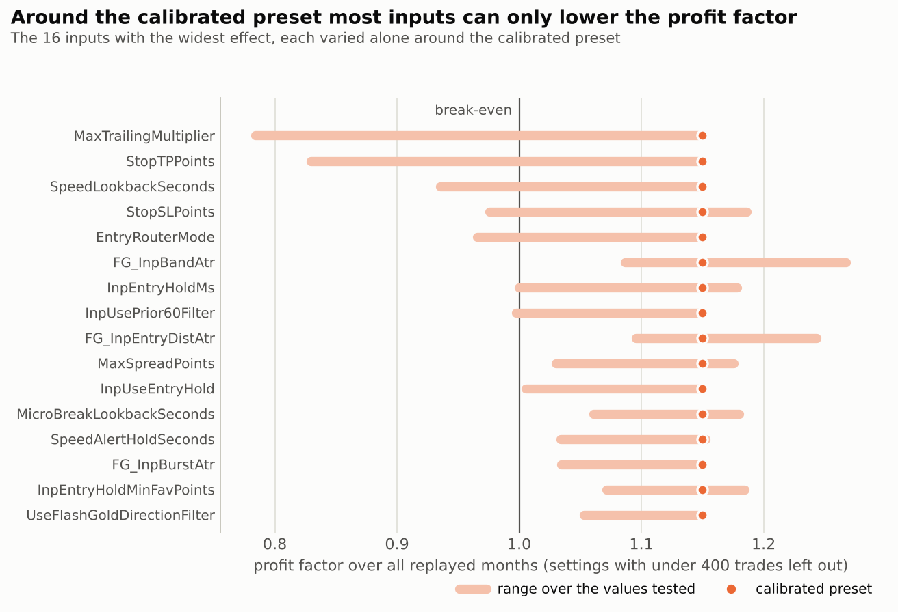

| input | calibrated | values tested | lowest | highest | best value | best: Nov-Feb / Mar-May / Oct-Nov |
| --- | --- | --- | ---: | ---: | --- | --- |
| MaxTrailingMultiplier | 30 | 3, 4, 5, 6, 7.5, 9, 11, 13, 16, 20, 25, 30, 35, 40, 50 | 0.78 | 1.15 | 30 | 1.16 / 1.06 / 1.39 |
| StopTPPoints | 600 | 60, 80, 100, 130, 180, 250, 400, 600, 1000, 1500 | 0.83 | 1.15 | 600 | 1.16 / 1.06 / 1.39 |
| SpeedLookbackSeconds | 10 | 2, 3, 5, 7, 10, 15 | 0.94 | 1.15 | 10 | 1.16 / 1.06 / 1.39 |
| StopSLPoints | 90 | 40, 60, 75, 90, 110, 130, 160, 200, 300 | 0.98 | 1.19 | 110 | 1.28 / 1.08 / 1.28 |
| EntryRouterMode | 0 | 0, 1, 2 | 0.97 | 1.15 | 0 | 1.16 / 1.06 / 1.39 |
| FG_InpBandAtr | 0.25 | 0, 0.1, 0.25, 0.5, 1 | 1.09 | 1.27 | 1 | 1.18 / 1.19 / 1.69 |
| InpEntryHoldMs | 1100 | 250, 500, 800, 1100, 1500, 2000, 3000 | 1.00 | 1.18 | 1500 | 1.32 / 1.09 / 1.13 |
| InpUsePrior60Filter | 1 | 0, 1 | 1.00 | 1.15 | 1 | 1.16 / 1.06 / 1.39 |
| FG_InpEntryDistAtr | 0.25 | 0, 0.25, 0.5, 1 | 1.10 | 1.24 | 1 | 1.19 / 1.12 / 1.80 |
| MaxSpreadPoints | 14 | 10, 11, 12, 13, 14, 16, 20, 31, 60 | 1.03 | 1.18 | 12 | 1.16 / 1.09 / 1.45 |
| InpUseEntryHold | 1 | 0, 1 | 1.01 | 1.15 | 1 | 1.16 / 1.06 / 1.39 |
| MicroBreakLookbackSeconds | 10 | 2, 5, 10, 20, 30, 60 | 1.06 | 1.18 | 60 | 1.26 / 1.03 / 1.48 |
| SpeedAlertHoldSeconds | 20 | 13, 15, 20, 30, 45, 60 | 1.03 | 1.15 | 13 | 1.17 / 1.00 / 1.59 |
| FG_InpBurstAtr | 0.5 | 0.25, 0.5, 1, 1.5, 2.5 | 1.03 | 1.15 | 0.5 | 1.16 / 1.06 / 1.39 |
| InpEntryHoldMinFavPoints | 5 | -20, 0, 5, 10, 20, 35, 50 | 1.07 | 1.18 | 10 | 1.22 / 1.11 / 1.33 |
| UseFlashGoldDirectionFilter | 1 | 0, 1 | 1.05 | 1.15 | 1 | 1.16 / 1.06 / 1.39 |

Settings with fewer than 400 trades are left out. 20 inputs change nothing at the calibrated
values. Most of the others can only lower the result: the calibrated values of the multiplier, the target,
the router, the entry hold and the drift filter are at or near the top of their own range. Several ranges
are jagged (for example `SpeedLookbackSeconds` and `StopEntryDistancePoints`), which is the noise of a
1,200-trade sample and not a property of the EA.

Values that beat the preset by at least 0.03 in all three samples (4):

| input | value | trades | profit factor | Nov-Feb | Mar-May | Oct-Nov 2026 | max drawdown, points |
| --- | --- | ---: | ---: | ---: | ---: | ---: | ---: |
| FG_InpBandAtr | 1 | 619 | 1.27 | 1.18 | 1.19 | 1.69 | 2,304 |
| FG_InpEntryDistAtr | 1 | 867 | 1.24 | 1.19 | 1.12 | 1.80 | 3,260 |
| InpCPMinTickRate60 | 2 | 1,284 | 1.18 | 1.19 | 1.08 | 1.49 | 4,666 |
| InpCPMinTickRate60 | 0 | 1,288 | 1.18 | 1.19 | 1.07 | 1.49 | 4,666 |

(pending)

## 11. FlashGold micro mode, spread, and what to do next

**The micro presets cannot trade as shipped.** With `FG_Resolution` = quote milliseconds the filter keeps at
most `FG_MicroMaxBars` (maximum 4,096) occupied buckets per capture epoch. The 4,097th bucket makes
`CFgfQuoteBuckets::Feed` fail with "capacity exhausted; restart required", and it stays failed: every later
entry is refused by `FlashGoldAllowsEntry`. That is 68 minutes of continuous quotes at 1 s and 17 minutes at
250 ms. Replayed literally, with a fresh start every week, the micro presets place 0
trades. The package's own test names this behaviour ("capacity blocks without rolling reseed"), so it is
intended for now, but no preset built on it can be backtested or calibrated. The micro numbers in this
report assume the stream restarts at capacity (new epoch, 100 bars of warm-up). On that assumption the 1 s
micro filter behaves like the native M5 filter: 0.71 on 9,111 trades for the shipped micro
preset, 1.14 for the calibrated preset.

**Spread.** The feed was rebuilt at five spread levels:

| median spread of the feed | 5 points | 10 points | 15 points | 20 points | 29 points |
| --- | ---: | ---: | ---: | ---: | ---: |
| shipped reference preset | 0.87 | 0.79 | 0.72 | 0.68 | 0.57 |
| calibrated preset | 1.03 | 1.01 | 1.15 | 0.92 | 0.64 |

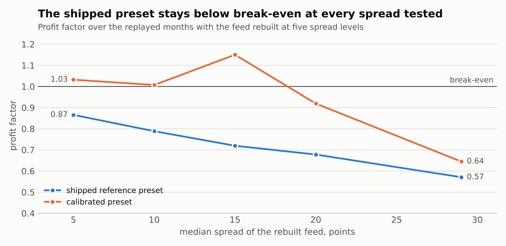

| trades | 5 points | 10 points | 15 points | 20 points | 29 points |
| --- | ---: | ---: | ---: | ---: | ---: |
| shipped reference preset | 11,682 | 10,912 | 9,282 | 7,380 | 3,669 |
| calibrated preset | 6,694 | 3,109 | 1,234 | 567 | 230 |

**Checking this in MetaTrader.** Use `presets/FlashGold_NativeReference_Calibrated_DISABLED.set` with
`TradingEnabled` switched on in the tester, "Every tick based on real ticks", an execution delay of about
150 ms, and at least three months. Things to compare with section 10: trades per day (about
8), share of trades that end at a stop (86%), average win and loss
(+230 / -99). Then, if it holds:

1. `FlashGold_NativeReference_Calibrated_entries_TESTER_OPT.set` optimises `MaxTrailingMultiplier` 20-45,
   `MaxSpreadPoints` 9-16, `StopEntryDistancePoints` 20-80 and `PendingExpirySeconds` 3-15.
2. `FlashGold_NativeReference_Calibrated_exits_TESTER_OPT.set` optimises the stop, the target and the trail
   layer distance (through `InpReferenceSpreadPts`).
3. `FlashGold_NativeReference_Calibrated_simple_trailing_TESTER_OPT.set` optimises the simple trailing in
   place of the trail layer.
4. `FlashGold_NativeReference_Calibrated_flashgold_TESTER_OPT.set` optimises the two FlashGold gate inputs
   named above.
5. `FlashGold_NativeReference_shipped_trailing_TESTER_OPT.set` is the trailing question on the shipped
   entries (expect section 8: no gain).

Use a forward period and keep the delay on. Set `MaxSpreadPoints` from your symbol's median spread, not from
the number 14. Count the broker's commission: 3 points per round trip leaves 1.10 in the replay
and 7 points 1.04.

**Changes in the code that the data supports**, none of them made here: a rolling or restarting bucket
series for the micro mode; the 6.8 pip exit gate as an input; a commission input that the continuation
filter can use; an hour filter is *not* supported by the data (no hour is reliably better).

## 12. Limits

- This is a replay written from the source, not MetaTrader. It matches the real account's exit mix, win rates
  and slippage, but it has been compared trade by trade on 283 trades only.
- The spread is a scaled Dukascopy spread. A broker whose spread behaves differently in fast markets changes
  the result; `MaxSpreadPoints` and `MaxTrailingMultiplier` both act through the spread.
- The calibrated preset earns 10.0 points per trade before commission, with a stop slippage factor
  fitted on one month of real fills. With the factor at 1.0 it makes 1.25, at 2.0
  1.06. It trades during the fastest moves, where real slippage is hardest to predict.
- The preset was chosen with all three samples in view, and the region around it averages
  1.06. Its own profit factor is not an estimate of what a forward run will show.
- The profit came from buys in a rising market and from 4 of 9 months.
- Nothing was tested with the order-flow feed, because nothing can be: the feed is not in the tester.
- June to September 2026 is missing from the data.

## 13. Files, and how to rerun

```
REPORT.md                      this report (generated by tools/make_report.py from REPORT.template.md)
presets/                       calibrated presets (*_DISABLED.set) and optimiser range files (*_TESTER_OPT.set)
shipped_presets/               the five presets of the package, unchanged
results/                       every table as csv, charts/, real/ (the real trades), zero_latency/ (searches without order delay)
tools/engine.py                the port of SpeedAlert_FlashGold_Micro.mq5 (numba)
tools/flashgold.py             the port of the FlashGold direction filter and the quote buckets
tools/ticks.py, sim.py, sweep.py, params.py     feed, runner, fill models, .set reading and writing
tools/run_all.sh               every study in order, one at a time, restartable
tools/selftest.py              checks of the port
```

```bash
pip install numpy pandas numba pyarrow matplotlib
cd flashgold_micro_calibration/tools
python -I fetch_hf_ticks.py ../data 2025-11 2026-05          # ticks, public copy of the Dukascopy feed
python -I fetch_dukascopy.py fetch XAUUSD 2026-10-06 2026-11-13 ../data && python -I fetch_dukascopy.py build XAUUSD ../data
python -I fetch_dukascopy.py hours XAUUSD ../data/real_trade_hours.txt ../data     # hours of the real-trade window, slow
python -I fetch_dukascopy.py build XAUUSD ../data ../data/real_window 2026-09-01 2026-10-09
python -I chart_trades.py <component>/basis/saved_chart.chr ../results/real/real_trades_sar.csv
bash run_all.sh                                               # about 45 minutes on 4 cores, 16 GB
python -I classify_inputs.py ../results
python -I make_presets.py ../presets/presets_spec.json ../presets
python -I charts.py ../results && python -I make_report.py
```

`python -I` keeps Python from importing anything from the working directory. To replay one of your own
presets: `sim.Sim(ticks.Feed("../data", 12)).run(sweep.base("<preset stem>"))` returns the trade list.
