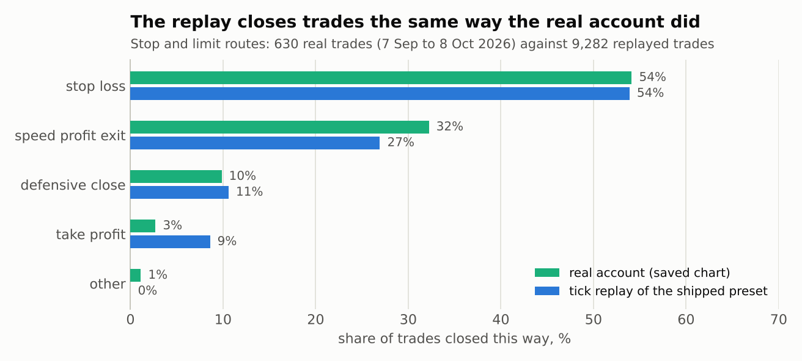
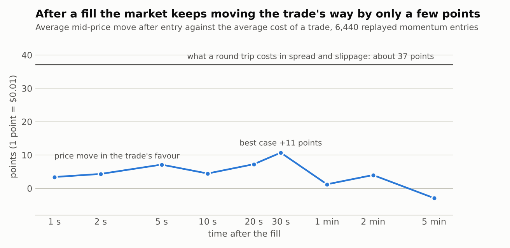
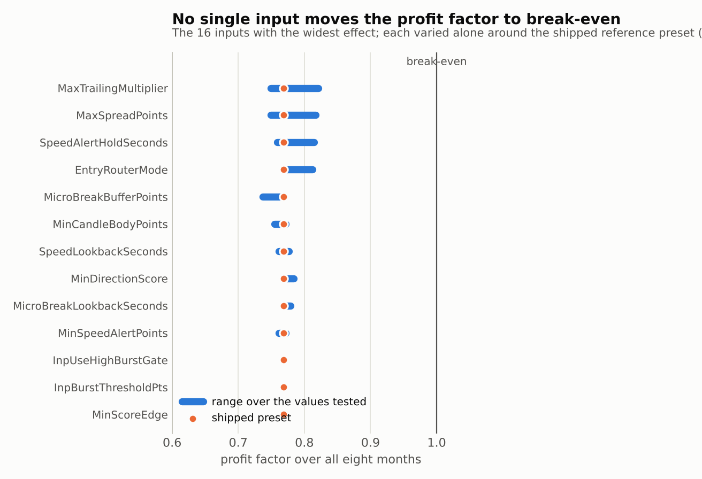
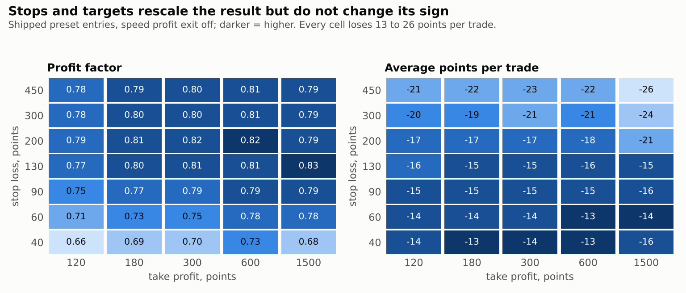
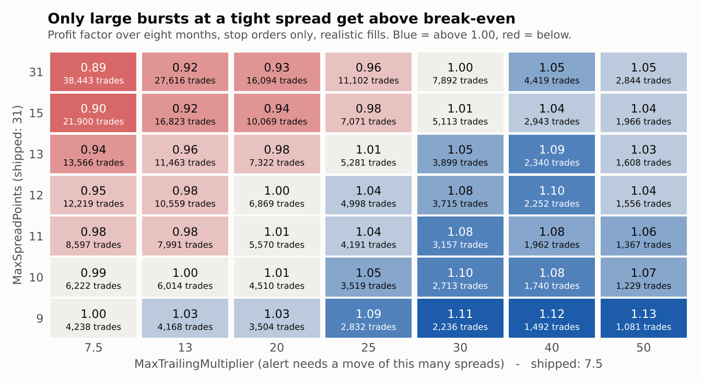

# SpeedAlert FlashGold Micro v1.501: calibration of every input and of the trailing

Date: 2026-11-15. Input: `components.zip` (`speedalert-flashgold-micro`, development build 1.501, tester only,
five `*_DISABLED.set` presets). MetaTrader does not run in this environment, so the EA was ported to a tick
replay and checked against the {{real_n}} real trades stored in the package's own `basis/saved_chart.chr`.
Every number below is in points per 0.01 lot (1 point = $0.01 of price = $0.01 per 0.01 lot) and can be
regenerated with the commands in section 13.

## 1. Short version

1. **The shipped settings lose money, on the real account and in the replay.** The saved chart holds
   {{real_n}} real trades of this EA from 7 September to 8 October 2026: profit factor **{{real_pf}}**,
   {{real_win}} winners, {{real_avg}} points per trade, {{real_net}} points in total. The replay of the shipped
   reference preset over eight other months gives **{{ref_pf}}** on {{ref_n}} trades and is below 1 in every
   month ({{ref_month_min}} to {{ref_month_max}}).
2. **The reason is cost, not exits.** After a fill the price keeps moving in the trade's favour by at most
   about {{fwd_best}} points on average, while a round trip costs about {{fwd_cost}} points in spread and
   stop slippage. Stops, targets and trailing cannot change that sign: across {{exit_n}} stop/target/exit
   combinations the result stays between {{exit_avg_worst}} and {{exit_avg_best}} points per trade.
3. **No single input fixes it.** {{oat_n_inputs}} inputs were varied one at a time ({{oat_n_runs}} replays): the
   profit factor stays between {{oat_min}} and {{oat_max}}. {{n_telemetry}} of the {{n_inputs}} inputs are
   telemetry and cannot change an order at all.
4. **Six changes together do.** Trade only bursts that are large against the spread
   (`MaxTrailingMultiplier` 7.5 to 30), cap the spread near its median (`MaxSpreadPoints` 31 to 14), place the
   stop entry further out (35 to 50), drop the fade and market routes (`EntryRouterMode` StopOnly), move the
   target out (180 to 600) and switch the fixed 100 point speed exit off. In the replay that set makes
   **{{fin_pf}}** on {{fin_n}} trades (calibration months {{fin_is}}, validation months {{fin_val}},
   hold-out month {{fin_test}}), {{fin_avg}} points per trade. It is thin: it drops to {{fin_comm7_pf}} with a
   7 point commission, {{fin_strict_pf}} with strict fills, {{fin_worst_pf}} with both.
5. **Trailing.** As shipped, neither trailing mechanism can ever act: `TrailStartPoints` 270 lies beyond the
   180 target, and the burst-settle rule waits for a 100 pip pullback. Switched on, trailing does not raise the
   profit factor by itself. On the calibrated entries the spread-scaled trail layer at 100 to 200 points keeps
   the profit factor and halves the drawdown ({{nt_dd}} to {{fin_dd}} points); trailing closer than about
   100 points lowers the profit factor.
6. **Three things to know before any Strategy Tester run.**
   - The four micro presets place **{{micro_literal_n}} trades in eight months** as shipped: the quote-bucket
     series blocks for good after 4,096 occupied buckets (about 68 minutes at 1 s) until the EA is restarted.
   - The tester fills orders on the tick that sends them. With that, a search finds "profit factors" up to
     {{z_grid_max}} from market entries; with the 150 ms delay that the real fills show, the same sets fall
     to {{mk_grid_lo}}-{{mk_grid_hi}}. Set an execution delay in the tester.
   - The order-flow feed (terminal global variables) does not exist in the tester, so a tester run never
     takes the market route that produced 74% of the real trades. Live and tester are different programs
     unless `UseOrderFlow` is false.

Deliverables: calibrated presets and optimiser range files in `presets/`, all result tables in `results/`,
the replay and every study in `tools/`. Nothing here has been run in MetaTrader; section 11 says how to
check it there.

## 2. What the EA does, in the order the replay follows

| stage | rule (shipped preset values) |
| --- | --- |
| speed alert | mid price moved over the last `SpeedLookbackSeconds` (10 s) by at least max(`MinSpeedAlertPoints` 37, spread x `MaxTrailingMultiplier` 7.5); it stays active until 20 s after the start of that window |
| direction score | speed direction 1.0, forming M1 candle body of at least 21 points 1.5, break of the 10 s high or low by 3 points 1.5, spread inside `MaxSpreadPoints` 0.5, plus up to three order-flow votes of 1.0. A side needs 4.0 and a lead of 1.5. Without the flow feed that means speed, body and micro-break must all agree |
| router | exhaustion (wick rejection, snap-back, opposite pressure): limit order 35 points against the burst (EXHL). Follow-through with flow agreement: market order (FOLM). Otherwise a stop order 35 points ahead (FLXQ, BNO, CONT...). Pending orders are deleted after 5 s |
| gates | FlashGold direction filter (BUY/SELL area of the last signal bar), entry hold (wait 1100 ms and need +5 points), price drift over the last 60 minutes on the trade's side, continuation filter (tick rate, quote gap, range against cost), one order and one position per scenario, lockout after three defensive closes |
| exits | stop 90 (market 80), target 180 (market/limit 160). EA-side exits are locked until the trade has first been more than 6.8 pips (68 points) in profit; that gate is a constant in the code, not an input. Then: close at 100+ points when a new alert on the trade's side is active (speed profit exit), close a trade that fell back to a loss (retest and pressure shields), trailing |

Of the {{n_inputs}} inputs, {{n_replayed}} can change an order in a tester run and are replayed,
{{n_telemetry}} are telemetry, logging, visuals or shadow scorecards, {{n_labels}} are labels, comments and
file names, {{n_flow}} belong to the order-flow feed, {{n_sizing}} are position sizing (irrelevant to the profit
factor at the fixed 0.01 lot) and {{n_notreplayed}} are not replayed (percentile threshold modes, retry
timers and the like). `results/inputs_classification.csv` lists every input with its class and the profit
factor range found for it.

## 3. The real trades in the saved chart

`basis/saved_chart.chr` was saved with trade history on, so it contains every closed trade of the account as
chart objects. `tools/chart_trades.py` reads them back: {{real_n}} trades with a `SAR:` comment on
{{real_days}} trading days (about {{real_per_day}} a day), all 0.01 lot, symbol XAUUSD-ECN with 2 digits. The
chart's own EA inputs are identical to the shipped reference preset except `TradingEnabled`, and the exit mix
shows the 6.8 pip gate was already active. Profit is price difference only; commission and swap are not on the
chart.

Overall: profit factor **{{real_pf}}**, {{real_win}} winners, average win +{{real_avg_win}}, average loss
{{real_avg_loss}}, {{real_net}} points (${{real_usd}} lost at 0.01 lot).

{{T_real_routes}}

{{T_real_exits}}

Two things stand out. Half of all trades end at the stop, and a third of all trades are closed within 10
seconds: those carry nearly the whole loss.

{{T_real_hold}}

And the order-flow feed did not pick better trades. Entries the feed agreed with did worse than the ones it
disagreed with:

{{T_real_flow}}

## 4. The replay, and how far it can be trusted

**Data.** XAUUSD ticks from Dukascopy: November 2025 to May 2026 (via the public Hugging Face copy
`CarlosSilva1/xauusd-ticks`, CC-BY-4.0) and 6 October to 13 November 2026 (downloaded directly), about 62
million quotes after rebuilding. The direct download is throttled hard (roughly a hundred hourly files, then a
long block), so June to September 2026 is missing and only two days of the real-trade window could be fetched. Dukascopy quotes 3
digits with a spread near 55 points, which the EA's own spread caps reject, so the replay keeps the Dukascopy
mid price and tick times and rebuilds a 2-digit bid/ask around it with the spread scaled to a median of 12
points in October-November 2026 (15 over all months). Real market fills sit a median of 1 to 7 points from the
Dukascopy mid on the trade's side, which is consistent with a real spread of about 10 points.

**Split.** Calibration November 2025 to February 2026, validation March to May 2026, hold-out October to
November 2026. Every table shows the three separately. The final preset was chosen after looking at all
three, so the hold-out is not a clean out-of-sample test any more; treat it as a third sample.

**Execution model, calibrated on the real fills.**

| what | real account | replay |
| --- | --- | --- |
| stop-order and stop-loss fills exactly at their level | 74% | 76% (a touch within 10 points of the level fills at the level) |
| average slip of a stop-loss fill | 7.6 to 8.1 points | 9.7 points |
| average slip of a stop-order entry | 2.8 to 6.0 points | 4.9 points |
| market entry against the price when the EA decided (5th / 25th / 50th / 75th / 90th percentile) | -24 / -3 / 0 / +3 / +14 points | -20 / -5 / 0 / +6 / +15 points with an order delay of 150 ms |
| limit orders and take profits | filled at the market, with price improvement | same |

"Real fills" in every table means this model. "Strict fills" means no snapping to the level, no price
improvement and a 250 ms delay.

**Does it reproduce the real account?** For the stop and limit routes (the replay has no order-flow feed, so
it cannot take the market route) on different months:

{{T_fidelity_routes}}



For the {{rr_n}} real trades of 7-8 October whose ticks could be downloaded, the replay was given the real
entries and only managed the exits: {{rr_sim_avg}} points per trade against {{rr_real_avg}} real (profit
factor {{rr_sim_pf}} against {{rr_real_pf}}), {{rr_sign}} of the trades ending on the same side, correlation
{{rr_corr}}. That sample is small.

**Self-test.** `tools/selftest.py` runs the package's own quote-bucket cases (`tests/test_bucket_host.py`)
against the port, checks the continuation filter and the TDI direction against plain numpy/pandas, and checks
that skipping idle ticks and re-injecting the replay's own fills change nothing: 1,218 checks pass.

**Not replayed.** The order-flow feed (it does not exist in the tester either), PERCENTILE threshold modes,
`CandleIndexToCheck` other than 0, broker stop/freeze levels (taken as 0), frozen-order retry paths, the
quote-session calendar of the FlashGold bars, and the "observed live" commits of the FlashGold parent/zone
directions. Trade-for-trade parity with MetaTrader is not claimed.

## 5. Baseline: the shipped presets

{{T_baseline}}

The five presets are one configuration with different FlashGold filter modes, and the filter mode barely
matters: with the filter off the reference preset makes {{ref_nofg_pf}} on {{ref_nofg_n}} trades. The source
code defaults (which differ from the presets in eleven EA inputs and the FlashGold timeframes) make {{src_pf}}
on {{src_n}} trades.


{{T_baseline_month}}

## 6. Why the shipped settings lose

For every replayed entry of the reference preset, the table follows the mid price after the fill, in the
trade's direction, with no stop or target.

{{T_forward}}



The momentum stop entries are right about direction, by a few points. They pay about {{fwd_spread}} points of
spread and {{fwd_slip}} points of entry slippage, and half of them pay stop-loss slippage on top. The limit
fades are wrong about direction from the first second. This is why every exit variant in sections 7 and 8
loses about the same number of points per trade.

## 7. Every input, one at a time

Each input was varied alone around the shipped reference preset, over the whole feed.



{{T_oat_top}}

Settings with fewer than 2,000 trades are left out of the table. Full results: `results/oat_native_all.csv`
(reference preset) and `results/oat_micro1s_fg.csv` ({{micro_n_inputs}} FlashGold inputs around the 1 s micro
preset, profit factor {{micro_lo}} to {{micro_hi}}).

Inputs that change nothing at the shipped values, because another setting makes them unreachable:
{{oat_dead}}.

One code constant matters more than any input: without the 6.8 pip exit gate (`minimumProfitPips` in
`TrailingActivationProfitReached`) the replay falls to {{gate0_pf}}. The gate is doing useful work; it would
be worth exposing as an input.

## 8. Trailing

The EA has three pieces:

- **Simple trailing** (`UseTrailing`, `TrailStartPoints`, `TrailBehindPoints`, `TrailStepPoints`): once the
  trade is `TrailStart` points up, keep the stop `TrailBehind` points behind the price.
- **Trail layer** (`InpUseTrailLayer` and the `internal*` inputs): after the trade is 68 points up, keep the
  stop behind the best price by a multiple of max(spread, `InpReferenceSpreadPts`). The multiple is
  `internalOrderDistance` clamped between `internalMinTrailing` and `internalMaxTrailing`, and the distance is
  capped at `InpTrailOuterCapPts`: 100 points at the shipped values. `internalMaxTrailing` must equal `internalMinTrailing` x `internalMultiplier`
  or the EA refuses to start, so the optimiser can only vary the distance through `InpReferenceSpreadPts`.
- **Burst settle** (`InpWaitForBurstSettle` and four inputs): both mechanisms may only tighten the stop after
  the price has pulled back `InpBurstSettlePullbackPips` from its best and stayed calm for
  `InpBurstSettleQuietMs`.

**As shipped nothing trails.** `TrailStartPoints` = 270 is beyond the 180 point target, the trail layer is
off, and the settle rule asks for a 100 pip ($10) pullback inside a trade whose stop is 90 points away.
Changing `TrailStart`, `TrailBehind` or `TrailStep` alone therefore does nothing.

**Simple trailing on the shipped entries** (settle rule off, speed exit kept; preset without trailing:
{{trail_base_pf}}):

{{T_trail_simple}}

With the settle rule on (source defaults and four variants) the range is {{trail_settle_lo}} to
{{trail_settle_hi}}: the rule mostly prevents the trail from acting.

**Trail layer on the shipped entries:**

{{T_trail_layer}}

**Letting winners run** (speed profit exit off, far target, late trail) is the best exit structure for the
shipped entries, and still below 1:

{{T_trail_runner}}

Trailing on the calibrated entries is in section 10.

## 9. Stops, targets and the speed profit exit



Profit factor, speed profit exit off:

{{T_exit_pf}}

Points per trade, same grid:

{{T_exit_avg}}

The profit factor moves because the size of wins and losses moves. The points lost per trade do not. The
highest profit factor in the whole grid (with the speed exit off, at 100 or at 200) is {{exit_pf_max}}.

## 10. What does work: large bursts at a tight spread

**First, a trap.** A joint random search over 23 inputs without any order delay ({{z_wide_n}} sets, then
{{z_focus_n}} in the best region, then a grid) kept finding the same recipe: market entries the instant the
score is met, no entry hold. Best profit factor {{z_grid_max}}, on all three samples. It is an artefact. Those
entries are sent in the middle of a burst (the price has moved about 90 points in the previous second on
average). With a 150 ms delay they fill {{mk_slip150}} points worse on average, which is more than the
{{mk_avg0}} points per trade the search thought it had found.

{{T_latency}}


The Strategy Tester has the same blind spot unless an execution delay is set. Results of the no-delay
searches are kept in `results/zero_latency/` for comparison.

**With the 150 ms delay**, stop orders are what remains (they rest at the server, so the delay does not
touch them). A search of {{jw_n}} random sets under the delay: profit factor 10th percentile {{jw_q10}},
median {{jw_med}}, 90th percentile {{jw_q90}}, best {{jw_max}}; {{jw_share}} of the sets are at or above 1 in
both the calibration and the validation months. What separates the good sets is how big the burst is against
the spread:



{{T_grid}}

(Stop orders only, no entry hold, stop 200, target 600, speed exit off, trail layer on. Trade counts are in
the figure.) The alert already scales with the spread, so raising `MaxTrailingMultiplier` from 7.5 to 30 means
"only bursts of 30 spreads in 10 seconds". That is the EA's own idea, turned up.

### The calibrated preset

| input | shipped | calibrated | what it does |
| --- | ---: | ---: | --- |
| `MaxTrailingMultiplier` | 7.5 | 30 | alert only on a move of 30 spreads within the lookback |
| `MaxSpreadPoints` | 31 | 14 | no entry while the spread is above about its median (15 over the replayed months; use your symbol's median) |
| `StopEntryDistancePoints` | 35 | 50 | the burst has to continue a little further before the stop order fills |
| `EntryRouterMode` | StopMarketLimit | StopOnly | no limit fades (they lose from the first second) and no market entries (they lose to the order delay) |
| `StopTPPoints` (and market/limit targets) | 180 (160) | 600 | let the winners run |
| `UseSpeedProfitExit` | true | false | do not close at +100 while the move continues |
| `InpUseTrailLayer`, `InpWaitForBurstSettle`, `UseTrailing` | false, true, true | true, false, false | trail layer 100 points behind the best price, allowed to act; simple trailing off |
| `UseOrderFlow` | true | false | makes a live run the same program as the tester run that was calibrated |

Everything else stays as shipped, including the entry hold, the 60 minute drift filter, the FlashGold filter
and the 90 point stop: each of them was tested and helps (table below).

Result over the eight months, real fills: **profit factor {{fin_pf}}** ({{fin_is}} / {{fin_val}} /
{{fin_test}}), {{fin_n}} trades (about {{fin_per_day}} a day), {{fin_win}} winners, average win
+{{fin_avg_win}}, average loss {{fin_avg_loss}}, {{fin_avg}} points per trade, maximum drawdown {{fin_dd}}
points. The t-statistic of the mean trade is {{fin_t}}; resampling the trades gives a 5%-95% range of
{{fin_boot_lo}} to {{fin_boot_hi}} for the profit factor, with {{fin_boot_below}} of resamples below 1.

{{T_final_month}}

{{fin_months_pos}} months are positive, and {{fin_top3_share}} of the profit comes from three of them
({{fin_months_top}}). The others are close to flat.

**How fragile is it?**

{{T_final_stress}}

**Trailing on the calibrated entries** (same entries, different trailing; first row = no trailing):

{{T_final_trailing}}

**Each calibrated or shipped setting put back, one at a time** (on the no-trailing variant, so the trailing
does not blur the comparison):

{{T_final_revert}}

**Neighbouring values** ({{nb_n}} replays, lowest {{nb_min}}):

{{T_final_neighbours}}

`MaxTrailingMultiplier` is the lever. Back at 7.5 the same preset makes {{fin_mult75_pf}}.

## 11. FlashGold micro mode, spread, and what to do next

**The micro presets cannot trade as shipped.** With `FG_Resolution` = quote milliseconds the filter keeps at
most `FG_MicroMaxBars` (maximum 4,096) occupied buckets per capture epoch. The 4,097th bucket makes
`CFgfQuoteBuckets::Feed` fail with "capacity exhausted; restart required", and it stays failed: every later
entry is refused by `FlashGoldAllowsEntry`. That is 68 minutes of continuous quotes at 1 s and 17 minutes at
250 ms. Replayed literally, with a fresh start every week, the micro presets place {{micro1s_literal_n}}
trades in eight months. The package's own test names this behaviour ("capacity blocks without rolling
reseed"), so it is intended for now, but no preset built on it can be backtested or calibrated. The micro
numbers in this report assume the stream restarts at capacity (new epoch, 100 bars of warm-up). On that
assumption the 1 s micro filter behaves like the native M5 filter: {{micro1s_pf}} on {{micro1s_n}} trades
for the shipped micro preset.

**Spread.** The feed was rebuilt at five spread levels:

{{T_spread}}


{{T_spread_n}}

**Checking this in MetaTrader.** Use `presets/FlashGold_NativeReference_Calibrated_DISABLED.set` with
`TradingEnabled` switched on in the tester, "Every tick based on real ticks", an execution delay of about
150 ms, and at least three months. Things to compare with section 10: trades per day (about
{{fin_per_day}}), share of stop-loss exits, average win and loss. Then, if it holds:

1. `FlashGold_NativeReference_Calibrated_entries_TESTER_OPT.set` optimises `MaxTrailingMultiplier` 20-45,
   `MaxSpreadPoints` 9-16, `StopEntryDistancePoints` 20-80 and `PendingExpirySeconds` 3-15.
2. `FlashGold_NativeReference_Calibrated_exits_TESTER_OPT.set` optimises the stop, the target, the trail
   layer distance (through `InpReferenceSpreadPts`) and the simple trailing.
3. `FlashGold_NativeReference_shipped_trailing_TESTER_OPT.set` is the trailing question on the shipped
   entries (expect section 8: no gain).

Use a forward period and keep the delay on. Set `MaxSpreadPoints` from your symbol's median spread, not from
the number 14.

**Changes in the code that the data supports**, none of them made here: a rolling or restarting bucket
series for the micro mode; the 6.8 pip exit gate as an input; a commission input that the continuation
filter and the replay of costs can use; an hour filter is *not* supported by the data (no hour is reliably
better).

## 12. Limits

- This is a replay written from the source, not MetaTrader. It matches the real account's exit mix, win rates
  and slippage, but it has not been compared trade by trade on more than {{rr_n}} trades.
- The spread is a scaled Dukascopy spread. A broker whose spread behaves differently in fast markets changes
  the result; `MaxSpreadPoints` and `MaxTrailingMultiplier` both act through the spread.
- The calibrated preset earns {{fin_avg}} points per trade before commission. A 7 point commission, or
  stop fills a few points worse than modelled, leaves about half of that or less. It trades during the
  fastest moves, where real slippage is hardest to predict.
- The preset was chosen with all three samples in view. Its hold-out result is not an independent test.
- Nothing was tested with the order-flow feed, because nothing can be: the feed is not in the tester.
- June to September 2026 is missing from the data.

## 13. Files, and how to rerun

```
REPORT.md                      this report (generated by tools/make_report.py from REPORT.template.md)
presets/                       calibrated presets (*_DISABLED.set) and optimiser range files (*_TESTER_OPT.set)
shipped_presets/               the five presets of the package, unchanged
results/                       every table as csv, charts/, real/ (the real trades), zero_latency/ (searches without order delay)
tools/engine.py                the port of SpeedAlert_FlashGold_Micro.mq5 (numba)
tools/flashgold.py             the port of the FlashGold direction filter and the quote buckets
tools/ticks.py, sim.py, sweep.py, params.py     feed, runner, fill models, .set reading and writing
tools/selftest.py              checks of the port
```

```bash
pip install numpy pandas numba pyarrow matplotlib
cd flashgold_micro_calibration/tools
python -I fetch_hf_ticks.py ../data 2025-11 2026-05          # ticks, public copy of the Dukascopy feed
python -I fetch_dukascopy.py fetch XAUUSD 2026-10-12 2026-11-13 ../data && python -I fetch_dukascopy.py build XAUUSD ../data
python -I selftest.py ../data
python -I chart_trades.py <component>/basis/saved_chart.chr ../results/real/real_trades_sar.csv
python -I baseline.py ../results                               # section 5 and 6
python -I oat.py FlashGold_NativeReference ../results/oat_native_all.csv     # section 7
python -I study.py trailing FlashGold_NativeReference ../results/study_trailing.csv   # section 8
python -I study.py exits FlashGold_NativeReference ../results/study_exits.csv         # section 9
python -I grid2.py ../results/center_stops.json ../results/grid_stops.json ../results/grid_stops.csv   # section 10
python -I local.py ../results/center_final.json ../results/center_final.csv   # the calibrated preset and its stress table
python -I make_presets.py ../presets/presets_spec.json ../presets
python -I charts.py ../results && python -I make_report.py
```

`python -I` keeps Python from importing anything from the working directory. To replay one of your own
presets: `sim.Sim(ticks.Feed("../data", 12)).run(sweep.base("<preset stem>"))` returns the trade list.
