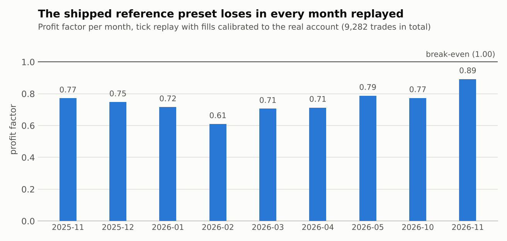
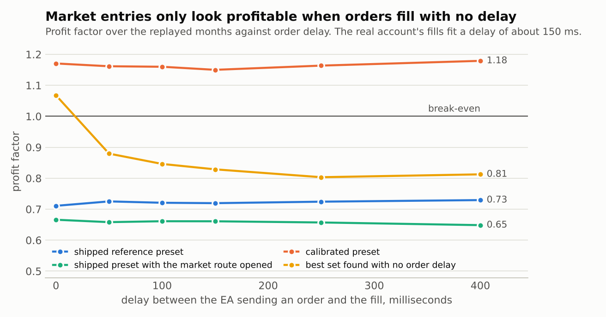
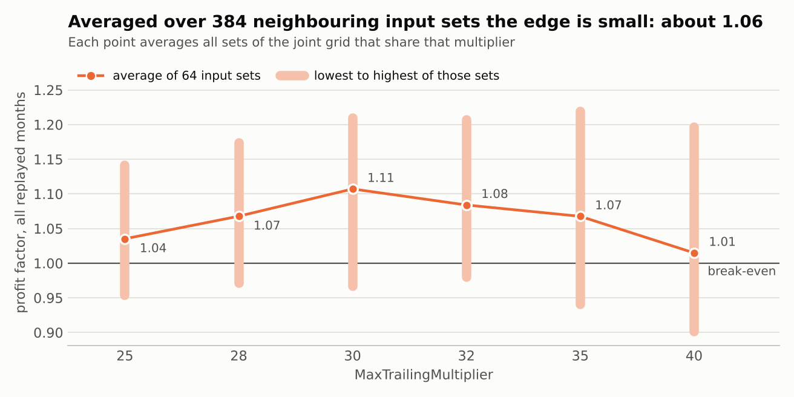
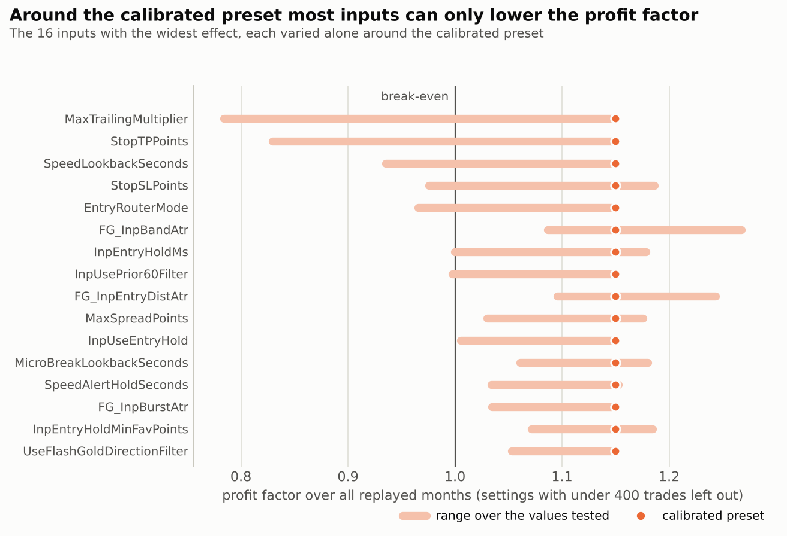
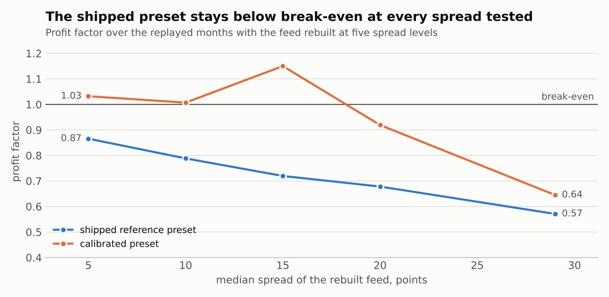

# SpeedAlert FlashGold Micro v1.501: calibration of every input and of the trailing

Date: 2026-11-15. Input: `components.zip` (`speedalert-flashgold-micro`, development build 1.501, tester only,
five `*_DISABLED.set` presets). MetaTrader does not run in this environment, so the EA was ported to a tick
replay and checked against the {{real_n}} real trades stored in the package's own `basis/saved_chart.chr`.
Every number below is in points per 0.01 lot (1 point = $0.01 of price = $0.01 per 0.01 lot) and can be
regenerated with the commands in section 13.

## 1. Short version

1. **The shipped settings lose money, on the real account and in the replay.** The saved chart holds
   {{real_n}} real trades of this EA from 7 September to 8 October 2026: profit factor **{{real_pf}}**,
   {{real_win}} winners, {{real_avg}} points per trade, {{real_net}} points in total. The replay of the shipped
   reference preset over nine other calendar months gives **{{ref_pf}}** on {{ref_n}} trades and is below 1 in
   every month ({{ref_month_min}} to {{ref_month_max}}). In October-November 2026, the months next to the real
   trades, it gives {{ref_test}}.
2. **The reason is cost, not exits.** After a fill the price keeps moving in the trade's favour by at most
   about {{fwd_best}} points on average, while a round trip costs about {{fwd_cost}} points in spread and
   slippage. Stops, targets and trailing cannot change that sign: across {{exit_n}} stop/target/exit
   combinations the result stays between {{exit_avg_worst}} and {{exit_avg_best}} points per trade.
3. **No single input fixes it.** {{oat_n_inputs}} inputs were varied one at a time ({{oat_n_runs}} replays): the
   profit factor stays between {{oat_min}} and {{oat_max}}. {{n_telemetry}} of the {{n_inputs}} inputs are
   telemetry and cannot change an order at all.
4. **Trailing does not fix it either.** As shipped, neither trailing mechanism can ever act: `TrailStartPoints`
   270 lies beyond the 180 target, and the burst-settle rule waits for a 100 pip pullback. Switched on, on the
   shipped entries, simple trailing gives {{trail_simple_worst}} to {{trail_simple_best}} and the best
   "let it run" exit {{trail_runner_best}}.
5. **A combination gets it to about break-even, slightly above.** Trade only bursts that are large against
   the spread (`MaxTrailingMultiplier` 7.5 to 30), cap the spread near its median (`MaxSpreadPoints` 31 to 14),
   drop the fade and market routes (`EntryRouterMode` StopOnly), move the target out (180 to 600), switch the
   fixed 100 point speed exit off and trail 150 points behind the best price. In the replay that preset makes
   **{{fin_pf}}** on {{fin_n}} trades (calibration months {{fin_is}}, validation months {{fin_val}},
   October-November 2026 {{fin_test}}), {{fin_avg}} points per trade.
6. **That number is thin, and it should be read as "about 1.0 to 1.15".** The average of {{jg_n}}
   neighbouring input sets is {{jg_pf_mean}}. {{fin_months_pos}} months are positive. The profit comes from
   buys ({{fin_buy_pf}}) and not from sells ({{fin_sell_pf}}). A 7 point commission leaves {{fin_comm7_pf}},
   strict fills {{fin_strict_pf}}, both together {{fin_worst_pf}}. If stop losses slip twice as far as quoted
   instead of 1.5 times, it is {{fin_slip20_pf}}.
7. **Three things to know before any Strategy Tester run.**
   - The four micro presets place **{{micro1s_literal_n}} trades** as shipped: the quote-bucket series blocks
     for good after 4,096 occupied buckets (about 68 minutes at 1 s) until the EA is restarted.
   - The tester fills orders on the tick that sends them. With that, every search here kept choosing market
     entries on the signal tick. The best such set makes {{mk_pf0}} with no delay and {{mk_pf150}} with the
     150 ms delay that the real fills show. Set an execution delay in the tester.
   - The order-flow feed (terminal global variables) does not exist in the tester, so a tester run never
     takes the market route that produced 74% of the real trades. Live and tester are different programs
     unless `UseOrderFlow` is false.

Deliverables: calibrated presets and optimiser range files in `presets/`, all result tables in `results/`,
the replay and every study in `tools/`. Nothing here has been run in MetaTrader; section 11 says how to
check it there.

## 2. What the EA does, in the order the replay follows

| stage | rule (shipped preset values) |
| --- | --- |
| speed alert | mid price moved over the last `SpeedLookbackSeconds` (10 s) by at least max(`MinSpeedAlertPoints` 37, spread x `MaxTrailingMultiplier` 7.5); it stays active until 20 s after the start of that window |
| direction score | speed direction 1.0, forming M1 candle body of at least 21 points 1.5, break of the 10 s high or low by 3 points 1.5, spread inside `MaxSpreadPoints` 0.5, plus up to three order-flow votes of 1.0. A side needs 4.0 and a lead of 1.5. Without the flow feed that means speed, body and micro-break must all agree |
| router | exhaustion (wick rejection, snap-back, opposite pressure): limit order 35 points against the burst (EXHL). Follow-through with flow agreement: market order (FOLM). Otherwise a stop order 35 points ahead (FLXQ, BNO, CONT...). Pending orders are deleted after 5 s |
| gates | FlashGold direction filter (BUY/SELL area of the last signal bar), entry hold (wait 1100 ms and need +5 points), price drift over the last 60 minutes on the trade's side, continuation filter (tick rate, quote gap, range against cost), one order and one position per scenario, lockout after three defensive closes |
| exits | stop 90 (market 80), target 180 (market/limit 160). EA-side exits are locked until the trade has first been more than 6.8 pips (68 points) in profit; that gate is a constant in the code, not an input. Then: close at 100+ points when a new alert on the trade's side is active (speed profit exit), close a trade that fell back to a loss (retest and pressure shields), trailing |

Of the {{n_inputs}} inputs, {{n_replayed}} can change an order in a tester run and are replayed,
{{n_telemetry}} are telemetry, logging, visuals or shadow scorecards, {{n_labels}} are labels, comments and
file names, {{n_flow}} belong to the order-flow feed, {{n_sizing}} are position sizing (irrelevant to the profit
factor at the fixed 0.01 lot) and {{n_notreplayed}} are not replayed (percentile threshold modes, retry
timers and the like). `results/inputs_classification.csv` lists every input with its class and the profit
factor range found for it.

## 3. The real trades in the saved chart

`basis/saved_chart.chr` was saved with trade history on, so it contains every closed trade of the account as
chart objects. `tools/chart_trades.py` reads them back: {{real_n}} trades with a `SAR:` comment on
{{real_days}} trading days (about {{real_per_day}} a day), all 0.01 lot, symbol XAUUSD-ECN with 2 digits. The
chart's own EA inputs are identical to the shipped reference preset except `TradingEnabled`, and the exit mix
shows the 6.8 pip gate was already active. Profit is price difference only; commission and swap are not on the
chart.

Overall: profit factor **{{real_pf}}**, {{real_win}} winners, average win +{{real_avg_win}}, average loss
{{real_avg_loss}}, {{real_net}} points (${{real_usd}} lost at 0.01 lot).

{{T_real_routes}}

{{T_real_exits}}

Two things stand out. Half of all trades end at the stop, and a third of all trades are closed within 10
seconds: those carry nearly the whole loss.

{{T_real_hold}}

And the order-flow feed did not pick better trades. Entries the feed agreed with did worse than the ones it
disagreed with:

{{T_real_flow}}

## 4. The replay, and how far it can be trusted

**Data.** XAUUSD ticks from Dukascopy: November 2025 to May 2026 (via the public Hugging Face copy
`CarlosSilva1/xauusd-ticks`, CC-BY-4.0) and 6 October to 13 November 2026 (downloaded directly): nine calendar
months, 38 trading weeks, about 62 million quotes after rebuilding. The direct download is throttled hard
(roughly a hundred hourly files, then a long block), so June to September 2026 is missing; of the real-trade
window only 6 to 8 October and {{rr_stretches}} separate hours could be fetched. Dukascopy quotes 3 digits
with a spread near 55 points, which the EA's own spread caps reject, so the replay keeps the Dukascopy mid
price and tick times and rebuilds a 2-digit bid/ask around it with the spread scaled to a median of 12 points
in October-November 2026 (15 over all months).

**Split.** Calibration November 2025 to February 2026, validation March to May 2026, hold-out October to
November 2026. Every table shows the three separately. The calibrated preset was chosen after looking at all
three, so the hold-out is not a clean out-of-sample test any more; treat it as a third sample.

**Execution model, calibrated on the real fills.** Three things were fitted to the account's own fills: a
stop or stop loss touched within 10 points of its level fills at the level; an order the EA sends takes
150 ms to reach the server; and a stop loss that is not filled at its level slips 1.5 times as far as the
Dukascopy quote shows.

{{T_fills}}

The last factor matters. Without it the replay's stop losses slip {{sl_sim_quoted}} points on average against
{{sl_real_mean}} on the account ({{sl_real_n}} real stop-loss fills). On the {{sl_pair_n}} trades where both
the account and the replay ended at the stop, the account slipped {{sl_pair_real}} points and the replay
(with the factor) {{sl_pair_sim}}. The calibrated preset closes nearly every trade through a stop, so its
result moves with this factor: section 10 shows it at 1.0, 1.5 and 2.0.

"Real fills" in every table means this model. "Strict fills" means no snapping to the level, no price
improvement on limits and targets, and a 250 ms delay.

**Does it reproduce the real account?** For the stop and limit routes (the replay has no order-flow feed, so
it cannot take the market route), real September-October against the replay of October-November and of all
months (the earlier months were faster and cost more):

{{T_fidelity_routes}}


For {{rr_n}} real trades on {{rr_days}} days whose ticks could be downloaded, the replay was given the real
entries and only managed the exits: {{rr_sim_avg}} points per trade against {{rr_real_avg}} real (profit
factor {{rr_sim_pf}} against {{rr_real_pf}}), {{rr_sign}} of the trades ending on the same side, correlation
{{rr_corr}}. On the same entries the replay is {{rr_gap}} points per trade away from the account, on the
pessimistic side.

The same real entries with other exit inputs (small sample, direction only):

{{T_real_replay}}

**Self-test.** `tools/selftest.py` runs the package's own quote-bucket cases (`tests/test_bucket_host.py`)
against the port, checks the continuation filter and the TDI direction against plain numpy/pandas, and checks
that skipping idle ticks and re-injecting the replay's own fills change nothing: 1,222 checks pass.

**Not replayed.** The order-flow feed (it does not exist in the tester either), PERCENTILE threshold modes,
`CandleIndexToCheck` other than 0, broker stop/freeze levels (taken as 0), frozen-order retry paths, the
quote-session calendar of the FlashGold bars, and the "observed live" commits of the FlashGold parent/zone
directions. Trade-for-trade parity with MetaTrader is not claimed.

## 5. Baseline: the shipped presets

{{T_baseline}}

The five presets are one configuration with different FlashGold filter modes, and the filter mode barely
matters: with the filter off the reference preset makes {{ref_nofg_pf}} on {{ref_nofg_n}} trades. The
250 ms expiry preset lets almost nothing through ({{exp250_n}} trades), too few to judge. The source code
defaults (which differ from the presets in eleven EA inputs and the FlashGold timeframes) make {{src_pf}} on
{{src_n}} trades.



{{T_baseline_month}}

## 6. Why the shipped settings lose

For every replayed entry of the reference preset, the table follows the mid price after the fill, in the
trade's direction, with no stop or target.

{{T_forward}}


The momentum stop entries are right about direction, by a few points. They pay about {{fwd_spread}} points of
spread and {{fwd_slip}} points of entry slippage, and half of them pay stop-loss slippage on top. The limit
fades are wrong about direction from the first second. This is why every exit variant in sections 8 and 9
loses about the same number of points per trade.

## 7. Every input, one at a time

Each input was varied alone around the shipped reference preset, over the whole feed.


{{T_oat_top}}

Settings with fewer than 2,000 trades are left out of the table. Full results: `results/oat_native_all.csv`
(reference preset) and `results/oat_micro1s_fg.csv` ({{micro_n_inputs}} FlashGold inputs around the 1 s micro
preset, profit factor {{micro_lo}} to {{micro_hi}}).

Inputs that change nothing at the shipped values, because another setting makes them unreachable:
{{oat_dead}}.

One code constant matters more than any input: without the 6.8 pip exit gate (`minimumProfitPips` in
`TrailingActivationProfitReached`) the replay falls to {{gate0_pf}}. The gate is doing useful work; it would
be worth exposing as an input.

## 8. Trailing on the shipped entries

The EA has three pieces:

- **Simple trailing** (`UseTrailing`, `TrailStartPoints`, `TrailBehindPoints`, `TrailStepPoints`): once the
  trade is `TrailStart` points up, keep the stop `TrailBehind` points behind the price.
- **Trail layer** (`InpUseTrailLayer` and the `internal*` inputs): after the trade is 68 points up, keep the
  stop behind the best price by a multiple of max(spread, `InpReferenceSpreadPts`). The multiple is
  `internalOrderDistance` clamped between `internalMinTrailing` and `internalMaxTrailing`, and the distance is
  capped at `InpTrailOuterCapPts`: 100 points at the shipped values. `internalMaxTrailing` must equal
  `internalMinTrailing` x `internalMultiplier` or the EA refuses to start, so the practical way to change the
  distance is `InpReferenceSpreadPts` (30 = 100 points, 45 = 150, 60 = 200).
- **Burst settle** (`InpWaitForBurstSettle` and four inputs): both mechanisms may only tighten the stop after
  the price has pulled back `InpBurstSettlePullbackPips` from its best and stayed calm for
  `InpBurstSettleQuietMs`.

**As shipped nothing trails.** `TrailStartPoints` = 270 is beyond the 180 point target, the trail layer is
off, and the settle rule asks for a 100 pip ($10) pullback inside a trade whose stop is 90 points away.
Changing `TrailStart`, `TrailBehind` or `TrailStep` alone therefore does nothing.

**Simple trailing on the shipped entries** (settle rule off, speed exit kept; preset without trailing:
{{trail_base_pf}}):

{{T_trail_simple}}

With the settle rule on (source defaults and four variants) the range is {{trail_settle_lo}} to
{{trail_settle_hi}}: the rule mostly prevents the trail from acting.

**Trail layer on the shipped entries:**

{{T_trail_layer}}

**Letting winners run** (speed profit exit off, far target, late trail) is the best exit structure for the
shipped entries, and still below 1:

{{T_trail_runner}}

Trailing on the calibrated entries is in section 10.

## 9. Stops, targets and the speed profit exit


Profit factor, speed profit exit off:

{{T_exit_pf}}

Points per trade, same grid:

{{T_exit_avg}}

The profit factor moves because the size of wins and losses moves. The points lost per trade do not. The
highest profit factor in the whole grid (with the speed exit off, at 100 or at 200) is {{exit_pf_max}}.

## 10. What gets closest: large bursts at a tight spread

### First, a trap: the order delay

A joint random search over 23 inputs without any order delay ({{z_wide_n}} sets, then {{z_focus_n}} in the
best region, then a grid) kept finding the same recipe: market entries the instant the score is met, no entry
hold. It reported profit factors up to {{z_grid_max}} on all three samples (before the stop-loss factor of
section 4 was added). It is an artefact. Those entries are sent in the middle of a burst. With a 150 ms
delay they fill {{mk_slip150}} points worse on average, which is more than the {{mk_avg0}} points per trade
the best of those sets makes without a delay.

{{T_latency}}



The second row is the shipped preset with the market route opened without the flow feed, which is the
closest the replay can get to the live route: it loses at every delay. The Strategy Tester has the same blind
spot as the first search unless an execution delay is set. Results of the no-delay searches are kept in
`results/zero_latency/` for comparison.

### What separates good from bad: burst size against spread

With the delay, stop orders are what remains: they rest at the server, so the delay only matters while they
are being placed (an order whose price the market has passed by then is refused). The alert already scales
with the spread, so raising `MaxTrailingMultiplier` from 7.5 to 30 means "only bursts of 30 spreads in 10
seconds". That is the EA's own idea, turned up.


{{T_grid}}

(The calibrated preset with only these two inputs changed; trade counts are in the figure.) Below a
multiplier of 20 nothing reaches break-even (best {{gc_low_max}}); the band of 25 to 40 does, at a spread cap
of 12 to 20. The same grid without the entry hold and the post-entry validation, with a 200 point stop, stays
between {{gs_min}} and {{gs_max}} (`results/grid_stops.csv`), so the other settings of the preset matter too.

### The calibrated preset

| input | shipped | calibrated | what it does |
| --- | ---: | ---: | --- |
| `MaxTrailingMultiplier` | 7.5 | 30 | alert only on a move of 30 spreads within the lookback |
| `MaxSpreadPoints` | 31 | 14 | no entry while the spread is above about its median (15 over the replayed months; use your symbol's median) |
| `EntryRouterMode` | StopMarketLimit | StopOnly | no limit fades (they lose from the first second) and no market entries (they lose to the order delay) |
| `StopEntryDistancePoints` | 35 | 50 | the burst has to continue a little further before the stop order fills (effect inside the noise, see below) |
| `StopTPPoints` (and market/limit targets) | 180 (160) | 600 | let the winners run |
| `UseSpeedProfitExit` | true | false | do not close at +100 while the move continues |
| `InpUseTrailLayer`, `InpWaitForBurstSettle`, `UseTrailing` | false, true, true | true, false, false | trail layer allowed to act; simple trailing off |
| `InpReferenceSpreadPts` | 30 | 45 | trail layer 150 points behind the best price instead of 100 |
| `UseOrderFlow` | true | false | makes a live run the same program as the tester run that was calibrated |

Everything else stays as shipped, including the entry hold, the 60 minute drift filter, the FlashGold filter
and the 90 point stop.

Result over the replayed months, real fills: **profit factor {{fin_pf}}** ({{fin_is}} / {{fin_val}} /
{{fin_test}}), {{fin_n}} trades (about {{fin_per_day}} a day), {{fin_win}} winners, average win
+{{fin_avg_win}}, average loss {{fin_avg_loss}}, {{fin_avg1}} points per trade, maximum drawdown {{fin_dd}}
points. The t-statistic of the mean trade is {{fin_t}}; resampling the trades gives a 5%-95% range of
{{fin_boot_lo}} to {{fin_boot_hi}} for the profit factor, with {{fin_boot_below}} of resamples below 1.


{{T_final_month}}

{{fin_months_pos}} months are positive. The three best ({{fin_months_top}}) earn {{fin_top3_net}} points; the
other {{fin_rest_n}} together make {{fin_rest_net}}.

These are very short trades in the fastest part of the market: the average alert is {{fin_alert}} points,
half the trades are over within {{fin_hold_med}} seconds, the average spread at entry is
{{fin_entry_spread}} points and the stop order fills {{fin_entry_slip}} points beyond its price on average.
{{fin_stop_share}} of the trades end at a stop:

{{T_final_exits}}

And the profit is one-sided:

{{T_final_side}}

Gold rose over most of the replayed months, so this may be the market and not the EA. It is not a reason to
switch sells off.

### How much of that is real: {{jg_n}} neighbouring sets

A single replay of about 1,200 trades has a standard error of about {{fin_boot_sd}} in the profit factor, and
the preset was picked from many, so its own number says little. A joint grid replaces it with averages: every combination of six multipliers, four spread
caps, four trailing variants, two entry holds and two stops.



{{T_jg_levels}}

Over all {{jg_n}} sets the profit factor has a median of {{jg_pf_med}} ({{jg_pf_min}} to {{jg_pf_max}});
{{jg_share1}} are at or above 1. In the months to May the median is {{jg_early_med}}, in October-November
2026 it is {{jg_test_med}}, and every set is above 1 there: those two months were kind to the whole region,
with a tighter spread and smaller slips. Inside the region one sample does not predict another: the rank
correlation between the November-February and the March-May profit factor of a set is {{jg_rank_is_val}},
and between the months to May and October-November {{jg_rank_early_test}}. So the differences between
neighbouring sets are noise, the region as a whole is slightly above break-even, and the preset's
{{fin_pf}} sits at the upper end of what to expect. The averages support the calibrated values: the
multiplier peaks at 30 with a smooth fall on both sides, a tighter spread cap is better, the shipped entry
hold of 1100 ms is better than 2000, and the stop makes no difference.

The sets ranked by the months to May alone, with the two later months as a check:

{{T_jg_top}}

### How fragile is it?

{{T_final_stress}}

### Trailing on the calibrated entries

Same entries, only the trailing differs ({{tc_n}} variants, `results/study_trailing_calibrated.csv`).


{{T_tc_layer}}

Simple trailing alone (trail layer off, settle rule off), profit factor:

{{T_tc_simple}}

and largest drawdown in points:

{{T_tc_simple_dd}}

What the tables say:

- No trailing at all makes {{tc_none_pf}} with a drawdown of {{tc_none_dd}} points.
- A trail 110 to 200 points behind the price keeps the profit factor ({{tc_wide_lo}} to {{tc_wide_hi}}) and
  lowers the drawdown to {{tc_wide_dd_lo}}-{{tc_wide_dd_hi}} points.
- A trail closer than about 100 points costs profit factor ({{tc_tight_lo}} to {{tc_tight_hi}}): every exit
  becomes a stop fill, and a stop fill costs slippage.
- In the joint grid, where each trailing variant is averaged over 96 entry sets, no trailing is the best for
  the profit factor and the trail layer at 150 points is close behind it with a lower drawdown. The shipped
  distance of 100 points is the worst of the four. That is why the calibrated preset uses 150, and
  `FlashGold_NativeReference_Calibrated_NoTrailing_DISABLED.set` is the variant without any trailing.
- `TrailStepPoints` hardly matters ({{tc_step}}). Trail layer and simple trailing together give
  {{tc_both}}.

The burst-settle rule on top of a trail (trail layer 100 or simple 160/110):

{{T_tc_settle}}

With the shipped settle values (last row of each block) the stop is never moved. A short quiet time and a
small pullback let the trail act and give the best single numbers of the study, but the gain is the size of
the noise.

Stop and target under the trail layer at 100 points:

{{T_tc_sltp100}}

and at 200 points:

{{T_tc_sltp200}}

### Each setting put back, one at a time

On the variant without trailing, so that the trailing does not blur the comparison:

{{T_final_revert}}

`MaxTrailingMultiplier` is the lever: back at 7.5 the same preset makes {{fin_mult75_pf}}. The fade route
costs most after that ({{rev_fade_pf}}). The entry hold, the 60 minute drift filter, the FlashGold filter
and the post-entry validation all help. The continuation filter does not matter here ({{rev_cp_pf}} without
it).

Neighbouring values ({{nb_n}} replays, {{nb_min}} to {{nb_max}}):

{{T_final_neighbours}}

### Every input once more, around the calibrated preset

The one-at-a-time sweep of section 7 was repeated around the calibrated preset: {{oc_n_inputs}} inputs,
{{oc_n_runs}} replays.



{{T_oc_top}}

Settings with fewer than 400 trades are left out. {{oc_dead_n}} inputs change nothing at the calibrated
values. Most of the others can only lower the result: the calibrated values of the multiplier, the target,
the router, the entry hold and the drift filter are at or near the top of their own range. Several ranges
are jagged (for example `SpeedLookbackSeconds` and `StopEntryDistancePoints`), which is the noise of a
1,200-trade sample and not a property of the EA.

Values that beat the preset by at least 0.03 in all three samples ({{oc_cand_n}}):

{{T_oc_cand}}

{{FG_GATE_TEXT}}

## 11. FlashGold micro mode, spread, and what to do next

**The micro presets cannot trade as shipped.** With `FG_Resolution` = quote milliseconds the filter keeps at
most `FG_MicroMaxBars` (maximum 4,096) occupied buckets per capture epoch. The 4,097th bucket makes
`CFgfQuoteBuckets::Feed` fail with "capacity exhausted; restart required", and it stays failed: every later
entry is refused by `FlashGoldAllowsEntry`. That is 68 minutes of continuous quotes at 1 s and 17 minutes at
250 ms. Replayed literally, with a fresh start every week, the micro presets place {{micro1s_literal_n}}
trades. The package's own test names this behaviour ("capacity blocks without rolling reseed"), so it is
intended for now, but no preset built on it can be backtested or calibrated. The micro numbers in this
report assume the stream restarts at capacity (new epoch, 100 bars of warm-up). On that assumption the 1 s
micro filter behaves like the native M5 filter: {{micro1s_pf}} on {{micro1s_n}} trades for the shipped micro
preset, {{fin_micro_pf}} for the calibrated preset.

**Spread.** The feed was rebuilt at five spread levels:

{{T_spread}}



{{T_spread_n}}

**Checking this in MetaTrader.** Use `presets/FlashGold_NativeReference_Calibrated_DISABLED.set` with
`TradingEnabled` switched on in the tester, "Every tick based on real ticks", an execution delay of about
150 ms, and at least three months. Things to compare with section 10: trades per day (about
{{fin_per_day}}), share of trades that end at a stop ({{fin_stop_share}}), average win and loss
(+{{fin_avg_win}} / {{fin_avg_loss}}). Then, if it holds:

1. `FlashGold_NativeReference_Calibrated_entries_TESTER_OPT.set` optimises `MaxTrailingMultiplier` 20-45,
   `MaxSpreadPoints` 9-16, `StopEntryDistancePoints` 20-80 and `PendingExpirySeconds` 3-15.
2. `FlashGold_NativeReference_Calibrated_exits_TESTER_OPT.set` optimises the stop, the target and the trail
   layer distance (through `InpReferenceSpreadPts`).
3. `FlashGold_NativeReference_Calibrated_simple_trailing_TESTER_OPT.set` optimises the simple trailing in
   place of the trail layer.
4. `FlashGold_NativeReference_Calibrated_flashgold_TESTER_OPT.set` optimises the two FlashGold gate inputs
   named above.
5. `FlashGold_NativeReference_shipped_trailing_TESTER_OPT.set` is the trailing question on the shipped
   entries (expect section 8: no gain).

Use a forward period and keep the delay on. Set `MaxSpreadPoints` from your symbol's median spread, not from
the number 14. Count the broker's commission: 3 points per round trip leaves {{fin_comm3_pf}} in the replay
and 7 points {{fin_comm7_pf}}.

**Changes in the code that the data supports**, none of them made here: a rolling or restarting bucket
series for the micro mode; the 6.8 pip exit gate as an input; a commission input that the continuation
filter can use; an hour filter is *not* supported by the data (no hour is reliably better).

## 12. Limits

- This is a replay written from the source, not MetaTrader. It matches the real account's exit mix, win rates
  and slippage, but it has been compared trade by trade on {{rr_n}} trades only.
- The spread is a scaled Dukascopy spread. A broker whose spread behaves differently in fast markets changes
  the result; `MaxSpreadPoints` and `MaxTrailingMultiplier` both act through the spread.
- The calibrated preset earns {{fin_avg1}} points per trade before commission, with a stop slippage factor
  fitted on one month of real fills. With the factor at 1.0 it makes {{fin_slip10_pf}}, at 2.0
  {{fin_slip20_pf}}. It trades during the fastest moves, where real slippage is hardest to predict.
- The preset was chosen with all three samples in view, and the region around it averages
  {{jg_pf_mean}}. Its own profit factor is not an estimate of what a forward run will show.
- The profit came from buys in a rising market and from {{fin_months_pos}} months.
- Nothing was tested with the order-flow feed, because nothing can be: the feed is not in the tester.
- June to September 2026 is missing from the data.

## 13. Files, and how to rerun

```
REPORT.md                      this report (generated by tools/make_report.py from REPORT.template.md)
presets/                       calibrated presets (*_DISABLED.set) and optimiser range files (*_TESTER_OPT.set)
shipped_presets/               the five presets of the package, unchanged
results/                       every table as csv, charts/, real/ (the real trades), zero_latency/ (searches without order delay)
tools/engine.py                the port of SpeedAlert_FlashGold_Micro.mq5 (numba)
tools/flashgold.py             the port of the FlashGold direction filter and the quote buckets
tools/ticks.py, sim.py, sweep.py, params.py     feed, runner, fill models, .set reading and writing
tools/run_all.sh               every study in order, one at a time, restartable
tools/selftest.py              checks of the port
```

```bash
pip install numpy pandas numba pyarrow matplotlib
cd flashgold_micro_calibration/tools
python -I fetch_hf_ticks.py ../data 2025-11 2026-05          # ticks, public copy of the Dukascopy feed
python -I fetch_dukascopy.py fetch XAUUSD 2026-10-06 2026-11-13 ../data && python -I fetch_dukascopy.py build XAUUSD ../data
python -I fetch_dukascopy.py hours XAUUSD ../data/real_trade_hours.txt ../data     # hours of the real-trade window, slow
python -I fetch_dukascopy.py build XAUUSD ../data ../data/real_window 2026-09-01 2026-10-09
python -I chart_trades.py <component>/basis/saved_chart.chr ../results/real/real_trades_sar.csv
bash run_all.sh                                               # about 45 minutes on 4 cores, 16 GB
python -I classify_inputs.py ../results
python -I make_presets.py ../presets/presets_spec.json ../presets
python -I charts.py ../results && python -I make_report.py
```

`python -I` keeps Python from importing anything from the working directory. To replay one of your own
presets: `sim.Sim(ticks.Feed("../data", 12)).run(sweep.base("<preset stem>"))` returns the trade list.
